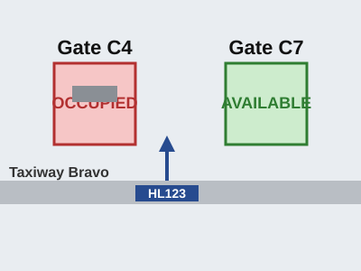
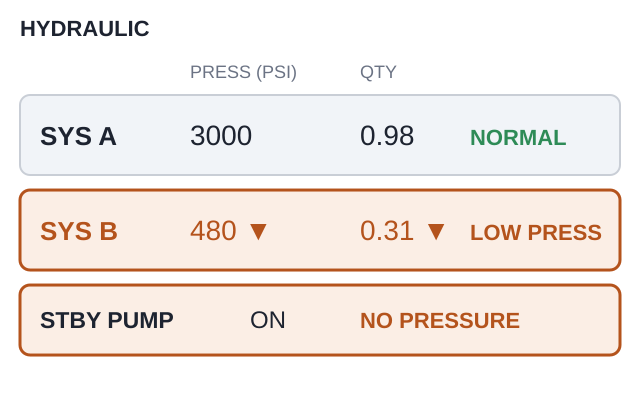

# EPTA 항공영어구술능력시험 조종사용 모의세트 EPTA_01 — 2026-10-01

안 내 메모 가능 / 문항당 1회 Say again 기능 사용 가능. 응시자 콜사인은 항상 **HL123**.

---

## Part Ⅰ TASK A. Readback and Hearback

✅ Directions : You will be listening to 4 ATC instructions. Your callsign will be HL123.
Listen carefully and make a correct readback for each of them. "Say again (=Repeat)"
available once only. You may take notes while listening.
  * Correct / Full readback : necessary for standard operating procedures
  * Response time for each question : 20 seconds or less

✅ 시험[응답] 요령

| 항목 | 내용 |
|---|---|
| 구성 | 4문항 / 문항 별 응대시간 : 20초 |
| 평가요소 | 기본적인 교신 능력 평가로 ATC의 지시사항에 맞게 표준교신용어로 readback |
| 진행 | 관제사 지시 → 응답녹음 |
| 평가항목 | 표준 교신속도/발음/억양의 사용 여부 · 필요한 정보의 효율적 전달 능력 평가 · 정확한 표준 교신용어의 사용 여부 · 관제 지시 후 교신 응대의 즉시성 여부 |
| 유의사항 | 올바른 readback : 운항절차에 필요한 필수 사항을 모두 포함한 readback · 필수사항은 아니지만 지시사항을 전체 readback 해도 감점되지 않음 |

**P1A-Q1** 🎙 20초
Ground : HL123, taxi via Kilo, hold short of runway 27.

Record your full readback.

[정답]

---

**P1A-Q2** 🎙 20초
Tower : HL123, cleared for takeoff runway 27, no delay, traffic six miles on final.

Record your full readback.

[정답]

---

**P1A-Q3** 🎙 20초
Center : HL123, Granite Control, descend to flight level 240, cross MARLO at or below
flight level 260.

Record your full readback.

[정답]

---

**P1A-Q4** 🎙 20초
Delivery : HL123, cleared to Lakeside Airport via the ORCHID TWO departure, maintain
6,000, departure frequency 124.35, squawk 4512.

Record your full readback.

[정답]

---
## Part Ⅰ TASK B. Checking, Clarifying, Confirming, Informing

✅ Directions : You will be listening to 6 audio clips, which consist of short situational
prompts. Respond to each of them using mainly Standard Phraseology if possible. If not,
you may use plain English to help clarify your response. "Say again (=Repeat)" available
only once. Your callsign is HL123. You may take notes while listening.
  * Response time for each question : 20 seconds or less

✅ 시험[응답] 요령

| 항목 | 내용 |
|---|---|
| 구성 | 6문항 / 문항 별 응대시간 : 20초 |
| 평가요소 | 기본적인 교신 능력 평가로 ATC의 지시사항에 맞게 표준교신용어로 readback |
| 진행 | 상황정보 제시 → 관제지시 → 응답녹음 |
| 평가항목 | Task B는 상황정보 이해력 및 해당 교신에 대한 적절한 응대력 평가 · 상황정보 및 ATC의 교신에 따라 플레인 영어 사용이 요구될 수 있음 |
| 유의사항 | 상황정보(prompt) 음성에는 교신용어가 플레인 영어(발음)로 들려질 수 있음. 필요 시 올바른 교신용어로 응답해야 함 |

**P1B-Q1** 🎙 20초
You are being vectored for the approach into Bridgeport. The tower has just changed the
landing runway. Now ATC contacts you. Acknowledge and respond accordingly.

Approach : HL123, Harbor Approach, runway change, expect ILS runway 09, new altimeter
29.92, there is a disabled aircraft on runway 27.

Record your response.

[정답]

---

**P1B-Q2** 🎙 20초
While taxiing out at Bridgeport you saw a large piece of rubber debris lying on taxiway
Mike, close to the holding point. You were already cleared to line up, so you could not
report it at the time. You are now airborne on the departure frequency. Acknowledge the
clearance and report what you saw on the ground.

Departure : HL123, Bridgeport Departure, radar contact, climb and maintain flight level
190.

Record your response.

[정답]

---

**P1B-Q3** 🎙 20초
You are level at flight level 290. There is a line of towering cumulus directly ahead of
you with tops well above flight level 350, so you cannot climb over it. Now ATC contacts
you. Respond accordingly with a reason.

Center : HL123, Granite Control, climb and maintain flight level 350 for traffic.

Record your response.

[정답]

---

**P1B-Q4** 🎙 20초
Approach instructed you to maintain 170 knots until five miles from touchdown. You are now
on final with a strong tailwind and you had to reduce to 150 knots to stay on the approach
profile. Now ATC contacts you. Respond accordingly.

Approach : HL123, confirm maintaining 170 knots?

🖥 [ 150 knots / tailwind ]

Record your response.

[정답]

---

**P1B-Q5** 🎙 20초
Granite Control cleared you to descend to flight level 200. You set 18,000 in the altitude
window by mistake and the aircraft is now descending through flight level 195. Now ATC
contacts you. Respond accordingly.

Center : HL123, Granite Control, say your altitude.

Record your response.

[정답]

---

**P1B-Q6** 🎙 20초
Your en route clearance includes a waypoint called VANDO. Your flight management computer
holds two waypoints with very similar names and you are not sure which one is on your
route. You are level at flight level 310 and the waypoint is twelve minutes ahead. Contact
Granite Control. Verify the waypoint and make a request so that you can be sure of it.

🖥 [ VANDO ]

Record your response.

[정답]

---
## Part Ⅱ TASK A. Role-play & Follow-up

✅ Directions : In Part 2 Task A, you will be going through a couple of flight situations
of a normal passenger flight. Follow the prompts for providing your response, which you
will either hear or see on the screen, or the both. "Say again (=Repeat)" available once
only. Your callsign is HL123.

After finishing Task A Role play, you will be asked one or two follow-up questions. You
will have up to 90 seconds to respond to them.

✅ 시험[응답] 요령

| 항목 | 내용 |
|---|---|
| 구성 | 약 7~12회 롤 플레이 / 응대시간 : 30초, Follow up : 90초 |
| 평가요소 | 정상상황에서 기본 교신능력과 비정상 발생시 상황보고 또는 요구사항 전달 등에 필요한 언어 구사력(교신용어와 플레인 영어의 복합 사용) |
| 진행 | 연속적인 비행 단계 또는 복합적인 상황의 롤 플레이. Initial Situation → continued → Situation update → continued |
| 평가항목 | 음성 또는 화면에 제공되는 Text clue(🖥)를 이용하여 지시대로 응대하는 능력 · 상황정보 및 ATC의 교신에 따라 요구되는 플레인 영어 사용능력 · 표준 교신속도/발음/억양의 사용 여부 및 정보의 효율적 전달능력 평가 · 교신 응대력(Role-play)과 플레인 영어(Follow-up) 능력을 전체적으로 평가 |
| 유의사항 | 교신상황은 시간제한 및 언어평가 목적에 따라 '인위적'일 수 있고, 상황 전개의 '비약'이 인정되므로 지시사항에 맞게 응답해야 함 · 응답 직전 '약간의' 준비시간은 용인됨. 다만 '매우' 늦은 응답 또는 무응답은 영향을 미침 |

Flight Paths
In this scenario, you'll be the pilot flying HL123, which goes through 3 flight stages:
Cruise, Descent, Approach.

Initial Situation You are the pilot of HL123, level at flight level 330 and approaching
TOPAZ, the first fix of the arrival into Lakeside Airport. You have not yet received the
arrival information. 🔔(dingdong)

**P2A-Q1** 🎙 30초
☞ Contact Granite Control, report your position and request descent.

[정답]

---

**P2A-Q2** 🎙 30초
☞ Listen to the controller and give a full readback.
Center : HL123, Granite Control, descend to flight level 190, cross TOPAZ at or below
flight level 240, Lakeside information Romeo is current.

[정답]

---

**P2A-Q3** 🎙 30초
☞ Listen to the controller's message, respond accordingly and request the information you
still need.
Center : HL123, descend and maintain 11,000, contact Harbor Approach on 125.4.

🖥 [ unable to receive ATIS / request landing information ]

[정답]

---

Situation Update The controller has passed you information Romeo. The landing runway is
09 and the wind is 070 at 8. You are now descending through flight level 150 for 11,000.
🔔(dingdong)

**P2A-Q4** 🎙 30초
☞ Contact Harbor Approach and report your passing altitude.

[정답]

---

**P2A-Q5** 🎙 30초
☞ Listen to the controller and give a full readback.
Approach : HL123, Harbor Approach, good morning, descend and maintain 5,000, reduce speed
to 220 knots, expect the TOPAZ ONE arrival, ILS runway 09, Lakeside altimeter 30.06.

[정답]

---

Situation Update The wind has backed round and is now 160 at 18, gusting 26. That is more
crosswind than the tower is willing to use on runway 09. 🔔(dingdong)

**P2A-Q6** 🎙 30초
☞ Listen to the controller's message, respond accordingly and advise what you need.
Approach : HL123, Harbor Approach, we are changing the landing runway to 14 because of the
wind, it will be an RNAV approach, and I have to take you around for the sequence, sorry
about that.

[정답]

---

**P2A-Q7** 🎙 30초
☞ Listen to the controller's question and respond accordingly.
Approach : HL123, are you able to accept a short approach if the Embraer ahead of you gets
off the runway in time? It would save you about eight miles.

(Q7) 

[정답]

---

**P2A-Q8** 🎙 30초
☞ Listen to the controller and give a full readback.
Approach : HL123, cleared for the RNAV runway 14 approach, maintain 170 knots to 5 miles,
contact Lakeside Tower on 118.75.

[정답]

---

Situation Update You are established on the final approach course for runway 14 and
passing 2,400 feet. 🔔(dingdong)

**P2A-Q9** 🎙 30초
☞ Contact Lakeside Tower, report your position and intention.

[정답]

---

**P2A-Q10** 🎙 30초
☞ Listen to the tower and give a full readback. Then inquire about the aircraft you can
see ahead on the runway.
Tower : HL123, Lakeside Tower, hello, wind 160 at 16, runway 14, cleared to land. The
Embraer ahead is a little slow vacating, keep your speed up if you can.

[정답]

---

**P2A-Q11** 🎙 90초 (Follow-up)
Follow-up question:
You have just finished Task A, as the pilot of Hotel Lima one two three.
In this situation, the controller changed your landing runway late in the arrival. What did
you have to do to get ready for the new approach, and why did you ask for the information
you asked for? From your own experience, how late is too late for a runway change? Give an
example.

[정답]

---

## Part Ⅱ TASK B. Extended Role-play : Single Incident/Emergency Related

✅ Directions : You will be interacting with an Air traffic controller or Ground crew
based on short situational prompts. Follow the prompts and respond as necessary. Assume
you can accept all the instructions, unless being specified otherwise. "Say again
(=Repeat)" available only once. Your callsign is HL123.
  * Response time for each question : 30 seconds or less

✅ 시험[응답] 요령 ※ Task B의 교신내용이 Task C의 태스크와 연계되므로, 관련 정보의 메모가 필요

| 항목 | 내용 |
|---|---|
| 구성 | 약 7~12회 롤 플레이 / 응대시간 : 30초 |
| 평가요소 | 단일 상황에서 비정상/비상상황에서 문제를 해결과정에서의 상황보고 또는 의사전달능력 등에 필요한 언어 구사력(플레인 영어의 빈도가 높아짐) |
| 진행 | 비정상 또는 비상 상황이 포함된 '단일'사건의 롤 플레이. Initial Situation → continued → Situation update → continued |
| 평가항목 | 음성 또는 화면에 제공되는 Text clue(🖥)를 이용하여 지시대로 응대하는 능력 · 상황정보 및 ATC의 내용에 따라 요구되는 교신용어 또는 플레인 영어 사용 능력 · 표준 교신속도/발음/억양의 사용 여부 및 정보의 효율적 전달능력 평가 · 교신 응대력(Role-play)과 플레인 영어능력을 전체적으로 평가 |
| 유의사항 | 교신상황은 시간제한 및 언어평가 목적에 따라 '인위적'일 수 있고, 상황 전개의 '비약'이 인정되므로 지시사항에 맞게 응답해야 함 · 응답 직전 '약간의' 준비시간은 용인됨. 다만 '매우' 늦은 응답 또는 무응답은 영향을 미침 · 플레인 영어 사용 빈도가 다소 높을 수 있고, 응대 내용의 정확도 및 유창도에 따라 Operational(Level4)과 Extended(Level5) 여부가 평가됨 |

Initial Situation You are the pilot of HL123, descending through flight level 160 to
9,000, inbound to Clearwater Airport. You have information Delta. 🔔(dingdong)

**P2B-Q1** 🎙 30초
☞ Contact Clearwater Approach and report your position.

[정답]

---

**P2B-Q2** 🎙 30초
☞ Listen to the controller's response and respond accordingly.
Approach : HL123, Clearwater Approach, good afternoon, descend and maintain 7,000, expect
the ILS runway 09, Clearwater altimeter 29.94.

🖥 [ ILS runway 09 ]

[정답]

---

Situation Update As you level off at 7,000 you get a HYDRAULIC SYSTEM B LOW PRESSURE
caution. The system B quantity is still falling and the standby pump has not brought the
pressure back. 🔔(dingdong)

**P2B-Q3** 🎙 30초
☞ Inform the controller of your situation, state that you are levelling off at 7,000, and
request time to work the checklist.

(Q3) 

[정답]

---

**P2B-Q4** 🎙 30초
☞ Listen to the controller's response, give a full readback and say your intentions.
Approach : HL123, roger, maintain 7,000, fly heading 270, that will keep you clear of the
arrival stream, and say your intentions when you are ready.

[정답]

---

**P2B-Q5** 🎙 30초
☞ Listen to the controller and respond negatively with a reason. Request what you need
instead.
Approach : HL123, runway 09 just went out of service, disabled aircraft on it. All I can
give you is runway 14, two thousand four hundred metres. Can you work with that?

[정답]

---

**P2B-Q6** 🎙 30초
☞ Listen to the controller's response and state your intentions.
Approach : HL123, understood. Lakeside is forty miles north with a three thousand two
hundred metre runway, weather is good there. Or I can ask how long until 09 is clear.
Which do you want?

[정답]

---

Situation Update The tower advises that runway 09 will be clear in about ten minutes. You
have finished the checklist and the landing gear will have to be extended by the alternate
system. 🔔(dingdong)

**P2B-Q7** 🎙 30초
☞ Contact approach, give them an update of your situation and state what you will need for
the landing.

[정답]

---

**P2B-Q8** 🎙 30초
☞ Listen to the controller and give a full readback.
Approach : HL123, roger, turn left heading 090, descend and maintain 3,000 until
established, cleared for the ILS runway 09 approach, the equipment will be standing by,
and let me know if anything changes.

[정답]

---

**P2B-Q9** 🎙 30초
☞ Listen to the controller's question and provide the requested information.
Approach : HL123, my tower is asking whether you will be able to vacate the runway
yourself, or whether they should plan on towing you off.

[정답]

---

## Part Ⅱ TASK C. Reporting about Task B

✅ Directions : You have just finished Part 2 Task B. Now you will be listening to the
ATC's radiotelephony messages to better recall the events. Afterwards, you will be
asked two questions about the situation. You will have 90 seconds for each question.

✅ 시험[응답] 요령

| 항목 | 내용 |
|---|---|
| 구성 | 2문항 / 응대시간 : 90초 |
| 평가요소 | Task B에서 수행한 롤 플레이 내용에 대한 리포팅(플레인 영어) 능력 |
| 진행 | TASK B의 ATC 교신 내용 다시 듣기 → 질문 → 응답하기 |
| 평가항목 | 구체적인 사건과 상황 전개의 내용을 묻는 질문(Q1)에 대한 사실전달 능력 · 사건에 대한 이해를 바탕으로 의견을 묻는 질문(Q2)에 대한 의견제시 능력 |
| 유의사항 | 제공시간을 최대한 활용하여 평가항목(유창성, 이해력, 어휘, 발음, 문장구조)에 대한 능력을 충분히 표현 · 경험 사례 또는 관련 지식/보도 등을 활용하여 플레인 영어능력을 최대로 발휘 |

☞ Now listen to the controller's radiotelephony messages.

ATC: HL123, Clearwater Approach, good afternoon, descend and maintain 7,000, expect the
ILS runway 09, Clearwater altimeter 29.94.
ATC: HL123, roger, maintain 7,000, fly heading 270, that will keep you clear of the
arrival stream, and say your intentions when you are ready.
ATC: HL123, runway 09 just went out of service, disabled aircraft on it. All I can give you
is runway 14, two thousand four hundred metres. Can you work with that?
ATC: HL123, understood. Lakeside is forty miles north with a three thousand two hundred
metre runway, weather is good there. Or I can ask how long until 09 is clear. Which do you
want?
ATC: HL123, roger, turn left heading 090, descend and maintain 3,000 until established,
cleared for the ILS runway 09 approach, the equipment will be standing by, and let me know
if anything changes.
ATC: HL123, my tower is asking whether you will be able to vacate the runway yourself, or
whether they should plan on towing you off. 🔔(dingdong)

☞ Now answer the questions.

**P2C-Q1** 🎙 90초
What happened to your aircraft (HL123)? Explain the nature of the incident.

[정답]

---

**P2C-Q2** 🎙 90초
How do you think the incident was handled by the air traffic controller? Do you feel the
situation could have been handled differently? Make a comment from a pilot's point of
view.

[정답]

---
