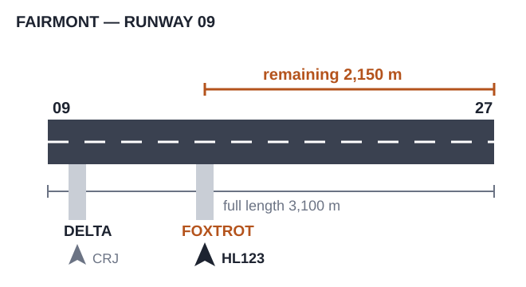
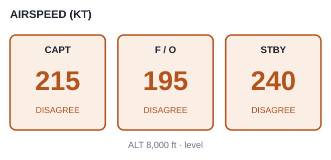

# EPTA 항공영어구술능력시험 조종사용 모의세트 EPTA_02 — 2026-08-19

안 내 메모 가능 / 문항당 1회 Say again 기능 사용 가능. 응시자 콜사인은 항상 **HL123**.

---

## Part Ⅰ TASK A. Readback and Hearback

✅ Directions : You will be listening to 4 ATC instructions. Your callsign will be HL123.
Listen carefully and make a correct readback for each of them. "Say again (=Repeat)"
available once only. You may take notes while listening.
  * Correct / Full readback : necessary for standard operating procedures
  * Response time for each question : 20 seconds or less

✅ 시험[응답] 요령

| 항목 | 내용 |
|---|---|
| 구성 | 4문항 / 문항 별 응대시간 : 20초 |
| 평가요소 | 기본적인 교신 능력 평가로 ATC의 지시사항에 맞게 표준교신용어로 readback |
| 진행 | 관제사 지시 → 응답녹음 |
| 평가항목 | 표준 교신속도/발음/억양의 사용 여부 · 필요한 정보의 효율적 전달 능력 평가 · 정확한 표준 교신용어의 사용 여부 · 관제 지시 후 교신 응대의 즉시성 여부 |
| 유의사항 | 올바른 readback : 운항절차에 필요한 필수 사항을 모두 포함한 readback · 필수사항은 아니지만 지시사항을 전체 readback 해도 감점되지 않음 |

**P1A-Q1** 🎙 20초
ATC : HL123, pushback and start up approved, face south, contact ground point six when ready to taxi.

[정답]
pushback and start up approved face south contack ground .6 when ready to taxi hl123

---

**P1A-Q2** 🎙 20초
ATC : HL123, traffic departing ahead is a heavy Boeing 777, caution wake turbulence, runway one eight, cleared for takeoff.

[정답]
cleared for takeoff runway18 hl123

---

**P1A-Q3** 🎙 20초
ATC : HL123, turn left heading 340, climb via SID to FL200, cross PIRUX at or below FL100, contact Center on 133.45 when leaving FL180.

[정답]
left turn hd 340 climb via sid to fl200 , cross pirux at or below fl100 , contact center 133.45 when leaving fl180 hl123

---

**P1A-Q4** 🎙 20초
ATC : HL123, expect a short approach due to traffic, cleared ILS approach runway two two, circle to land runway two seven.

[정답]
cleared ils approach runway22 circle to land runway 27 hl123

---

## Part Ⅰ TASK B. Checking, Clarifying, Confirming, Informing

✅ Directions : You will be listening to 6 audio clips, which consist of short situational
prompts. Respond to each of them using mainly Standard Phraseology if possible. If not,
you may use plain English to help clarify your response. "Say again (=Repeat)" available
only once. Your callsign is HL123. You may take notes while listening.
  * Response time for each question : 20 seconds or less

✅ 시험[응답] 요령

| 항목 | 내용 |
|---|---|
| 구성 | 6문항 / 문항 별 응대시간 : 20초 |
| 평가요소 | 기본적인 교신 능력 평가로 ATC의 지시사항에 맞게 표준교신용어로 readback |
| 진행 | 상황정보 제시 → 관제지시 → 응답녹음 |
| 평가항목 | Task B는 상황정보 이해력 및 해당 교신에 대한 적절한 응대력 평가 · 상황정보 및 ATC의 교신에 따라 플레인 영어 사용이 요구될 수 있음 |
| 유의사항 | 상황정보(prompt) 음성에는 교신용어가 플레인 영어(발음)로 들려질 수 있음. 필요 시 올바른 교신용어로 응답해야 함 |

**P1B-Q1** 🎙 20초
You have just landed and are taxiing to the gate. Ground gives you a straightforward
instruction.

ATC : HL123, continue on Alpha, contact ramp control on 131.8.

[정답]
contine on a , contact ramp 131.8 hl123

---

**P1B-Q2** 🎙 20초
You are cruising at FL330 and have been experiencing light-to-moderate chop for the
last ten minutes. ATC checks in with you.

ATC : HL123, how is your ride?

[정답]
expreiencing light to moderate chop for 10 min at fl330 hl123

---

**P1B-Q3** 🎙 20초
You are climbing out and ATC assigns a higher altitude, but your aircraft's weight and
the outside temperature mean you cannot make that altitude yet.

ATC : HL123, climb and maintain FL360.

[정답]
unable climb fl 360 due to flight restriction hl123

---

**P1B-Q4** 🎙 20초
ATC assigned you squawk 4521, but you mistakenly dialed in 4512 instead. Now ATC
contacts you.

ATC : HL123, confirm squawking 4521?

[정답]
my mistake , i'll squawk 4521 now hl123

---

**P1B-Q5** 🎙 20초
Your company has put you on a ground delay program before departure, and you would
like to know when you're expected to leave the gate.

ATC : HL123, say your request.

🖥 [ request expected departure time ]

[정답]
request expected departure time hl123

---

**P1B-Q6** 🎙 20초
You've just been given a complex reroute over the radio and are not fully sure whether
one of the altitude restrictions still applies after the change.

ATC : HL123, cross MOXIE at FL200, then as filed.

🖥 [ verify altitude restriction at MOXIE ]

[정답]
verify altitude restrtiction at moxie hl123

---

## Part Ⅱ TASK A. Role-play & Follow-up

✅ Directions : In Part 2 Task A, you will be going through a couple of flight situations
of a normal passenger flight. Follow the prompts for providing your response, which you
will either hear or see on the screen, or the both. "Say again (=Repeat)" available once
only. Your callsign is HL123.

After finishing Task A Role play, you will be asked one or two follow-up questions. You
will have up to 90 seconds to respond to them.

✅ 시험[응답] 요령

| 항목 | 내용 |
|---|---|
| 구성 | 약 7~12회 롤 플레이 / 응대시간 : 30초, Follow up : 90초 |
| 평가요소 | 정상상황에서 기본 교신능력과 비정상 발생시 상황보고 또는 요구사항 전달 등에 필요한 언어 구사력(교신용어와 플레인 영어의 복합 사용) |
| 진행 | 연속적인 비행 단계 또는 복합적인 상황의 롤 플레이. Initial Situation → continued → Situation update → continued |
| 평가항목 | 음성 또는 화면에 제공되는 Text clue(🖥)를 이용하여 지시대로 응대하는 능력 · 상황정보 및 ATC의 교신에 따라 요구되는 플레인 영어 사용능력 · 표준 교신속도/발음/억양의 사용 여부 및 정보의 효율적 전달능력 평가 · 교신 응대력(Role-play)과 플레인 영어(Follow-up) 능력을 전체적으로 평가 |
| 유의사항 | 교신상황은 시간제한 및 언어평가 목적에 따라 '인위적'일 수 있고, 상황 전개의 '비약'이 인정되므로 지시사항에 맞게 응답해야 함 · 응답 직전 '약간의' 준비시간은 용인됨. 다만 '매우' 늦은 응답 또는 무응답은 영향을 미침 |

Flight Paths
In this scenario, you'll be the pilot flying HL123, which goes through 3 flight stages:
Clearance, Taxi, Departure.

Initial Situation You are ready for IFR clearance to Westgate Airport. There may be a
routing or procedure change before departure. 🔔(dingdong)

**P2A-Q1** 🎙 30초
☞ Contact Clearance Delivery and make a request.

[정답]
ground hl123 request ifr clearance to westgate airport

---

**P2A-Q2** 🎙 30초
Continued…
☞ Listen to the controller and give a full readback.
Delivery : HL123, cleared to Westgate Airport, MOXIE TWO departure, PIRUX transition,
maintain 5,000, expect FL220 10 minutes after departure, squawk 4521.

[정답]
cleared to westgate airport moxie 2 departure , pirux transition maintain 5000 expect fl220 10min after departure suawk 4521 hl123

---

Situation Update Before you finish your cockpit setup, the SID has been revised due to
a noise abatement procedure change. 🔔(dingdong)

**P2A-Q3** 🎙 30초
☞ Listen to the controller and give a full readback.
Delivery : HL123, your SID has been changed to MOXIE THREE departure, rest of the
clearance unchanged.

🖥 [ MOXIE THREE ]

[정답]
roger moxie 3 departure hl123

---

**P2A-Q4** 🎙 30초
☞ Contact Ground and request pushback and taxi.

[정답]
ground hl123 request pushback and taxi

---

**P2A-Q5** 🎙 30초
Continued…
☞ Listen to the controller and give a full readback.
Ground : HL123, pushback approved, taxi to runway one eight via Alpha, Bravo, taxiway
Charlie is closed, use Delta instead.

(Q5) 

[정답]
pushback approved taxi to runway 18 via a b d hl123

---

Situation Update While taxiing, Ground relays that the aircraft behind you would like
to expedite if possible. 🔔(dingdong)

**P2A-Q6** 🎙 30초
☞ Listen to the controller's message and respond accordingly.
Ground : HL123, the traffic behind you would like to expedite if able, can you keep it
moving?

[정답]
Affrim hl123

---

**P2A-Q7** 🎙 30초
☞ Contact Tower, report holding short and ready for departure.

[정답]
tower hl123 hold short of runway and ready for departure.

---

**P2A-Q8** 🎙 30초
Continued…
☞ Listen to the controller and give a full readback.
Tower : HL123, traffic on a three mile final, line up and wait runway one eight.

[정답]
traffic insight, line up and wait runway 18 hl123

---

**P2A-Q9** 🎙 30초
Continued…
☞ Listen to the controller and give a full readback.
Tower : HL123, wind two two zero at eight, cleared for takeoff runway one eight.

[정답]
cleared for takeoff runway 18 hl123

---

**P2A-Q10** 🎙 90초 (Follow-up)
Follow-up question:
You have just finished Task A, as the pilot of Hotel Lima one two three.
In this situation, how did you handle the pressure from the aircraft behind you while
still following your own taxi procedures, and what would you do differently next time?

[정답]
In this Task A , i just let the aircraft go first , but next time, i would rather to go first , because , it takes time and fuel even though it is little and for passenger it is precious for saving their time, so i will refuse to give the order next time.

---

## Part Ⅱ TASK B. Extended Role-play : Single Incident/Emergency Related

✅ Directions : You will be interacting with an Air traffic controller or Ground crew
based on short situational prompts. Follow the prompts and respond as necessary. Assume
you can accept all the instructions, unless being specified otherwise. "Say again
(=Repeat)" available only once. Your callsign is HL123.
  * Response time for each question : 30 seconds or less

✅ 시험[응답] 요령 ※ Task B의 교신내용이 Task C의 태스크와 연계되므로, 관련 정보의 메모가 필요

| 항목 | 내용 |
|---|---|
| 구성 | 약 7~12회 롤 플레이 / 응대시간 : 30초 |
| 평가요소 | 단일 상황에서 비정상/비상상황에서 문제를 해결과정에서의 상황보고 또는 의사전달능력 등에 필요한 언어 구사력(플레인 영어의 빈도가 높아짐) |
| 진행 | 비정상 또는 비상 상황이 포함된 '단일'사건의 롤 플레이. Initial Situation → continued → Situation update → continued |
| 평가항목 | 음성 또는 화면에 제공되는 Text clue(🖥)를 이용하여 지시대로 응대하는 능력 · 상황정보 및 ATC의 내용에 따라 요구되는 교신용어 또는 플레인 영어 사용 능력 · 표준 교신속도/발음/억양의 사용 여부 및 정보의 효율적 전달능력 평가 · 교신 응대력(Role-play)과 플레인 영어능력을 전체적으로 평가 |
| 유의사항 | 교신상황은 시간제한 및 언어평가 목적에 따라 '인위적'일 수 있고, 상황 전개의 '비약'이 인정되므로 지시사항에 맞게 응답해야 함 · 응답 직전 '약간의' 준비시간은 용인됨. 다만 '매우' 늦은 응답 또는 무응답은 영향을 미침 · 플레인 영어 사용 빈도가 다소 높을 수 있고, 응대 내용의 정확도 및 유창도에 따라 Operational(Level4)과 Extended(Level5) 여부가 평가됨 |

Initial Situation You are the pilot of HL123, cruising at FL350 en-route to your
destination. Everything is normal so far. 🔔(dingdong)

**P2B-Q1** 🎙 30초
☞ Listen to Center and give a full readback.
Center : HL123, radar contact, maintain FL350.

[정답]
roger maintain fl350 hl123

---

Situation Update A warning horn sounds and you notice the cabin altitude is climbing
above normal — you are losing cabin pressurization. 🔔(dingdong)

(Q2) 

**P2B-Q2** 🎙 30초
☞ Contact Center, declare an emergency, and request an immediate descent.

[정답]
Center hl123 mayday mayday mayday request immediate descent due to pressure

---

**P2B-Q3** 🎙 30초
Continued…
☞ Listen to the controller's response and give a full readback.
Center : HL123, roger, descend and maintain 10,000, turn left heading 250 for traffic,
all traffic advised.

[정답]
descned and maintain 10000 turn left hd250 hl123

---

**P2B-Q4** 🎙 30초
Continued…
Center : HL123, say your intentions.
☞ Respond, stating you'll continue the emergency descent to 10,000 and advise once
you've assessed the cabin.

[정답]
continue descend to 10000 and i will advise you once i assesed the cabin hl123

---

Situation Update You have leveled off at 10,000ft. Cabin pressure has stabilized and
there are no injuries, but you're now concerned about fuel at this lower altitude.
🔔(dingdong)

**P2B-Q5** 🎙 30초
☞ Contact Center, update them on your status, and state your intention to divert to
the nearest suitable airport.

[정답]
pressure has stabilized and no injuries , request to the nearest airport due to fuel hl123

---

**P2B-Q6** 🎙 30초
Continued…
Center : HL123, roger, let me know your fuel and souls on board so I can coordinate
with the airport.
☞ Provide the requested information.

🖥 [ 3 hours fuel remaining / 128 SOB ]

[정답]
we have 3hours of fuel remaining and 128 souls on board hl123

---

**P2B-Q7** 🎙 30초
Continued…
☞ Listen to the controller and give a full readback.
Center : HL123, cleared direct Fenwick Airport, descend and maintain 4,000, expect ILS
runway zero niner.

[정답]
cleared direct fenwick airport descned and maintain 4000 expect ils runway 09 hl123

---

**P2B-Q8** 🎙 30초
☞ Contact Fenwick Tower, report your position and intentions, and advise you are
declaring an emergency.

[정답]
fenwick tower hl123 direct fenwick airport descend and maintain 4000 we are emergency now.

---

**P2B-Q9** 🎙 30초
Continued…
☞ Listen to the controller and give a full readback.
Tower : HL123, wind zero eight zero at six, cleared to land runway zero niner,
emergency equipment standing by.

[정답]
cleared to land runway09 hl123

---

## Part Ⅱ TASK C. Reporting about Task B

✅ Directions : You have just finished Part 2 Task B. Now you will be listening to the
ATC's radiotelephony messages to better recall the events. Afterwards, you will be
asked two questions about the situation. You will have 90 seconds for each question.

✅ 시험[응답] 요령

| 항목 | 내용 |
|---|---|
| 구성 | 2문항 / 응대시간 : 90초 |
| 평가요소 | Task B에서 수행한 롤 플레이 내용에 대한 리포팅(플레인 영어) 능력 |
| 진행 | TASK B의 ATC 교신 내용 다시 듣기 → 질문 → 응답하기 |
| 평가항목 | 구체적인 사건과 상황 전개의 내용을 묻는 질문(Q1)에 대한 사실전달 능력 · 사건에 대한 이해를 바탕으로 의견을 묻는 질문(Q2)에 대한 의견제시 능력 |
| 유의사항 | 제공시간을 최대한 활용하여 평가항목(유창성, 이해력, 어휘, 발음, 문장구조)에 대한 능력을 충분히 표현 · 경험 사례 또는 관련 지식/보도 등을 활용하여 플레인 영어능력을 최대로 발휘 |

☞ Now listen to the controller's radiotelephony messages.

ATC: HL123, roger, descend and maintain 10,000, turn left heading 250 for traffic, all traffic
advised.
ATC: HL123, say your intentions.
ATC: HL123, roger, let me know your fuel and souls on board so I can coordinate with the
airport.
ATC: HL123, cleared direct Fenwick Airport, descend and maintain 4,000, expect ILS runway
zero niner.
ATC: HL123, wind zero eight zero at six, cleared to land runway zero niner, emergency
equipment standing by. 🔔(dingdong)

☞ Now answer the questions.

**P2C-Q1** 🎙 90초
What happened to your aircraft (HL123)? Explain the nature of the incident.

[정답]
hl123 have abnormal pressure on passenger , so we called emergency and ask atc to descend , so atc instruct our aircraft descend , after leveling off fl100 , the pressure went normal , but we are worried about low altitude and fuel , so ask to land the nearest suitable airport , so we instructed to contact the nearest airport ,fenwick airport , the airport instruct us to land as soon as contact , and they prepared emergency equipment on airport.

---

**P2C-Q2** 🎙 90초
How do you think the incident was handled by the air traffic controller? Do you feel
the situation could have been handled differently? Make a comment from a pilot's point
of view.

[정답]
Although i have few experience about similar issue about this , i think this handling was wonderful , first the pilot let them know their situation rightly and the atc instruct them better ways to solve the issue , and also the pilot think about the small cautious about fuel so ask to land nearest airport is the best choice which the pilots choice. so i think it is excellent ways what they did

---
