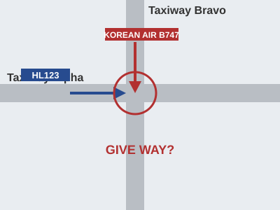
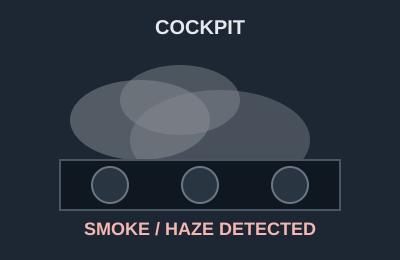

# EPTA 항공영어구술능력시험 조종사용 모의세트 EPTA_03 — 2026-10-16

안 내 메모 가능 / 문항당 1회 Say again 기능 사용 가능. 응시자 콜사인은 항상 **HL123**.

---

## Part Ⅰ TASK A. Readback and Hearback

✅ Directions : You will be listening to 4 ATC instructions. Your callsign will be HL123.
Listen carefully and make a correct readback for each of them. "Say again (=Repeat)"
available once only. You may take notes while listening.
  * Correct / Full readback : necessary for standard operating procedures
  * Response time for each question : 20 seconds or less

✅ 시험[응답] 요령

| 항목 | 내용 |
|---|---|
| 구성 | 4문항 / 문항 별 응대시간 : 20초 |
| 평가요소 | 기본적인 교신 능력 평가로 ATC의 지시사항에 맞게 표준교신용어로 readback |
| 진행 | 관제사 지시 → 응답녹음 |
| 평가항목 | 표준 교신속도/발음/억양의 사용 여부 · 필요한 정보의 효율적 전달 능력 평가 · 정확한 표준 교신용어의 사용 여부 · 관제 지시 후 교신 응대의 즉시성 여부 |
| 유의사항 | 올바른 readback : 운항절차에 필요한 필수 사항을 모두 포함한 readback · 필수사항은 아니지만 지시사항을 전체 readback 해도 감점되지 않음 |

**P1A-Q1** 🎙 20초
Ground : HL123, taxi to holding point runway tree 6 via Alpha.

Record your full readback.

[정답]

---

**P1A-Q2** 🎙 20초
Tower : HL123, after departure climb straight ahead to 2,000 feet, cleared for takeoff
runway tree 6, wind calm.

Record your full readback.

[정답]

---

**P1A-Q3** 🎙 20초
Center : HL123, climb and maintain flight level tree 50, contact Sejong Control on 128.25.

Record your full readback.

[정답]

---

**P1A-Q4** 🎙 20초
Delivery : HL123, cleared to Muan Airport via the PALDA ONE departure, maintain 5,000
feet, squawk 5721.

Record your full readback.

[정답]

---

## Part Ⅰ TASK B. Checking, Clarifying, Confirming, Informing

✅ Directions : You will be listening to 6 audio clips, which consist of short situational
prompts. Respond to each of them using mainly Standard Phraseology if possible. If not,
you may use plain English to help clarify your response. "Say again (=Repeat)" available
only once. Your callsign is HL123. You may take notes while listening.
  * Response time for each question : 20 seconds or less

✅ 시험[응답] 요령

| 항목 | 내용 |
|---|---|
| 구성 | 6문항 / 문항 별 응대시간 : 20초 |
| 평가요소 | 기본적인 교신 능력 평가로 ATC의 지시사항에 맞게 표준교신용어로 readback |
| 진행 | 상황정보 제시 → 관제지시 → 응답녹음 |
| 평가항목 | Task B는 상황정보 이해력 및 해당 교신에 대한 적절한 응대력 평가 · 상황정보 및 ATC의 교신에 따라 플레인 영어 사용이 요구될 수 있음 |
| 유의사항 | 상황정보(prompt) 음성에는 교신용어가 플레인 영어(발음)로 들려질 수 있음. 필요 시 올바른 교신용어로 응답해야 함 |

**P1B-Q1** 🎙 20초
You have just been handed over to Sejong Control while climbing out. You are passing
9,000 feet for flight level 180, and you are not sure whether your cleared level has been
changed. Contact Sejong Control, report your present altitude, and confirm your cleared
level.

Record your response.

[정답]

---

**P1B-Q2** 🎙 20초
While crossing PALDA you encountered moderate turbulence for about two minutes at flight
level tree 50. You changed frequency before you could report it, so the new controller
does not know about it yet. Acknowledge the instruction, and report the turbulence you
encountered.

Center : HL123, Sejong Control, descend to flight level 2 tree 0, report reaching.

Record your response.

[정답]

---

**P1B-Q3** 🎙 20초
Centre instructed you to maintain Mach decimal 7 8 for separation. You have been in light
turbulence and you reduced to Mach decimal 7 4, and you are flying at decimal 7 4 now.
Now ATC contacts you. Respond accordingly.

Center : HL123, confirm maintaining Mach decimal 7 8?

🖥 [ Mach .74 / turbulence ]

Record your response.

[정답]

---

**P1B-Q4** 🎙 20초
The routing direct to TOPLA requires RNP 1. Your number two navigation receiver is
inoperative today, so you are not RNP 1 capable. Listen to the controller, make a readback
of what you can accept, and a request with a reason.

Center : HL123, cleared direct TOPLA.

Record your response.

[정답]

---

**P1B-Q5** 🎙 20초
Centre instructed you to turn left heading 2 tree 0. You read the number the wrong way
round and you are now steady on heading 2 0 tree. Now ATC contacts you. Respond
accordingly.

Center : HL123, say your heading.

Record your response.

[정답]

---

**P1B-Q6** 🎙 20초
Your diversion around a closed area has used more fuel than you planned. You now have one
hour forty minutes of fuel on board, and your alternate needs one hour ten. You are level
at flight level tree 50 approaching NOSOK. Contact Sejong Control. Report your fuel state,
and request a more direct routing.

🖥 [ 1 hour 40 minutes / request direct ]

Record your response.

[정답]

---

## Part Ⅱ TASK A. Role-play & Follow-up

✅ Directions : In Part 2 Task A, you will be going through a couple of flight situations
of a normal passenger flight. Follow the prompts for providing your response, which you
will either hear or see on the screen, or the both. "Say again (=Repeat)" available once
only. Your callsign is HL123.

After finishing Task A Role play, you will be asked one or two follow-up questions. You
will have up to 90 seconds to respond to them.

✅ 시험[응답] 요령

| 항목 | 내용 |
|---|---|
| 구성 | 약 7~12회 롤 플레이 / 응대시간 : 30초, Follow up : 90초 |
| 평가요소 | 정상상황에서 기본 교신능력과 비정상 발생시 상황보고 또는 요구사항 전달 등에 필요한 언어 구사력(교신용어와 플레인 영어의 복합 사용) |
| 진행 | 연속적인 비행 단계 또는 복합적인 상황의 롤 플레이. Initial Situation → continued → Situation update → continued |
| 평가항목 | 음성 또는 화면에 제공되는 Text clue(🖥)를 이용하여 지시대로 응대하는 능력 · 상황정보 및 ATC의 교신에 따라 요구되는 플레인 영어 사용능력 · 표준 교신속도/발음/억양의 사용 여부 및 정보의 효율적 전달능력 평가 · 교신 응대력(Role-play)과 플레인 영어(Follow-up) 능력을 전체적으로 평가 |
| 유의사항 | 교신상황은 시간제한 및 언어평가 목적에 따라 '인위적'일 수 있고, 상황 전개의 '비약'이 인정되므로 지시사항에 맞게 응답해야 함 · 응답 직전 '약간의' 준비시간은 용인됨. 다만 '매우' 늦은 응답 또는 무응답은 영향을 미침 |

Initial Situation You are the pilot of HL123, level at flight level tree 50 and
approaching PALDA, en route to Muan Airport. 🔔(dingdong)

**P2A-Q1** 🎙 30초
☞ Contact Sejong Control and report your position.

[정답]

---

**P2A-Q2** 🎙 30초
☞ Listen to the controller, give a full readback, and inquire how many extra track miles
this will add.
Center : HL123, Sejong Control, the military training area west of NOSOK is active, so
route direct KARBU then NOSOK, descend to flight level 2 tree 0.

(Q2) 

[정답]

---

Situation Update The re-route has added track miles and your fuel is now tighter than you
planned. You have one hour 45 minutes of fuel on board. 🔔(dingdong)

**P2A-Q3** 🎙 30초
☞ Contact the controller, report your fuel state, and request direct NOSOK as soon as the
area is clear.

[정답]

---

**P2A-Q4** 🎙 30초
☞ Listen to the controller and give a full readback.
Center : HL123, roger, expect direct NOSOK in about ten miles. Descend to 1 tree thousand
feet, contact Muan Approach on 119.2.

[정답]

---

Situation Update You are now descending through flight level 150 for 1 tree thousand
feet, and the training area is behind you. 🔔(dingdong)

**P2A-Q5** 🎙 30초
☞ Contact Muan Approach and report your passing altitude.

[정답]

---

**P2A-Q6** 🎙 30초
☞ Listen to the controller and give a full readback.
Approach : HL123, Muan Approach, descend to 4,000 feet, reduce speed to 210 knots, expect
the NOSOK TWO arrival, ILS runway tree 6, Muan altimeter 1012.

[정답]

---

**P2A-Q7** 🎙 30초
☞ Listen to the controller's question and respond accordingly. Tell him what you need to
know before you decide.
Approach : HL123, the Airbus A321 ahead of you reported braking action medium on runway
tree 6, and it is still raining. Are you happy to continue, or do you want the longer
runway at Daegu?

[정답]

---

**P2A-Q8** 🎙 30초
☞ Listen to the controller and give a full readback.
Approach : HL123, roger, turn left heading 020, descend to 2,500 feet until established,
cleared for the ILS runway tree 6 approach, contact Muan Tower on 118.55.

[정답]

---

Situation Update You are established on the ILS for runway tree 6 and passing 2,000 feet.
🔔(dingdong)

**P2A-Q9** 🎙 30초
☞ Contact Muan Tower, report your position, and request the latest braking action.

[정답]

---

**P2A-Q10** 🎙 90초 (Follow-up)
Follow-up question:
In this situation, the controller told you the aircraft ahead had reported braking action
medium on a wet runway. What did you want to know before you decided, and why did that
matter to you? From your own experience, what makes you decide to divert to a longer
runway instead of continuing? Give an example.

[정답]

---

## Part Ⅱ TASK B. Extended Role-play : Single Incident/Emergency Related

✅ Directions : You will be interacting with an Air traffic controller or Ground crew
based on short situational prompts. Follow the prompts and respond as necessary. Assume
you can accept all the instructions, unless being specified otherwise. "Say again
(=Repeat)" available only once. Your callsign is HL123.
  * Response time for each question : 30 seconds or less

✅ 시험[응답] 요령 ※ Task B의 교신내용이 Task C의 태스크와 연계되므로, 관련 정보의 메모가 필요

| 항목 | 내용 |
|---|---|
| 구성 | 약 7~12회 롤 플레이 / 응대시간 : 30초 |
| 평가요소 | 단일 상황에서 비정상/비상상황에서 문제를 해결과정에서의 상황보고 또는 의사전달능력 등에 필요한 언어 구사력(플레인 영어의 빈도가 높아짐) |
| 진행 | 비정상 또는 비상 상황이 포함된 '단일'사건의 롤 플레이. Initial Situation → continued → Situation update → continued |
| 평가항목 | 음성 또는 화면에 제공되는 Text clue(🖥)를 이용하여 지시대로 응대하는 능력 · 상황정보 및 ATC의 내용에 따라 요구되는 교신용어 또는 플레인 영어 사용 능력 · 표준 교신속도/발음/억양의 사용 여부 및 정보의 효율적 전달능력 평가 · 교신 응대력(Role-play)과 플레인 영어능력을 전체적으로 평가 |
| 유의사항 | 교신상황은 시간제한 및 언어평가 목적에 따라 '인위적'일 수 있고, 상황 전개의 '비약'이 인정되므로 지시사항에 맞게 응답해야 함 · 응답 직전 '약간의' 준비시간은 용인됨. 다만 '매우' 늦은 응답 또는 무응답은 영향을 미침 · 플레인 영어 사용 빈도가 다소 높을 수 있고, 응대 내용의 정확도 및 유창도에 따라 Operational(Level4)과 Extended(Level5) 여부가 평가됨 |

Initial Situation You are the pilot of HL123, climbing through 8,000 feet for flight level
180 after departure from Gimhae. You have just been handed to Sejong Control.
🔔(dingdong)

**P2B-Q1** 🎙 30초
☞ Contact Sejong Control and report your position.

[정답]

---

**P2B-Q2** 🎙 30초
☞ Listen to the controller and give a full readback.
Center : HL123, Sejong Control, radar contact, climb and maintain flight level 2 tree 0,
proceed direct TOPLA.

[정답]

---

Situation Update Passing flight level 150 you get an ENGINE 1 FIRE warning. You have shut
the engine down and discharged the first bottle, and the warning has now gone out. You are
flying on one engine. 🔔(dingdong)

**P2B-Q3** 🎙 30초
☞ Declare an emergency, state the nature of the problem, and request a return to Gimhae.

(Q3) 

[정답]

---

**P2B-Q4** 🎙 30초
☞ Listen to the controller, give a full readback and say your intentions.
Center : HL123, roger your mayday, turn left heading 180, descend to 1 tree thousand feet,
Gimhae is at your eight o'clock and 25 miles. Say your intentions.

[정답]

---

Situation Update The cabin crew report no injuries. You have two hours 50 minutes of fuel
remaining and 164 people on board. 🔔(dingdong)

**P2B-Q5** 🎙 30초
☞ Listen to the controller's question and provide the requested information.
Center : HL123, say fuel endurance and souls on board.

[정답]

---

**P2B-Q6** 🎙 30초
☞ Listen to the controller and state your intentions, with a reason.
Center : HL123, Gimhae is reporting a crosswind of 20 knots on runway tree 6, and Daegu is
40 miles further with calm wind and a longer runway. Which would you rather have?

[정답]

---

Situation Update You have completed the checklist, the fire has not come back, and the
aircraft is stable on one engine. 🔔(dingdong)

**P2B-Q7** 🎙 30초
☞ Contact approach, give them an update of your situation, and state what you will need on
landing.

[정답]

---

**P2B-Q8** 🎙 30초
☞ Listen to the controller and give a full readback.
Approach : HL123, Gimhae Approach, turn right heading 290, descend to 2,500 feet until
established, cleared for the ILS runway tree 6 approach, the emergency services are
standing by.

[정답]

---

**P2B-Q9** 🎙 30초
☞ Listen to the controller's question and respond accordingly.
Approach : HL123, do you want to cancel the emergency now that the engine is secured, or
keep it active until you are on the ground?

[정답]

---

## Part Ⅱ TASK C. Reporting about Task B

✅ Directions : You have just finished Part 2 Task B. Now you will be listening to the
ATC's radiotelephony messages to better recall the events. Afterwards, you will be
asked two questions about the situation. You will have 90 seconds for each question.

✅ 시험[응답] 요령

| 항목 | 내용 |
|---|---|
| 구성 | 2문항 / 응대시간 : 90초 |
| 평가요소 | Task B에서 수행한 롤 플레이 내용에 대한 리포팅(플레인 영어) 능력 |
| 진행 | TASK B의 ATC 교신 내용 다시 듣기 → 질문 → 응답하기 |
| 평가항목 | 구체적인 사건과 상황 전개의 내용을 묻는 질문(Q1)에 대한 사실전달 능력 · 사건에 대한 이해를 바탕으로 의견을 묻는 질문(Q2)에 대한 의견제시 능력 |
| 유의사항 | 제공시간을 최대한 활용하여 평가항목(유창성, 이해력, 어휘, 발음, 문장구조)에 대한 능력을 충분히 표현 · 경험 사례 또는 관련 지식/보도 등을 활용하여 플레인 영어능력을 최대로 발휘 |

☞ Now listen to the controller's radiotelephony messages.

ATC: HL123, Sejong Control, radar contact, climb and maintain flight level 2 tree 0,
proceed direct TOPLA.
ATC: HL123, roger your mayday, turn left heading 180, descend to 1 tree thousand feet,
Gimhae is at your eight o'clock and 25 miles. Say your intentions.
ATC: HL123, say fuel endurance and souls on board.
ATC: HL123, Gimhae is reporting a crosswind of 20 knots on runway tree 6, and Daegu is 40
miles further with calm wind and a longer runway. Which would you rather have?
ATC: HL123, Gimhae Approach, turn right heading 290, descend to 2,500 feet until
established, cleared for the ILS runway tree 6 approach, the emergency services are
standing by.
ATC: HL123, do you want to cancel the emergency now that the engine is secured, or keep it
active until you are on the ground? 🔔(dingdong)

☞ Now answer the questions.

**P2C-Q1** 🎙 90초
What happened to your aircraft (HL123)? Explain the nature of the incident.

[정답]

---

**P2C-Q2** 🎙 90초
How do you think the incident was handled by the air traffic controller? Do you feel the
situation could have been handled differently? Make a comment from a pilot's point of
view.

[정답]

---
