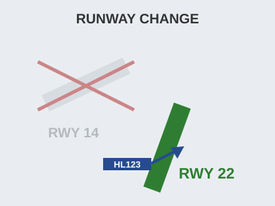
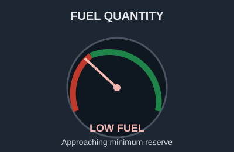

# EPTA 항공영어구술능력시험 조종사용 모의세트 EPTA_04 — 2026-10-20

안 내 메모 가능 / 문항당 1회 Say again 기능 사용 가능. 응시자 콜사인은 항상 **HL123**.

---

## Part Ⅰ TASK A. Readback and Hearback

✅ Directions : You will be listening to 4 ATC instructions. Your callsign will be HL123.
Listen carefully and make a correct readback for each of them. "Say again (=Repeat)"
available once only. You may take notes while listening.
  * Correct / Full readback : necessary for standard operating procedures
  * Response time for each question : 20 seconds or less

✅ 시험[응답] 요령

| 항목 | 내용 |
|---|---|
| 구성 | 4문항 / 문항 별 응대시간 : 20초 |
| 평가요소 | 기본적인 교신 능력 평가로 ATC의 지시사항에 맞게 표준교신용어로 readback |
| 진행 | 관제사 지시 → 응답녹음 |
| 평가항목 | 표준 교신속도/발음/억양의 사용 여부 · 필요한 정보의 효율적 전달 능력 평가 · 정확한 표준 교신용어의 사용 여부 · 관제 지시 후 교신 응대의 즉시성 여부 |
| 유의사항 | 올바른 readback : 운항절차에 필요한 필수 사항을 모두 포함한 readback · 필수사항은 아니지만 지시사항을 전체 readback 해도 감점되지 않음 |

**P1A-Q1** 🎙 20초
Ground : HL123, give way to the Boeing 787 on Charlie.

Record your full readback.

[정답]

---

**P1A-Q2** 🎙 20초
Tower : HL123, traffic is an ATR on final, cleared for immediate takeoff runway 08, report
passing 3,000 feet.

Record your full readback.

[정답]

---

**P1A-Q3** 🎙 20초
Approach : HL123, descend to 4,000 feet, cleared for the RNAV runway 26 approach, contact
Halston Tower on 120.35.

Record your full readback.

[정답]

---

**P1A-Q4** 🎙 20초
Delivery : HL123, cleared to Halston Airport via the CANTO TWO departure, maintain 6,000
feet, squawk 2046.

Record your full readback.

[정답]

---

## Part Ⅰ TASK B. Checking, Clarifying, Confirming, Informing

✅ Directions : You will be listening to 6 audio clips, which consist of short situational
prompts. Respond to each of them using mainly Standard Phraseology if possible. If not,
you may use plain English to help clarify your response. "Say again (=Repeat)" available
only once. Your callsign is HL123. You may take notes while listening.
  * Response time for each question : 20 seconds or less

✅ 시험[응답] 요령

| 항목 | 내용 |
|---|---|
| 구성 | 6문항 / 문항 별 응대시간 : 20초 |
| 평가요소 | 기본적인 교신 능력 평가로 ATC의 지시사항에 맞게 표준교신용어로 readback |
| 진행 | 상황정보 제시 → 관제지시 → 응답녹음 |
| 평가항목 | Task B는 상황정보 이해력 및 해당 교신에 대한 적절한 응대력 평가 · 상황정보 및 ATC의 교신에 따라 플레인 영어 사용이 요구될 수 있음 |
| 유의사항 | 상황정보(prompt) 음성에는 교신용어가 플레인 영어(발음)로 들려질 수 있음. 필요 시 올바른 교신용어로 응답해야 함 |

**P1B-Q1** 🎙 20초
You are holding over OBLIN while the controller sorts out the arrival sequence. You have
one hour 20 minutes of fuel on board, and your alternate needs 40 minutes. Now ATC
contacts you. Provide both pieces of information.

Center : HL123, say your endurance, and how many more turns in the hold you can take.

Record your response.

[정답]

---

**P1B-Q2** 🎙 20초
On final into Everett last night you were hit by a green laser from the left of the
approach path, at about 600 feet. You were too busy to report it then. You have now landed
and the ground controller calls you. Acknowledge the taxi instruction, and report what
happened on the approach.

Ground : HL123, Everett Ground, taxi to stand 24 via Bravo.

Record your response.

[정답]

---

**P1B-Q3** 🎙 20초
Approach instructed you to maintain heading 070. A build-up appeared ahead, so you turned
20 degrees right to avoid it and you are now steady on heading 090. Now ATC contacts you.
Respond accordingly.

Approach : HL123, confirm maintaining heading 070?

🖥 [ heading 090 / weather avoidance ]

Record your response.

[정답]

---

**P1B-Q4** 🎙 20초
The controller has cleared you direct ZAVER. Your weather radar shows a line of storms
sitting right on that track, with tops above your level, and you can only take that
routing after you are past the line. Listen to the controller, respond with a reason, and
tell him what you can accept instead.

Center : HL123, cleared direct ZAVER.

Record your response.

[정답]

---

**P1B-Q5** 🎙 20초
Delivery gave you squawk 2046 before departure. You set 2064 in the transponder by mistake
and it has been running that way since take-off. Now ATC contacts you. Respond accordingly.

Center : HL123, verify your squawk.

Record your response.

[정답]

---

**P1B-Q6** 🎙 20초
Your arrival chart shows a crossing restriction of 11,000 feet at MERIS, but the
controller has cleared you to descend to flight level 120, which leaves you above that
restriction. You are 30 miles from MERIS. Contact Halston Approach. Point out the
difference, and request the descent you need.

🖥 [ MERIS 11,000 feet ]

Record your response.

[정답]

---

## Part Ⅱ TASK A. Role-play & Follow-up

✅ Directions : In Part 2 Task A, you will be going through a couple of flight situations
of a normal passenger flight. Follow the prompts for providing your response, which you
will either hear or see on the screen, or the both. "Say again (=Repeat)" available once
only. Your callsign is HL123.

After finishing Task A Role play, you will be asked one or two follow-up questions. You
will have up to 90 seconds to respond to them.

✅ 시험[응답] 요령

| 항목 | 내용 |
|---|---|
| 구성 | 약 7~12회 롤 플레이 / 응대시간 : 30초, Follow up : 90초 |
| 평가요소 | 정상상황에서 기본 교신능력과 비정상 발생시 상황보고 또는 요구사항 전달 등에 필요한 언어 구사력(교신용어와 플레인 영어의 복합 사용) |
| 진행 | 연속적인 비행 단계 또는 복합적인 상황의 롤 플레이. Initial Situation → continued → Situation update → continued |
| 평가항목 | 음성 또는 화면에 제공되는 Text clue(🖥)를 이용하여 지시대로 응대하는 능력 · 상황정보 및 ATC의 교신에 따라 요구되는 플레인 영어 사용능력 · 표준 교신속도/발음/억양의 사용 여부 및 정보의 효율적 전달능력 평가 · 교신 응대력(Role-play)과 플레인 영어(Follow-up) 능력을 전체적으로 평가 |
| 유의사항 | 교신상황은 시간제한 및 언어평가 목적에 따라 '인위적'일 수 있고, 상황 전개의 '비약'이 인정되므로 지시사항에 맞게 응답해야 함 · 응답 직전 '약간의' 준비시간은 용인됨. 다만 '매우' 늦은 응답 또는 무응답은 영향을 미침 |

Flight Paths
In this scenario, you'll be the pilot flying HL123, which goes through 3 flight stages:
Climb, Cruise, Diversion.

Initial Situation You are the pilot of HL123, climbing through 12,000 feet for flight
level 330, departed from Everett and bound for Halston. 🔔(dingdong)

**P2A-Q1** 🎙 30초
☞ Contact Northfield Control and report your position.

[정답]

---

**P2A-Q2** 🎙 30초
☞ Listen to the controller and give a full readback.
Center : HL123, Northfield Control, radar contact, climb and maintain flight level 330,
after CANTO cleared direct MERIS.

[정답]

---

Situation Update You are level at flight level 330. The cabin crew call to tell you a
passenger has collapsed and is not responding well. A doctor on board is attending.
🔔(dingdong)

**P2A-Q3** 🎙 30초
☞ Inform the controller of the situation, state that you are considering a diversion, and
request the weather at the nearest suitable airport.

[정답]

---

**P2A-Q4** 🎙 30초
☞ Listen to the controller, give a readback of the weather, and state your intentions with
a reason.
Center : HL123, roger, the nearest suitable is Redwood, 60 miles south-east, wind 240 at
8, visibility 10 kilometres, runway 26 is 2,600 metres. Halston is 140 miles ahead. Say
your intentions.

(Q4) 

[정답]

---

Situation Update You have decided to divert to Redwood and the company agrees. The doctor
says the passenger should be on the ground within the hour. 🔔(dingdong)

**P2A-Q5** 🎙 30초
☞ Contact Northfield Control, request descent and direct Redwood, and request priority
handling with an ambulance on arrival.

[정답]

---

**P2A-Q6** 🎙 30초
☞ Listen to the controller and give a full readback.
Center : HL123, roger, descend to flight level 180, direct Redwood, contact Redwood
Approach on 126.9. Your ambulance request is passed on.

[정답]

---

Situation Update You are now descending through flight level 190 for 11,000 feet. There
are 178 passengers and 8 crew on board. 🔔(dingdong)

**P2A-Q7** 🎙 30초
☞ Contact Redwood Approach and report your passing altitude.

[정답]

---

**P2A-Q8** 🎙 30초
☞ Listen to the controller and give a full readback.
Approach : HL123, Redwood Approach, descend to 3,000 feet, reduce speed to 180 knots,
cleared for the ILS runway 26 approach, report established.

[정답]

---

**P2A-Q9** 🎙 30초
☞ Listen to the controller and provide both pieces of information.
Approach : HL123, two things — how many people are on board, and do you need the ambulance
at the gate or on the runway?

[정답]

---

**P2A-Q10** 🎙 30초
☞ Listen to the tower and give a full readback. Then inquire where the ambulance will meet
you.
Tower : HL123, Redwood Tower, wind 250 at 10, runway 26, cleared to land, the ambulance is
standing by.

[정답]

---

**P2A-Q11** 🎙 90초 (Follow-up)
Follow-up question:
You have just finished Task A, as the pilot of Hotel Lima one two three.
In this situation, you chose to divert to Redwood instead of continuing to Halston. What
did you weigh up before you made that choice? In your role as a pilot, how do you decide
whether a sick passenger is a reason to divert? Give an example of a case where you would
keep going instead.

[정답]

---

## Part Ⅱ TASK B. Extended Role-play : Single Incident/Emergency Related

✅ Directions : You will be interacting with an Air traffic controller or Ground crew
based on short situational prompts. Follow the prompts and respond as necessary. Assume
you can accept all the instructions, unless being specified otherwise. "Say again
(=Repeat)" available only once. Your callsign is HL123.
  * Response time for each question : 30 seconds or less

✅ 시험[응답] 요령 ※ Task B의 교신내용이 Task C의 태스크와 연계되므로, 관련 정보의 메모가 필요

| 항목 | 내용 |
|---|---|
| 구성 | 약 7~12회 롤 플레이 / 응대시간 : 30초 |
| 평가요소 | 단일 상황에서 비정상/비상상황에서 문제를 해결과정에서의 상황보고 또는 의사전달능력 등에 필요한 언어 구사력(플레인 영어의 빈도가 높아짐) |
| 진행 | 비정상 또는 비상 상황이 포함된 '단일'사건의 롤 플레이. Initial Situation → continued → Situation update → continued |
| 평가항목 | 음성 또는 화면에 제공되는 Text clue(🖥)를 이용하여 지시대로 응대하는 능력 · 상황정보 및 ATC의 내용에 따라 요구되는 교신용어 또는 플레인 영어 사용 능력 · 표준 교신속도/발음/억양의 사용 여부 및 정보의 효율적 전달능력 평가 · 교신 응대력(Role-play)과 플레인 영어능력을 전체적으로 평가 |
| 유의사항 | 교신상황은 시간제한 및 언어평가 목적에 따라 '인위적'일 수 있고, 상황 전개의 '비약'이 인정되므로 지시사항에 맞게 응답해야 함 · 응답 직전 '약간의' 준비시간은 용인됨. 다만 '매우' 늦은 응답 또는 무응답은 영향을 미침 · 플레인 영어 사용 빈도가 다소 높을 수 있고, 응대 내용의 정확도 및 유창도에 따라 Operational(Level4)과 Extended(Level5) 여부가 평가됨 |

Initial Situation You are the pilot of HL123, descending through flight level 160 for
9,000 feet, inbound to Halston Airport. You have information Bravo. 🔔(dingdong)

**P2B-Q1** 🎙 30초
☞ Contact Halston Approach and report your position.

[정답]

---

**P2B-Q2** 🎙 30초
☞ Listen to the controller and give a full readback.
Approach : HL123, Halston Approach, good evening, descend and maintain 9,000 feet, reduce
speed to 220 knots, expect the MERIS ONE arrival, ILS runway 08, Halston altimeter 29.88.

[정답]

---

Situation Update Selecting flap for the approach, the flaps stop at 15 and will not move
any further. The checklist tells you to plan a flaps 15 landing — your approach speed will
be 165 knots and you will need 2,400 metres of landing distance. 🔔(dingdong)

**P2B-Q3** 🎙 30초
☞ Inform the controller of your situation, state that you are maintaining 9,000 feet, and
request time to work the checklist.

(Q3) 

[정답]

---

**P2B-Q4** 🎙 30초
☞ Listen to the controller, give a full readback and say your intentions.
Approach : HL123, roger, fly heading 120 and maintain 9,000 feet, that will keep you clear
of the arrivals. Say your intentions when you are ready.

[정답]

---

**P2B-Q5** 🎙 30초
☞ Listen to the controller and provide both pieces of information.
Approach : HL123, two questions — what is your approach speed with flaps 15, and how much
landing distance do you need?

[정답]

---

**P2B-Q6** 🎙 30초
☞ Listen to the controller. Tell him what you need to know before you decide, then state
your intentions with a reason.
Approach : HL123, runway 08 is 2,300 metres, so that is tight for you. Runway 26 is 3,000
metres but you would have a 15 knot tailwind. Which do you want?

[정답]

---

Situation Update The tower reports the wind is now 080 at 6, so the tailwind on runway 26
has gone. You have finished the checklist. 🔔(dingdong)

**P2B-Q7** 🎙 30초
☞ Contact approach, give them an update, state your decision, and say what you will need
on landing.

[정답]

---

**P2B-Q8** 🎙 30초
☞ Listen to the controller and give a full readback.
Approach : HL123, roger, turn right heading 350, descend to 2,500 feet until established,
cleared for the ILS runway 26 approach, contact Halston Tower on 120.35.

[정답]

---

**P2B-Q9** 🎙 30초
☞ Listen to the controller and provide both pieces of information.
Approach : HL123, the tower is asking two things — will you be able to vacate at the end,
and do you want the fire service to follow you in?

[정답]

---

## Part Ⅱ TASK C. Reporting about Task B

✅ Directions : You have just finished Part 2 Task B. Now you will be listening to the
ATC's radiotelephony messages to better recall the events. Afterwards, you will be
asked two questions about the situation. You will have 90 seconds for each question.

✅ 시험[응답] 요령

| 항목 | 내용 |
|---|---|
| 구성 | 2문항 / 응대시간 : 90초 |
| 평가요소 | Task B에서 수행한 롤 플레이 내용에 대한 리포팅(플레인 영어) 능력 |
| 진행 | TASK B의 ATC 교신 내용 다시 듣기 → 질문 → 응답하기 |
| 평가항목 | 구체적인 사건과 상황 전개의 내용을 묻는 질문(Q1)에 대한 사실전달 능력 · 사건에 대한 이해를 바탕으로 의견을 묻는 질문(Q2)에 대한 의견제시 능력 |
| 유의사항 | 제공시간을 최대한 활용하여 평가항목(유창성, 이해력, 어휘, 발음, 문장구조)에 대한 능력을 충분히 표현 · 경험 사례 또는 관련 지식/보도 등을 활용하여 플레인 영어능력을 최대로 발휘 |

☞ Now listen to the controller's radiotelephony messages.

ATC: HL123, Halston Approach, good evening, descend and maintain 9,000 feet, reduce speed
to 220 knots, expect the MERIS ONE arrival, ILS runway 08, Halston altimeter 29.88.
ATC: HL123, roger, fly heading 120 and maintain 9,000 feet, that will keep you clear of
the arrivals. Say your intentions when you are ready.
ATC: HL123, two questions — what is your approach speed with flaps 15, and how much
landing distance do you need?
ATC: HL123, runway 08 is 2,300 metres, so that is tight for you. Runway 26 is 3,000 metres
but you would have a 15 knot tailwind. Which do you want?
ATC: HL123, roger, turn right heading 350, descend to 2,500 feet until established,
cleared for the ILS runway 26 approach, contact Halston Tower on 120.35.
ATC: HL123, the tower is asking two things — will you be able to vacate at the end, and do
you want the fire service to follow you in? 🔔(dingdong)

☞ Now answer the questions.

**P2C-Q1** 🎙 90초
What happened to your aircraft (HL123)? Explain the nature of the incident.

[정답]

---

**P2C-Q2** 🎙 90초
How do you think the incident was handled by the air traffic controller? Do you feel the
situation could have been handled differently? Make a comment from a pilot's point of
view.

[정답]

---
