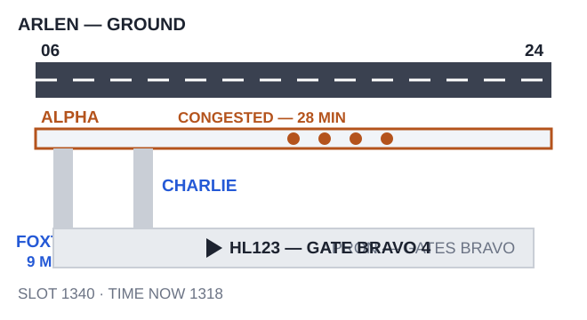
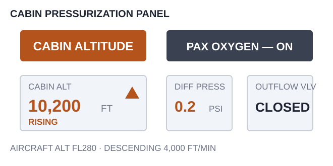

# EPTA 항공영어구술능력시험 조종사용 모의세트 EPTA_06 — 2026-10-27

안 내 메모 가능 / 문항당 1회 Say again 기능 사용 가능. 응시자 콜사인은 항상 **HL123**.

---

## Part Ⅰ TASK A. Readback and Hearback

✅ Directions : You will be listening to 4 ATC instructions. Your callsign will be HL123.
Listen carefully and make a correct readback for each of them. "Say again (=Repeat)"
available once only. You may take notes while listening.
  * Correct / Full readback : necessary for standard operating procedures
  * Response time for each question : 20 seconds or less

✅ 시험[응답] 요령

| 항목 | 내용 |
|---|---|
| 구성 | 4문항 / 문항 별 응대시간 : 20초 |
| 평가요소 | 기본적인 교신 능력 평가로 ATC의 지시사항에 맞게 표준교신용어로 readback |
| 진행 | 관제사 지시 → 응답녹음 |
| 평가항목 | 표준 교신속도/발음/억양의 사용 여부 · 필요한 정보의 효율적 전달 능력 평가 · 정확한 표준 교신용어의 사용 여부 · 관제 지시 후 교신 응대의 즉시성 여부 |
| 유의사항 | 올바른 readback : 운항절차에 필요한 필수 사항을 모두 포함한 readback · 필수사항은 아니지만 지시사항을 전체 readback 해도 감점되지 않음 |

**P1A-Q1** 🎙 20초
Ground : HL123, hold position, traffic crossing right to left.

Record your full readback.

[정답]

---

**P1A-Q2** 🎙 20초
Delivery : HL123, cleared to Kingsbury via the SONTEL TWO departure, RIKAS transition,
climb to 6,000 feet, squawk 4703.

Record your full readback.

[정답]

---

**P1A-Q3** 🎙 20초
Center : HL123, expedite climb until passing flight level 180, then climb to flight level
310.

Record your full readback.

[정답]

---

**P1A-Q4** 🎙 20초
Approach : HL123, descend to 2,500 feet, cleared for the ILS runway 33 approach, report
established.

Record your full readback.

[정답]

---

## Part Ⅰ TASK B. Checking, Clarifying, Confirming, Informing

✅ Directions : You will be listening to 6 audio clips, which consist of short situational
prompts. Respond to each of them using mainly Standard Phraseology if possible. If not,
you may use plain English to help clarify your response. "Say again (=Repeat)" available
only once. Your callsign is HL123. You may take notes while listening.
  * Response time for each question : 20 seconds or less

✅ 시험[응답] 요령

| 항목 | 내용 |
|---|---|
| 구성 | 6문항 / 문항 별 응대시간 : 20초 |
| 평가요소 | 기본적인 교신 능력 평가로 ATC의 지시사항에 맞게 표준교신용어로 readback |
| 진행 | 상황정보 제시 → 관제지시 → 응답녹음 |
| 평가항목 | Task B는 상황정보 이해력 및 해당 교신에 대한 적절한 응대력 평가 · 상황정보 및 ATC의 교신에 따라 플레인 영어 사용이 요구될 수 있음 |
| 유의사항 | 상황정보(prompt) 음성에는 교신용어가 플레인 영어(발음)로 들려질 수 있음. 필요 시 올바른 교신용어로 응답해야 함 |

**P1B-Q1** 🎙 20초
The time is now 1352. At your present speed MAGRU is 18 minutes ahead of you. Listen to
the controller, respond with a reason, and tell him what you need.

🖥 [ time now 1352 / MAGRU 18 minutes ahead ]

Center : HL123, cross MAGRU at 1405.

Record your response.

[정답]

---

**P1B-Q2** 🎙 20초
Just after departure from Arlen you saw a flock of large birds at about 2,000 feet, just
north of the runway. You were busy with the climb checks and did not report it. Departure
now calls you. Acknowledge the instruction, and report what you saw.

Departure : HL123, Arlen Departure, radar contact, climb to flight level 190.

Record your response.

[정답]

---

**P1B-Q3** 🎙 20초
Approach told you to maintain 210 knots. Moderate turbulence has forced you to slow to 180
knots and you are staying at that speed. Now ATC contacts you. Respond accordingly.

🖥 [ 180 knots / moderate turbulence ]

Approach : HL123, confirm maintaining 210 knots?

Record your response.

[정답]

---

**P1B-Q4** 🎙 20초
You are 12 miles from the field, but you are high and fast and you need about 18 miles of
track to get down and configure for landing. Listen to the controller, respond with a
reason, and tell him what you need instead.

Approach : HL123, are you able to accept a short approach to runway 33?

Record your response.

[정답]

---

**P1B-Q5** 🎙 20초
Center cleared you to climb to flight level 200. You set flight level 220 in the altitude
window by mistake and you are now climbing through flight level 205. Now ATC contacts you.
Respond accordingly.

Center : HL123, I show you climbing above flight level 200 — say your cleared level.

Record your response.

[정답]

---

**P1B-Q6** 🎙 20초
You are number four for departure at Arlen. Ground told you to expect 10 minutes, but it
has now been 25. Your crew duty time requires you to be airborne by 1430, it is now 1410,
and the taxi to the runway takes 12 minutes. Contact Arlen Ground. Point out the problem
and request what you need.

Record your response.

[정답]

---

## Part Ⅱ TASK A. Role-play & Follow-up

✅ Directions : In Part 2 Task A, you will be going through a couple of flight situations
of a normal passenger flight. Follow the prompts for providing your response, which you
will either hear or see on the screen, or the both. "Say again (=Repeat)" available once
only. Your callsign is HL123.

After finishing Task A Role play, you will be asked one or two follow-up questions. You
will have up to 90 seconds to respond to them.

✅ 시험[응답] 요령

| 항목 | 내용 |
|---|---|
| 구성 | 약 7~12회 롤 플레이 / 응대시간 : 30초, Follow up : 90초 |
| 평가요소 | 정상상황에서 기본 교신능력과 비정상 발생시 상황보고 또는 요구사항 전달 등에 필요한 언어 구사력(교신용어와 플레인 영어의 복합 사용) |
| 진행 | 연속적인 비행 단계 또는 복합적인 상황의 롤 플레이. Initial Situation → continued → Situation update → continued |
| 평가항목 | 음성 또는 화면에 제공되는 Text clue(🖥)를 이용하여 지시대로 응대하는 능력 · 상황정보 및 ATC의 교신에 따라 요구되는 플레인 영어 사용능력 · 표준 교신속도/발음/억양의 사용 여부 및 정보의 효율적 전달능력 평가 · 교신 응대력(Role-play)과 플레인 영어(Follow-up) 능력을 전체적으로 평가 |
| 유의사항 | 교신상황은 시간제한 및 언어평가 목적에 따라 '인위적'일 수 있고, 상황 전개의 '비약'이 인정되므로 지시사항에 맞게 응답해야 함 · 응답 직전 '약간의' 준비시간은 용인됨. 다만 '매우' 늦은 응답 또는 무응답은 영향을 미침 |

Flight Paths
In this scenario, you'll be the pilot flying HL123, which goes through 2 flight stages:
Taxi, Departure.

Initial Situation You are the pilot of HL123 at Gate Bravo 4 at Arlen Airport, ready to
depart for Kingsbury. You have information Quebec and runway 24 is in use. Your flow
control slot for Kingsbury is 1340, and it is now 1318. 🔔(dingdong)

**P2A-Q1** 🎙 30초
☞ Contact Arlen Ground, request pushback and give your information letter.

[정답]

---

**P2A-Q2** 🎙 30초
☞ Listen to the ground controller, give a full readback, and tell him what you will do.
Ground : HL123, Arlen Ground, pushback approved, face south. There's an A220 pushing at
Bravo 2 right now, so hold where you are until he's clear — give me a call when you're
moving.

[정답]

---

Situation Update Ground tells you that taxiway Alpha is congested and the taxi to runway
24 will take 28 minutes. The time is now 1318 and your slot is 1340. 🔔(dingdong)

(Q3) 

**P2A-Q3** 🎙 30초
☞ Contact Arlen Ground. Point out the problem with that taxi time, and request what you
need.

[정답]

---

**P2A-Q4** 🎙 30초
☞ Listen to the ground controller and respond accordingly. Tell him what you need to know
before you decide. (Your information Quebec is 25 minutes old, and your tailwind limit is
10 knots.)
Ground : HL123, I can give you runway 06 instead — that's about a 9-minute taxi from where
you are. Runway 06 has a tailwind though. Do what you need to do.

[정답]

---

**P2A-Q5** 🎙 30초
☞ Listen to the ground controller, then state your decision with a reason.
Ground : HL123, the current wind is 190 at 8 knots, so that's about 7 knots of tailwind on
runway 06.

[정답]

---

**P2A-Q6** 🎙 30초
☞ Listen to the ground controller and give a full readback.
Ground : HL123, taxi to runway 06 via Charlie and Foxtrot, hold short of Foxtrot 1, and
contact Arlen Tower on 118.35.

[정답]

---

**P2A-Q7** 🎙 30초
☞ Listen to the tower and give a full readback.
Tower : HL123, Arlen Tower, number two, after the Saab 340 on short final, line up and
wait runway 06.

[정답]

---

**P2A-Q8** 🎙 30초
☞ Listen to the tower and give a full readback.
Tower : HL123, cleared for takeoff runway 06, climb to 3,000 feet, report passing 1,800
feet.

[정답]

---

Situation Update You are airborne and passing 1,800 feet, climbing to 3,000 feet.
🔔(dingdong)

**P2A-Q9** 🎙 30초
☞ Contact Arlen Departure, report your passing altitude and request further climb.

[정답]

---

**P2A-Q10** 🎙 30초
☞ Listen to the controller, give a full readback, and inquire what that means for your
arrival.
Departure : HL123, Arlen Departure, radar contact, climb to flight level 190, direct
SONTEL when able. And by the way, Kingsbury have just moved your slot to 1352 — I'm sorry
about that.

[정답]

---

**P2A-Q11** 🎙 90초 (Follow-up)
You have just finished Task A, as the pilot of Hotel Lima one two three.

In this situation, Ground offered you runway 06 with a tailwind when your slot was about
to expire. What did you need to know before you accepted it, and why? In your role as a
pilot, how do you decide whether to take a runway that saves time but has a tailwind?
Give an example of a time pressure you would refuse to accept, no matter what it cost the
schedule.

[정답]

---

## Part Ⅱ TASK B. Extended Role-play : Single Incident/Emergency Related

✅ Directions : You will be interacting with an Air traffic controller or Ground crew
based on short situational prompts. Follow the prompts and respond as necessary. Assume
you can accept all the instructions, unless being specified otherwise. "Say again
(=Repeat)" available only once. Your callsign is HL123.
  * Response time for each question : 30 seconds or less

✅ 시험[응답] 요령 ※ Task B의 교신내용이 Task C의 태스크와 연계되므로, 관련 정보의 메모가 필요

| 항목 | 내용 |
|---|---|
| 구성 | 약 7~12회 롤 플레이 / 응대시간 : 30초 |
| 평가요소 | 단일 상황에서 비정상/비상상황에서 문제를 해결과정에서의 상황보고 또는 의사전달능력 등에 필요한 언어 구사력(플레인 영어의 빈도가 높아짐) |
| 진행 | 비정상 또는 비상 상황이 포함된 '단일'사건의 롤 플레이. Initial Situation → continued → Situation update → continued |
| 평가항목 | 음성 또는 화면에 제공되는 Text clue(🖥)를 이용하여 지시대로 응대하는 능력 · 상황정보 및 ATC의 내용에 따라 요구되는 교신용어 또는 플레인 영어 사용 능력 · 표준 교신속도/발음/억양의 사용 여부 및 정보의 효율적 전달능력 평가 · 교신 응대력(Role-play)과 플레인 영어능력을 전체적으로 평가 |
| 유의사항 | 교신상황은 시간제한 및 언어평가 목적에 따라 '인위적'일 수 있고, 상황 전개의 '비약'이 인정되므로 지시사항에 맞게 응답해야 함 · 응답 직전 '약간의' 준비시간은 용인됨. 다만 '매우' 늦은 응답 또는 무응답은 영향을 미침 · 플레인 영어 사용 빈도가 다소 높을 수 있고, 응대 내용의 정확도 및 유창도에 따라 Operational(Level4)과 Extended(Level5) 여부가 평가됨 |

Initial Situation You are the pilot of HL123, level at flight level 330 and 110 miles from
Westmoor Airport. You have 1 hour 40 minutes of fuel on board. 🔔(dingdong)

**P2B-Q1** 🎙 30초
☞ Contact Eastvale Control and report your position.

[정답]

---

**P2B-Q2** 🎙 30초
☞ Listen to the controller and give a full readback.
Center : HL123, Eastvale Control, descend to flight level 240, reduce speed to 280 knots,
expect the MAGRU ONE arrival, ILS runway 33, Westmoor altimeter 29.92.

[정답]

---

Situation Update Passing flight level 280 you get a CABIN ALTITUDE warning. The cabin
altitude is climbing through 10,000 feet and the oxygen masks are on. You must get the
aircraft down to 10,000 feet. You are descending at about 4,000 feet per minute. You have
154 passengers and 6 crew, and two passengers are feeling unwell but nobody needs urgent
treatment. 🔔(dingdong)

(Q3) 

**P2B-Q3** 🎙 30초
☞ Inform the controller of your situation, tell him you are starting an emergency descent,
and request a lower level.

[정답]

---

**P2B-Q4** 🎙 30초
☞ Listen to the controller, give a full readback, tell him what the problem is, and
request what you need.
Center : HL123, roger, descend at your discretion. Be advised the minimum safe altitude on
your present track is 11,500 feet for the next 30 miles.

[정답]

---

**P2B-Q5** 🎙 30초
☞ Listen to the controller, give a full readback and say your intentions.
Center : HL123, turn right heading 290, that will take you clear of the high ground in 15
miles, descend to 10,000 feet. Say your intentions.

[정답]

---

**P2B-Q6** 🎙 30초
☞ Listen to the controller and provide both pieces of information.
Center : HL123, two things — say your present rate of descent, and tell me whether anyone
on board needs medical attention.

[정답]

---

**P2B-Q7** 🎙 30초
☞ Listen to the controller. Tell him what you need to know before you decide, then state
your decision with a reason.
Center : HL123, Westmoor is 70 miles ahead, about 20 minutes at your level. Daleford is 35
miles behind you, about 11 minutes. What would you like to do?

[정답]

---

Situation Update You are now level at 10,000 feet. The cabin altitude has stopped climbing
and the passengers are off oxygen. You have 1 hour 15 minutes of fuel on board.
🔔(dingdong)

**P2B-Q8** 🎙 30초
☞ Contact the controller, give him an update, state your decision, and say what you will
need on arrival.
Center : HL123, I have Daleford weather for you — the visibility there is 800 metres in fog
and they have no ILS. Westmoor is clear. I'd go to Westmoor if I were you.

[정답]

---

**P2B-Q9** 🎙 30초
☞ Listen to the controller and give a full readback.
Approach : HL123, descend to 3,000 feet until established, cleared for the ILS runway 33
approach, contact Westmoor Tower on 120.55.

[정답]

---

## Part Ⅱ TASK C. Reporting about Task B

✅ Directions : You have just finished Part 2 Task B. Now you will be listening to the
ATC's radiotelephony messages to better recall the events. Afterwards, you will be
asked two questions about the situation. You will have 90 seconds for each question.

✅ 시험[응답] 요령

| 항목 | 내용 |
|---|---|
| 구성 | 2문항 / 응대시간 : 90초 |
| 평가요소 | Task B에서 수행한 롤 플레이 내용에 대한 리포팅(플레인 영어) 능력 |
| 진행 | TASK B의 ATC 교신 내용 다시 듣기 → 질문 → 응답하기 |
| 평가항목 | 구체적인 사건과 상황 전개의 내용을 묻는 질문(Q1)에 대한 사실전달 능력 · 사건에 대한 이해를 바탕으로 의견을 묻는 질문(Q2)에 대한 의견제시 능력 |
| 유의사항 | 제공시간을 최대한 활용하여 평가항목(유창성, 이해력, 어휘, 발음, 문장구조)에 대한 능력을 충분히 표현 · 경험 사례 또는 관련 지식/보도 등을 활용하여 플레인 영어능력을 최대로 발휘 |

☞ Now listen to the controller's radiotelephony messages.

ATC: HL123, Eastvale Control, descend to flight level 240, reduce speed to 280 knots,
expect the MAGRU ONE arrival, ILS runway 33, Westmoor altimeter 29.92.
ATC: HL123, roger, descend at your discretion. Be advised the minimum safe altitude on
your present track is 11,500 feet for the next 30 miles.
ATC: HL123, turn right heading 290, that will take you clear of the high ground in 15
miles, descend to 10,000 feet. Say your intentions.
ATC: HL123, two things — say your present rate of descent, and tell me whether anyone
on board needs medical attention.
ATC: HL123, Westmoor is 70 miles ahead, about 20 minutes at your level. Daleford is 35
miles behind you, about 11 minutes. What would you like to do?
ATC: HL123, I have Daleford weather for you — the visibility there is 800 metres in fog
and they have no ILS. Westmoor is clear. I'd go to Westmoor if I were you.
ATC: HL123, descend to 3,000 feet until established, cleared for the ILS runway 33
approach, contact Westmoor Tower on 120.55. 🔔(dingdong)

☞ Now answer the questions.

**P2C-Q1** 🎙 90초
What happened to your aircraft (HL123)? Explain the nature of the incident.

[정답]

---

**P2C-Q2** 🎙 90초
How do you think the incident was handled by the air traffic controller? Do you feel the
situation could have been handled differently? Make a comment from a pilot's point of
view.

[정답]

---
