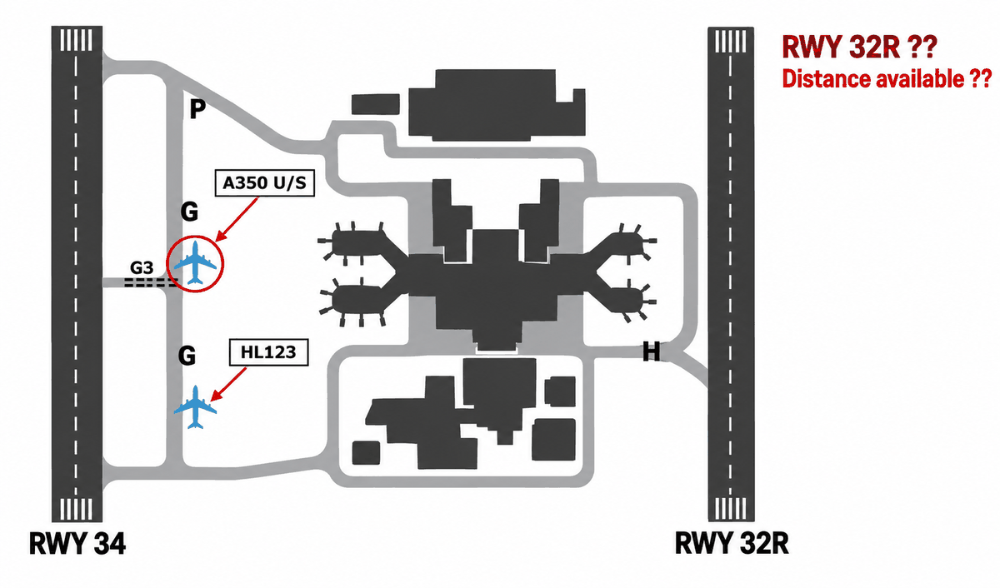
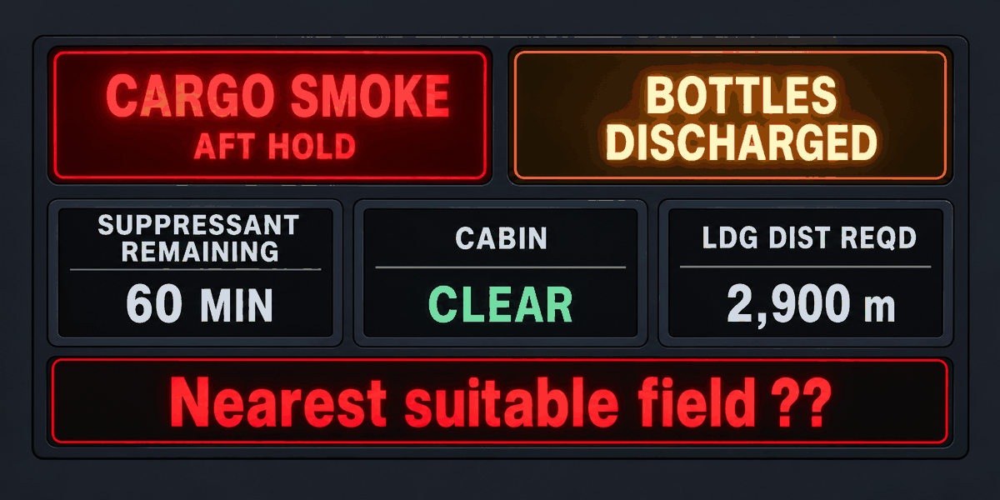

# EPTA 항공영어구술능력시험 조종사용 모의세트 EPTA_07 — 2026-10-29

안 내 메모 가능 / 문항당 1회 Say again 기능 사용 가능. 응시자 콜사인은 항상 **HL123**.

---

## Part Ⅰ TASK A. Readback and Hearback

✅ Directions : You will be listening to 4 ATC instructions. Your callsign will be HL123.
Listen carefully and make a correct readback for each of them. "Say again (=Repeat)"
available once only. You may take notes while listening.
  * Correct / Full readback : necessary for standard operating procedures
  * Response time for each question : 20 seconds or less

✅ 시험[응답] 요령

| 항목 | 내용 |
|---|---|
| 구성 | 4문항 / 문항 별 응대시간 : 20초 |
| 평가요소 | 기본적인 교신 능력 평가로 ATC의 지시사항에 맞게 표준교신용어로 readback |
| 진행 | 관제사 지시 → 응답녹음 |
| 평가항목 | 표준 교신속도/발음/억양의 사용 여부 · 필요한 정보의 효율적 전달 능력 평가 · 정확한 표준 교신용어의 사용 여부 · 관제 지시 후 교신 응대의 즉시성 여부 |
| 유의사항 | 올바른 readback : 운항절차에 필요한 필수 사항을 모두 포함한 readback · 필수사항은 아니지만 지시사항을 전체 readback 해도 감점되지 않음 |

**P1A-Q1** 🎙 20초
Ground : HL123, hold short of runway tree four, traffic landing.

Record your full readback.

[정답]

---

**P1A-Q2** 🎙 20초
Tower : HL123, after departure climb to flight level tree tree zero, report passing 5,000
feet.

Record your full readback.

[정답]

---

**P1A-Q3** 🎙 20초
🖥 [ TAMNA ]
Center : HL123, descend to flight level two four zero, cross TAMNA at or above one zero
thousand.

Record your full readback.

[정답]

---

**P1A-Q4** 🎙 20초
Approach : HL123, turn left heading tree one zero, cleared for the ILS runway tree four
approach.

Record your full readback.

[정답]

---

## Part Ⅰ TASK B. Checking, Clarifying, Confirming, Informing

✅ Directions : You will be listening to 6 audio clips, which consist of short situational
prompts. Respond to each of them using mainly Standard Phraseology if possible. If not,
you may use plain English to help clarify your response. "Say again (=Repeat)" available
only once. Your callsign is HL123. You may take notes while listening.
  * Response time for each question : 20 seconds or less

✅ 시험[응답] 요령

| 항목 | 내용 |
|---|---|
| 구성 | 6문항 / 문항 별 응대시간 : 20초 |
| 평가요소 | 기본적인 교신 능력 평가로 ATC의 지시사항에 맞게 표준교신용어로 readback |
| 진행 | 상황정보 제시 → 관제지시 → 응답녹음 |
| 평가항목 | Task B는 상황정보 이해력 및 해당 교신에 대한 적절한 응대력 평가 · 상황정보 및 ATC의 교신에 따라 플레인 영어 사용이 요구될 수 있음 |
| 유의사항 | 상황정보(prompt) 음성에는 교신용어가 플레인 영어(발음)로 들려질 수 있음. 필요 시 올바른 교신용어로 응답해야 함 |

**P1B-Q1** 🎙 20초
Your required landing distance today is 2,900 metres. Runway one six is 2,400 metres long
and the surface is wet. Listen to the controller, respond with a reason, and tell him what
you need instead.

Approach : HL123, are you able to accept runway one six?

Record your response.

[정답]

---

**P1B-Q2** 🎙 20초
Center cleared you to fly heading tree one zero. You had to turn left to heading two niner
zero to stay clear of a build-up, and you are still on that heading. Now ATC contacts you.
Respond accordingly.

Center : HL123, confirm maintaining heading tree one zero?

Record your response.

[정답]

---

**P1B-Q3** 🎙 20초
During your takeoff roll you saw a maintenance vehicle moving towards the runway from
taxiway Juliet. You were too busy to report it then. Departure now calls you. Acknowledge
the instruction, and report what you saw.

Departure : HL123, Gimpo Departure, radar contact, climb to flight level one five zero.

Record your response.

[정답]

---

**P1B-Q4** 🎙 20초
You have been in continuous light to moderate turbulence for the last 20 minutes. A
preceding aircraft has reported smooth air two levels above you. Contact Jeju Control.
Make a request with a reason.

Record your response.

[정답]

---

**P1B-Q5** 🎙 20초
🖥 [ SIMUN ]
At your present weight you cannot reach flight level tree eight zero. Listen to the
controller and respond accordingly.

Center : HL123, climb to flight level tree eight zero. If unable, maintain flight level
tree four zero until SIMUN.

Record your response.

[정답]

---

**P1B-Q6** 🎙 20초
🖥 [ Cheongju Approach / runway in use / wind check ]
Your arrival information says runway tree four is in use at Cheongju. On the way in you
have watched the wind back round to the south, and you think the runway may have changed.
Contact Cheongju Approach. Ask what you need to know, and make a request.

Record your response.

[정답]

---

## Part Ⅱ TASK A. Role-play & Follow-up

✅ Directions : In Part 2 Task A, you will be going through a couple of flight situations
of a normal passenger flight. Follow the prompts for providing your response, which you
will either hear or see on the screen, or the both. "Say again (=Repeat)" available once
only. Your callsign is HL123.

After finishing Task A Role play, you will be asked one or two follow-up questions. You
will have up to 90 seconds to respond to them.

✅ 시험[응답] 요령

| 항목 | 내용 |
|---|---|
| 구성 | 약 7~12회 롤 플레이 / 응대시간 : 30초, Follow up : 90초 |
| 평가요소 | 정상상황에서 기본 교신능력과 비정상 발생시 상황보고 또는 요구사항 전달 등에 필요한 언어 구사력(교신용어와 플레인 영어의 복합 사용) |
| 진행 | 연속적인 비행 단계 또는 복합적인 상황의 롤 플레이. Initial Situation → continued → Situation update → continued |
| 평가항목 | 음성 또는 화면에 제공되는 Text clue(🖥)를 이용하여 지시대로 응대하는 능력 · 상황정보 및 ATC의 교신에 따라 요구되는 플레인 영어 사용능력 · 표준 교신속도/발음/억양의 사용 여부 및 정보의 효율적 전달능력 평가 · 교신 응대력(Role-play)과 플레인 영어(Follow-up) 능력을 전체적으로 평가 |
| 유의사항 | 교신상황은 시간제한 및 언어평가 목적에 따라 '인위적'일 수 있고, 상황 전개의 '비약'이 인정되므로 지시사항에 맞게 응답해야 함 · 응답 직전 '약간의' 준비시간은 용인됨. 다만 '매우' 늦은 응답 또는 무응답은 영향을 미침 |

Initial Situation You are the pilot of HL123 at Gimpo Airport, ready to taxi for departure
to Cheongju. You have information Delta and runway tree four is in use. Your required
takeoff distance today is 2,900 metres. 🔔(dingdong)

**P2A-Q1** 🎙 30초
🖥 [ Gimpo Ground / information Delta ]
☞ Contact Gimpo Ground and request taxi.

[정답]

---

**P2A-Q2** 🎙 30초
☞ Listen to the ground controller, give a full readback, and acknowledge the delay.
Ground : HL123, Gimpo Ground, taxi to runway tree four via Papa and Golf, hold short of
Golf tree. There's an A350 unserviceable at the holding point ahead of you, so it may be a
while — I'll keep you posted.

[정답]

---

(Q3) 

**P2A-Q3** 🎙 30초
🖥 [ runway tree two right / takeoff distance available ]
☞ Listen to the ground controller and respond accordingly. Tell him what you need to know
before you decide.
Ground : HL123, I can offer you runway tree two right instead — you'd go via Hotel and be
number one. Do what you need to do.

[정답]

---

**P2A-Q4** 🎙 30초
☞ Listen to the ground controller, then state your decision with a reason.
Ground : HL123, runway tree two right has tree,200 metres available, and the surface is
dry.

[정답]

---

**P2A-Q5** 🎙 30초
☞ Listen to the ground controller and give a full readback.
Ground : HL123, taxi to runway tree two right via Hotel, hold short of Hotel two, contact
Gimpo Tower on 118.1.

[정답]

---

**P2A-Q6** 🎙 30초
☞ Listen to the tower and give a full readback.
Tower : HL123, Gimpo Tower, behind the departing Cessna Citation, line up and wait runway
tree two right.

[정답]

---

**P2A-Q7** 🎙 30초
☞ Listen to the tower and give a full readback.
Tower : HL123, cleared for takeoff runway tree two right, climb to 4,000 feet, report
passing 2,500 feet.

[정답]

---

Situation Update You are airborne and passing 2,500 feet, climbing to 4,000 feet.
🔔(dingdong)

**P2A-Q8** 🎙 30초
☞ Contact Gimpo Departure, report your passing altitude and request further climb.

[정답]

---

**P2A-Q9** 🎙 30초
🖥 [ direct SIMUN ]
☞ Listen to the controller, give your full readback, then tell him what you need to know
before you accept.
Departure : HL123, radar contact, climb to flight level two tree zero. I can give you
direct SIMUN if you want it — it'll cut the corner off your route. Up to you.

[정답]

---

**P2A-Q10** 🎙 30초
☞ Listen to the controller, state your decision with a reason, and make any request you
need.
Departure : HL123, direct SIMUN saves you about 40 track miles, but it takes you through an
area of moderate turbulence at your level.

[정답]

---

**P2A-Q11** 🎙 90초 (Follow-up)
Follow up question.

In this situation, Ground offered you a different runway while an aircraft ahead of you
was unserviceable. What did you need to know before you accepted it, and why? In your role
as a pilot, how do you decide whether a runway change is worth taking? Give an example of
a runway change you would turn down.

[정답]

---

## Part Ⅱ TASK B. Extended Role-play : Single Incident/Emergency Related

✅ Directions : You will be interacting with an Air traffic controller or Ground crew
based on short situational prompts. Follow the prompts and respond as necessary. Assume
you can accept all the instructions, unless being specified otherwise. "Say again
(=Repeat)" available only once. Your callsign is HL123.
  * Response time for each question : 30 seconds or less

✅ 시험[응답] 요령 ※ Task B의 교신내용이 Task C의 태스크와 연계되므로, 관련 정보의 메모가 필요

| 항목 | 내용 |
|---|---|
| 구성 | 약 7~12회 롤 플레이 / 응대시간 : 30초 |
| 평가요소 | 단일 상황에서 비정상/비상상황에서 문제를 해결과정에서의 상황보고 또는 의사전달능력 등에 필요한 언어 구사력(플레인 영어의 빈도가 높아짐) |
| 진행 | 비정상 또는 비상 상황이 포함된 '단일'사건의 롤 플레이. Initial Situation → continued → Situation update → continued |
| 평가항목 | 음성 또는 화면에 제공되는 Text clue(🖥)를 이용하여 지시대로 응대하는 능력 · 상황정보 및 ATC의 내용에 따라 요구되는 교신용어 또는 플레인 영어 사용 능력 · 표준 교신속도/발음/억양의 사용 여부 및 정보의 효율적 전달능력 평가 · 교신 응대력(Role-play)과 플레인 영어능력을 전체적으로 평가 |
| 유의사항 | 교신상황은 시간제한 및 언어평가 목적에 따라 '인위적'일 수 있고, 상황 전개의 '비약'이 인정되므로 지시사항에 맞게 응답해야 함 · 응답 직전 '약간의' 준비시간은 용인됨. 다만 '매우' 늦은 응답 또는 무응답은 영향을 미침 · 플레인 영어 사용 빈도가 다소 높을 수 있고, 응대 내용의 정확도 및 유창도에 따라 Operational(Level4)과 Extended(Level5) 여부가 평가됨 |

Initial Situation You are the pilot of HL123, descending through flight level one eight
zero for one one thousand, inbound to Cheongju Airport. You have information Hotel. Your
required landing distance is 2,900 metres. 🔔(dingdong)

**P2B-Q1** 🎙 30초
☞ Contact Cheongju Approach and report your position.

[정답]

---

**P2B-Q2** 🎙 30초
🖥 [ TAMNA ONE arrival / ILS runway tree four ]
☞ Listen to the controller and give a full readback.
Approach : HL123, Cheongju Approach, descend to 9,000 feet, reduce speed to two one zero
knots, expect the TAMNA ONE arrival, ILS runway tree four, Cheongju altimeter two niner
niner two.

[정답]

---

Situation Update Passing 12,000 feet you get a CARGO SMOKE warning for the aft hold. You
have discharged the fire bottles and the suppressant will last about 60 minutes. The cabin
is clear and the passengers are not affected. 🔔(dingdong)

(Q3) 

**P2B-Q3** 🎙 30초
☞ Declare an emergency, inform the controller of your situation, and request priority for
landing.

[정답]

---

**P2B-Q4** 🎙 30초
🖥 [ Yangyang / landing distance available ]
☞ Listen to the controller. Tell him what you need to know before you decide.
Approach : HL123, roger. Cheongju is two five minutes from you. Yangyang is only one two
minutes if you want to go there instead. What would you like?

[정답]

---

**P2B-Q5** 🎙 30초
☞ Listen to the controller, then state your decision with a reason.
Approach : HL123, Yangyang has 2,500 metres available. Cheongju has tree,600.

[정답]

---

**P2B-Q6** 🎙 30초
☞ Listen to the controller, give a full readback and say your intentions.
Approach : HL123, roger, turn right heading zero tree zero for vectors to the ILS, descend
to 5,000 feet. Say your intentions.

[정답]

---

**P2B-Q7** 🎙 30초
☞ Listen to the controller and provide both pieces of information.
Approach : HL123, two things — say your fuel endurance and the number of persons on board.

[정답]

---

Situation Update The smoke warning went out about tree minutes after you discharged the
bottles. You have 1 hour 25 minutes of fuel, and 172 passengers and 8 crew on board.
🔔(dingdong)

**P2B-Q8** 🎙 30초
☞ Listen to the controller, give him an update, answer his question, and say what you will
need on arrival.
Approach : HL123, the fire service wants to know — do you intend to evacuate on the runway,
or will you taxi clear?

[정답]

---

**P2B-Q9** 🎙 30초
☞ Listen to the controller and give a full readback.
Approach : HL123, descend to 2,500 feet until established, cleared for the ILS runway tree
four approach, contact Cheongju Tower on 119.2.

[정답]

---

## Part Ⅱ TASK C. Reporting about Task B

✅ Directions : You have just finished Part 2 Task B. Now you will be listening to the
ATC's radiotelephony messages to better recall the events. Afterwards, you will be
asked two questions about the situation. You will have 90 seconds for each question.

✅ 시험[응답] 요령

| 항목 | 내용 |
|---|---|
| 구성 | 2문항 / 응대시간 : 90초 |
| 평가요소 | Task B에서 수행한 롤 플레이 내용에 대한 리포팅(플레인 영어) 능력 |
| 진행 | TASK B의 ATC 교신 내용 다시 듣기 → 질문 → 응답하기 |
| 평가항목 | 구체적인 사건과 상황 전개의 내용을 묻는 질문(Q1)에 대한 사실전달 능력 · 사건에 대한 이해를 바탕으로 의견을 묻는 질문(Q2)에 대한 의견제시 능력 |
| 유의사항 | 제공시간을 최대한 활용하여 평가항목(유창성, 이해력, 어휘, 발음, 문장구조)에 대한 능력을 충분히 표현 · 경험 사례 또는 관련 지식/보도 등을 활용하여 플레인 영어능력을 최대로 발휘 |

☞ Now listen to the controller's radiotelephony messages.

ATC: HL123, Cheongju Approach, descend to 9,000 feet, reduce speed to two one zero knots,
expect the TAMNA ONE arrival, ILS runway tree four, Cheongju altimeter two niner niner two.
ATC: HL123, roger. Cheongju is two five minutes from you. Yangyang is only one two minutes
if you want to go there instead. What would you like?
ATC: HL123, Yangyang has 2,500 metres available. Cheongju has tree,600.
ATC: HL123, roger, turn right heading zero tree zero for vectors to the ILS, descend to
5,000 feet. Say your intentions.
ATC: HL123, two things — say your fuel endurance and the number of persons on board.
ATC: HL123, the fire service wants to know — do you intend to evacuate on the runway, or
will you taxi clear?
ATC: HL123, descend to 2,500 feet until established, cleared for the ILS runway tree four
approach, contact Cheongju Tower on 119.2. 🔔(dingdong)

☞ Now answer the questions.

**P2C-Q1** 🎙 90초
What happened to your aircraft (HL123)? Explain the nature of the incident.

[정답]

---

**P2C-Q2** 🎙 90초
How do you think the incident was handled by the air traffic controller? Do you feel the
situation could have been handled differently? Make a comment from a pilot's point of
view.

[정답]

---
