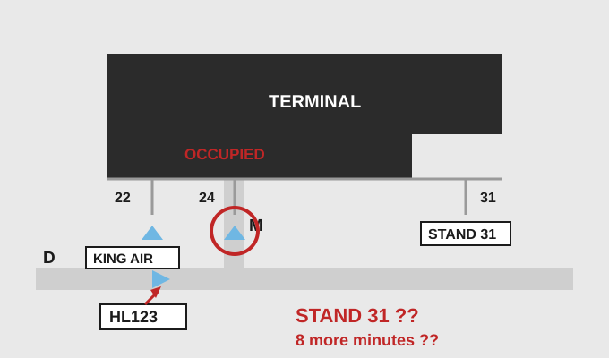
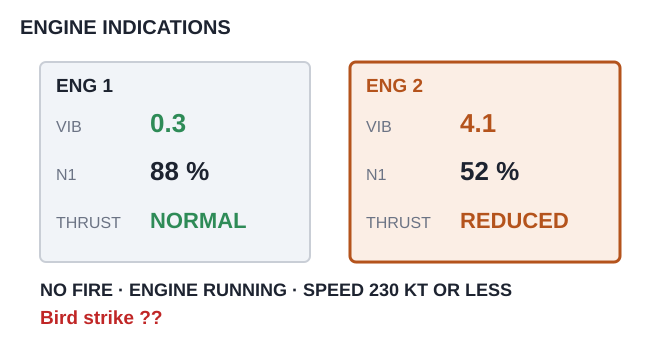

# EPTA 항공영어구술능력시험 조종사용 모의세트 EPTA_08 — 2026-10-31

안 내 메모 가능 / 문항당 1회 Say again 기능 사용 가능. 응시자 콜사인은 항상 **HL123**.

---

## Part Ⅰ TASK A. Readback and Hearback

✅ Directions : You will be listening to 4 ATC instructions. Your callsign will be HL123.
Listen carefully and make a correct readback for each of them. "Say again (=Repeat)"
available once only. You may take notes while listening.
  * Correct / Full readback : necessary for standard operating procedures
  * Response time for each question : 20 seconds or less

✅ 시험[응답] 요령

| 항목 | 내용 |
|---|---|
| 구성 | 4문항 / 문항 별 응대시간 : 20초 |
| 평가요소 | 기본적인 교신 능력 평가로 ATC의 지시사항에 맞게 표준교신용어로 readback |
| 진행 | 관제사 지시 → 응답녹음 |
| 평가항목 | 표준 교신속도/발음/억양의 사용 여부 · 필요한 정보의 효율적 전달 능력 평가 · 정확한 표준 교신용어의 사용 여부 · 관제 지시 후 교신 응대의 즉시성 여부 |
| 유의사항 | 올바른 readback : 운항절차에 필요한 필수 사항을 모두 포함한 readback · 필수사항은 아니지만 지시사항을 전체 readback 해도 감점되지 않음 |

**P1A-Q1** 🎙 20초
Ground : HL123, taxi straight ahead, caution jet blast.

Record your full readback.

[정답]

---

**P1A-Q2** 🎙 20초
Delivery : HL123, cleared to Oakport via the KEVNA TWO departure, BARSO transition, climb
to 5,000 feet, squawk 3471.

Record your full readback.

[정답]

---

**P1A-Q3** 🎙 20초
🖥 [ WYNTA ]
Center : HL123, climb to flight level 310, cross WYNTA at 220 knots or less.

Record your full readback.

[정답]

---

**P1A-Q4** 🎙 20초
Approach : HL123, descend to 3,000 feet until established, cleared for the ILS runway 15
approach.

Record your full readback.

[정답]

---

## Part Ⅰ TASK B. Checking, Clarifying, Confirming, Informing

✅ Directions : You will be listening to 6 audio clips, which consist of short situational
prompts. Respond to each of them using mainly Standard Phraseology if possible. If not,
you may use plain English to help clarify your response. "Say again (=Repeat)" available
only once. Your callsign is HL123. You may take notes while listening.
  * Response time for each question : 20 seconds or less

✅ 시험[응답] 요령

| 항목 | 내용 |
|---|---|
| 구성 | 6문항 / 문항 별 응대시간 : 20초 |
| 평가요소 | 기본적인 교신 능력 평가로 ATC의 지시사항에 맞게 표준교신용어로 readback |
| 진행 | 상황정보 제시 → 관제지시 → 응답녹음 |
| 평가항목 | Task B는 상황정보 이해력 및 해당 교신에 대한 적절한 응대력 평가 · 상황정보 및 ATC의 교신에 따라 플레인 영어 사용이 요구될 수 있음 |
| 유의사항 | 상황정보(prompt) 음성에는 교신용어가 플레인 영어(발음)로 들려질 수 있음. 필요 시 올바른 교신용어로 응답해야 함 |

**P1B-Q1** 🎙 20초
Your required takeoff distance today is 2,100 metres. Ground has told you that an
intersection departure from Golf 4 leaves 2,400 metres available. Listen to the
controller, respond with a reason, and tell him what distance you need.

Ground : HL123, are you able to accept an intersection departure from Golf 4?

Record your response.

[정답]

---

**P1B-Q2** 🎙 20초
Approach first told you to maintain 7,000 feet. A few minutes later the same controller
cleared you down to 5,000 feet, and you are level at 5,000 now. Now ATC contacts you.
Respond accordingly.

Approach : HL123, confirm maintaining 7,000 feet?

Record your response.

[정답]

---

**P1B-Q3** 🎙 20초
While in the cruise you saw what looked like a drone, about 2 miles away at your ten
o'clock and slightly below. You were dealing with a level change and did not report it.
Now ATC contacts you. Acknowledge the instruction, and report what you saw.

Center : HL123, Fenwick Control, radar contact, maintain flight level 330.

Record your response.

[정답]

---

**P1B-Q4** 🎙 20초
Your RNAV equipment is inoperative today and the aircraft is dispatched under the minimum
equipment list. Listen to the controller, respond with a reason, and tell him what you
need instead.

Approach : HL123, expect the RNAV runway 15 approach.

Record your response.

[정답]

---

**P1B-Q5** 🎙 20초
Approach told you to contact the next controller on 128.3. You set 128.5 by mistake and
heard nothing, so you have come back to the previous frequency. Now ATC contacts you.
Respond accordingly.

Approach : HL123, I have been calling you. Say the frequency you were given.

Record your response.

[정답]

---

**P1B-Q6** 🎙 20초
🖥 [ Marchfield Approach / WYNTA / expected further clearance ]
You are holding at WYNTA. You have 1 hour 10 minutes of fuel on board and your alternate
needs 25 minutes from here. Approach has just given you an expected further clearance time
of 20 minutes. Contact Marchfield Approach. Tell him whether you can accept that, and say
what your limit is.

Record your response.

[정답]

---

## Part Ⅱ TASK A. Role-play & Follow-up

✅ Directions : In Part 2 Task A, you will be going through a couple of flight situations
of a normal passenger flight. Follow the prompts for providing your response, which you
will either hear or see on the screen, or the both. "Say again (=Repeat)" available once
only. Your callsign is HL123.

After finishing Task A Role play, you will be asked one or two follow-up questions. You
will have up to 90 seconds to respond to them.

✅ 시험[응답] 요령

| 항목 | 내용 |
|---|---|
| 구성 | 약 7~12회 롤 플레이 / 응대시간 : 30초, Follow up : 90초 |
| 평가요소 | 정상상황에서 기본 교신능력과 비정상 발생시 상황보고 또는 요구사항 전달 등에 필요한 언어 구사력(교신용어와 플레인 영어의 복합 사용) |
| 진행 | 연속적인 비행 단계 또는 복합적인 상황의 롤 플레이. Initial Situation → continued → Situation update → continued |
| 평가항목 | 음성 또는 화면에 제공되는 Text clue(🖥)를 이용하여 지시대로 응대하는 능력 · 상황정보 및 ATC의 교신에 따라 요구되는 플레인 영어 사용능력 · 표준 교신속도/발음/억양의 사용 여부 및 정보의 효율적 전달능력 평가 · 교신 응대력(Role-play)과 플레인 영어(Follow-up) 능력을 전체적으로 평가 |
| 유의사항 | 교신상황은 시간제한 및 언어평가 목적에 따라 '인위적'일 수 있고, 상황 전개의 '비약'이 인정되므로 지시사항에 맞게 응답해야 함 · 응답 직전 '약간의' 준비시간은 용인됨. 다만 '매우' 늦은 응답 또는 무응답은 영향을 미침 |

Flight Paths
In this scenario, you'll be the pilot flying HL123, which goes through 2 flight stages:
Descent, Approach.

Initial Situation You are the pilot of HL123, level at flight level 290 and 90 miles from
DORLIN, inbound to Marchfield Airport. You have 1 hour 5 minutes of fuel on board.
🔔(dingdong)

**P2A-Q1** 🎙 30초
☞ Contact Fenwick Control, report your position and request descent.

[정답]

---

**P2A-Q2** 🎙 30초
🖥 [ DORLIN ONE arrival / ILS runway 15 ]
☞ Listen to the controller and give a full readback.
Center : HL123, Fenwick Control, descend to flight level 190, reduce speed to 280 knots,
expect the DORLIN ONE arrival, ILS runway 15, Marchfield altimeter 30.12.

[정답]

---

**P2A-Q3** 🎙 30초
🖥 [ DORLIN / Oakport ]
☞ Listen to the controller and respond accordingly. Tell him what you need to know before
you decide.
Approach : HL123, Marchfield Approach, they're clearing snow off runway 15 — it'll be
about 15 minutes. You can hold at DORLIN or go to Oakport, it's 30 minutes from you. Up to
you.

[정답]

---

**P2A-Q4** 🎙 30초
☞ Listen to the controller, state your decision with a reason, and tell him how much fuel
you have.
Approach : HL123, once they're done it'll be about 10 more minutes to touchdown from the
hold.

[정답]

---

**P2A-Q5** 🎙 30초
☞ Listen to the controller and give a full readback.
Approach : HL123, roger, hold at DORLIN, right turns, maintain flight level 190, expect
further clearance at one five.

[정답]

---

Situation Update The snow clearing is finished and you are leaving the hold.
🔔(dingdong)

**P2A-Q6** 🎙 30초
☞ Listen to the controller and give a full readback.
Approach : HL123, runway 15 is open, descend to 5,000 feet, turn left heading 120 for
vectors to the ILS.

[정답]

---

Situation Update You are established on the ILS for runway 15 and passing 2,200 feet.
🔔(dingdong)

**P2A-Q7** 🎙 30초
☞ Contact Marchfield Tower, report your position and intention.

[정답]

---

**P2A-Q8** 🎙 30초
☞ Listen to the tower, give a full readback, and tell him whether you can do that.
Tower : HL123, Marchfield Tower, wind 150 at 12, runway 15, cleared to land. Vacate via
Delta if you can, the A319 behind you is tight.

[정답]

---

**P2A-Q9** 🎙 30초
🖥 [ stand 24 / Delta / Mike ]
☞ Listen to the ground controller and give a full readback.
Ground : HL123, Marchfield Ground, taxi to stand 24 via Delta and Mike, give way to the
King Air coming out of stand 22.

[정답]

---

(Q10) 

**P2A-Q10** 🎙 30초
☞ Listen to the ground controller, state your decision with a reason, and make any request
you need.
Ground : HL123, I'm sorry about that — stand 24 is still occupied. I can give you stand
31, but it's a long taxi, another 8 minutes. What would you like?

[정답]

---

**P2A-Q11** 🎙 90초 (Follow-up)
You have just finished Task A, as the pilot of Hotel Lima one two three.

In this situation, Approach offered you a hold at DORLIN or a diversion to Oakport while
they cleared the snow. What did you need to know before you decided, and why? In your role
as a pilot, how do you decide whether to hold or divert? Give an example of a situation
where you would divert straight away rather than hold.

[정답]

---

## Part Ⅱ TASK B. Extended Role-play : Single Incident/Emergency Related

✅ Directions : You will be interacting with an Air traffic controller or Ground crew
based on short situational prompts. Follow the prompts and respond as necessary. Assume
you can accept all the instructions, unless being specified otherwise. "Say again
(=Repeat)" available only once. Your callsign is HL123.
  * Response time for each question : 30 seconds or less

✅ 시험[응답] 요령 ※ Task B의 교신내용이 Task C의 태스크와 연계되므로, 관련 정보의 메모가 필요

| 항목 | 내용 |
|---|---|
| 구성 | 약 7~12회 롤 플레이 / 응대시간 : 30초 |
| 평가요소 | 단일 상황에서 비정상/비상상황에서 문제를 해결과정에서의 상황보고 또는 의사전달능력 등에 필요한 언어 구사력(플레인 영어의 빈도가 높아짐) |
| 진행 | 비정상 또는 비상 상황이 포함된 '단일'사건의 롤 플레이. Initial Situation → continued → Situation update → continued |
| 평가항목 | 음성 또는 화면에 제공되는 Text clue(🖥)를 이용하여 지시대로 응대하는 능력 · 상황정보 및 ATC의 내용에 따라 요구되는 교신용어 또는 플레인 영어 사용 능력 · 표준 교신속도/발음/억양의 사용 여부 및 정보의 효율적 전달능력 평가 · 교신 응대력(Role-play)과 플레인 영어능력을 전체적으로 평가 |
| 유의사항 | 교신상황은 시간제한 및 언어평가 목적에 따라 '인위적'일 수 있고, 상황 전개의 '비약'이 인정되므로 지시사항에 맞게 응답해야 함 · 응답 직전 '약간의' 준비시간은 용인됨. 다만 '매우' 늦은 응답 또는 무응답은 영향을 미침 · 플레인 영어 사용 빈도가 다소 높을 수 있고, 응대 내용의 정확도 및 유창도에 따라 Operational(Level4)과 Extended(Level5) 여부가 평가됨 |

Initial Situation You are the pilot of HL123, level at flight level 240 and 80 miles from
BARSO, inbound to Oakport Airport. You have information Romeo. 🔔(dingdong)

**P2B-Q1** 🎙 30초
☞ Contact Oakport Approach and report your position.

[정답]

---

**P2B-Q2** 🎙 30초
🖥 [ BARSO ONE arrival / ILS runway 27 ]
☞ Listen to the controller and give a full readback.
Approach : HL123, Oakport Approach, descend to 10,000 feet, reduce speed to 250 knots,
expect the BARSO ONE arrival, ILS runway 27, Oakport altimeter 29.88.

[정답]

---

Situation Update Passing 15,000 feet you fly through a flock of birds. Engine number 2
starts vibrating heavily. You have reduced thrust on that engine and the vibration has
settled, but you must keep the speed at 230 knots or less and you cannot use full thrust
on it. There is no fire and the engine is still running. 🔔(dingdong)

(Q3) 

**P2B-Q3** 🎙 30초
☞ Inform the controller of your situation, tell him what you have done about it, and
request priority for landing.

[정답]

---

**P2B-Q4** 🎙 30초
☞ Listen to the controller, respond with a reason, and tell him both speeds.
Approach : HL123, roger. For spacing with the traffic ahead I need 210 knots or less. Can
you do that?

[정답]

---

**P2B-Q5** 🎙 30초
☞ Listen to the controller, give a full readback and say your intentions.
Approach : HL123, thank you. Turn left heading 300 for vectors to the ILS, descend to
6,000 feet. Say your intentions.

[정답]

---

**P2B-Q6** 🎙 30초
☞ Listen to the controller and provide both pieces of information.
Approach : HL123, two things — do you want the fire service, and will you need to shut
that engine down before landing?

[정답]

---

Situation Update The vibration has dropped further and engine number 2 is now running
normally at reduced thrust. 🔔(dingdong)

**P2B-Q7** 🎙 30초
☞ Listen to the controller, then state your decision with a reason.
Approach : HL123, the wind has backed — runway 09 now has a 10 knot headwind instead of a
tailwind on 27. Do you want to change?

[정답]

---

**P2B-Q8** 🎙 30초
☞ Contact the controller, give him an update on the engine, and say what you will need on
arrival.

[정답]

---

**P2B-Q9** 🎙 30초
☞ Listen to the controller and give a full readback.
Approach : HL123, descend to 2,000 feet until established, cleared for the ILS runway 09
approach, contact Oakport Tower on 120.9.

[정답]

---

## Part Ⅱ TASK C. Reporting about Task B

✅ Directions : You have just finished Part 2 Task B. Now you will be listening to the
ATC's radiotelephony messages to better recall the events. Afterwards, you will be
asked two questions about the situation. You will have 90 seconds for each question.

✅ 시험[응답] 요령

| 항목 | 내용 |
|---|---|
| 구성 | 2문항 / 응대시간 : 90초 |
| 평가요소 | Task B에서 수행한 롤 플레이 내용에 대한 리포팅(플레인 영어) 능력 |
| 진행 | TASK B의 ATC 교신 내용 다시 듣기 → 질문 → 응답하기 |
| 평가항목 | 구체적인 사건과 상황 전개의 내용을 묻는 질문(Q1)에 대한 사실전달 능력 · 사건에 대한 이해를 바탕으로 의견을 묻는 질문(Q2)에 대한 의견제시 능력 |
| 유의사항 | 제공시간을 최대한 활용하여 평가항목(유창성, 이해력, 어휘, 발음, 문장구조)에 대한 능력을 충분히 표현 · 경험 사례 또는 관련 지식/보도 등을 활용하여 플레인 영어능력을 최대로 발휘 |

☞ Now listen to the controller's radiotelephony messages.

ATC: HL123, Oakport Approach, descend to 10,000 feet, reduce speed to 250 knots, expect
the BARSO ONE arrival, ILS runway 27, Oakport altimeter 29.88.
ATC: HL123, roger. For spacing with the traffic ahead I need 210 knots or less. Can you do
that?
ATC: HL123, thank you. Turn left heading 300 for vectors to the ILS, descend to 6,000
feet. Say your intentions.
ATC: HL123, two things — do you want the fire service, and will you need to shut that
engine down before landing?
ATC: HL123, the wind has backed — runway 09 now has a 10 knot headwind instead of a
tailwind on 27. Do you want to change?
ATC: HL123, descend to 2,000 feet until established, cleared for the ILS runway 09
approach, contact Oakport Tower on 120.9. 🔔(dingdong)

☞ Now answer the questions.

**P2C-Q1** 🎙 90초
What happened to your aircraft (HL123)? Explain the nature of the incident.

[정답]

---

**P2C-Q2** 🎙 90초
How do you think the incident was handled by the air traffic controller? Do you feel the
situation could have been handled differently? Make a comment from a pilot's point of
view.

[정답]

---
