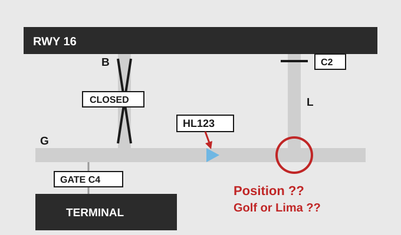
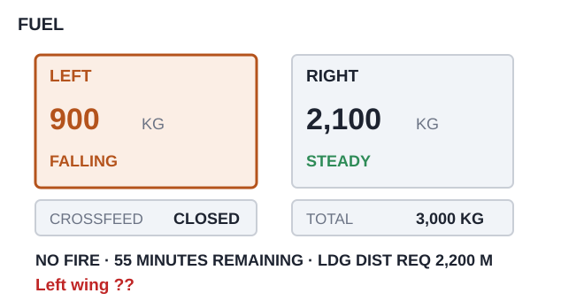

# EPTA 항공영어구술능력시험 조종사용 모의세트 EPTA_09 — 2026-11-02

안 내 메모 가능 / 문항당 1회 Say again 기능 사용 가능. 응시자 콜사인은 항상 **HL123**.

---

## Part Ⅰ TASK A. Readback and Hearback

✅ Directions : You will be listening to 4 ATC instructions. Your callsign will be HL123.
Listen carefully and make a correct readback for each of them. "Say again (=Repeat)"
available once only. You may take notes while listening.
  * Correct / Full readback : necessary for standard operating procedures
  * Response time for each question : 20 seconds or less

✅ 시험[응답] 요령

| 항목 | 내용 |
|---|---|
| 구성 | 4문항 / 문항 별 응대시간 : 20초 |
| 평가요소 | 기본적인 교신 능력 평가로 ATC의 지시사항에 맞게 표준교신용어로 readback |
| 진행 | 관제사 지시 → 응답녹음 |
| 평가항목 | 표준 교신속도/발음/억양의 사용 여부 · 필요한 정보의 효율적 전달 능력 평가 · 정확한 표준 교신용어의 사용 여부 · 관제 지시 후 교신 응대의 즉시성 여부 |
| 유의사항 | 올바른 readback : 운항절차에 필요한 필수 사항을 모두 포함한 readback · 필수사항은 아니지만 지시사항을 전체 readback 해도 감점되지 않음 |

**P1A-Q1** 🎙 20초
Tower : HL123, line up and wait runway 16, number two for departure.

Record your full readback.

[정답]

---

**P1A-Q2** 🎙 20초
Tower : HL123, after departure turn left heading 130, climb to 11,000 feet, contact
Departure on 125.75.

Record your full readback.

[정답]

---

**P1A-Q3** 🎙 20초
🖥 [ BRIMO ]
Center : HL123, when 30 miles from BRIMO descend to 10,000 feet, reduce speed to 250
knots.

Record your full readback.

[정답]

---

**P1A-Q4** 🎙 20초
Approach : HL123, descend to 2,500 feet, cleared for the ILS runway 16 approach, report
established.

Record your full readback.

[정답]

---

## Part Ⅰ TASK B. Checking, Clarifying, Confirming, Informing

✅ Directions : You will be listening to 6 audio clips, which consist of short situational
prompts. Respond to each of them using mainly Standard Phraseology if possible. If not,
you may use plain English to help clarify your response. "Say again (=Repeat)" available
only once. Your callsign is HL123. You may take notes while listening.
  * Response time for each question : 20 seconds or less

✅ 시험[응답] 요령

| 항목 | 내용 |
|---|---|
| 구성 | 6문항 / 문항 별 응대시간 : 20초 |
| 평가요소 | 기본적인 교신 능력 평가로 ATC의 지시사항에 맞게 표준교신용어로 readback |
| 진행 | 상황정보 제시 → 관제지시 → 응답녹음 |
| 평가항목 | Task B는 상황정보 이해력 및 해당 교신에 대한 적절한 응대력 평가 · 상황정보 및 ATC의 교신에 따라 플레인 영어 사용이 요구될 수 있음 |
| 유의사항 | 상황정보(prompt) 음성에는 교신용어가 플레인 영어(발음)로 들려질 수 있음. 필요 시 올바른 교신용어로 응답해야 함 |

**P1B-Q1** 🎙 20초
Your company minimum for a visual approach is 5,000 metres visibility and a 2,500 foot
cloud base. The latest report gives 8,000 metres and a cloud base of 4,000 feet. Listen to
the controller, respond with a reason, and tell him both the reported visibility and the
figure your company requires.

Approach : HL123, are you able to accept a visual approach to runway 21?

Record your response.

[정답]

---

**P1B-Q2** 🎙 20초
Earlier the controller told you to maintain 250 knots. Ten minutes later the same
controller said "no speed restriction, resume normal speed", and you have been at 300
knots since then. Now ATC contacts you. Respond accordingly.

Center : HL123, confirm maintaining 250 knots?

Record your response.

[정답]

---

**P1B-Q3** 🎙 20초
While descending through 7,000 feet you lost about 15 knots of airspeed very suddenly and
the aircraft sank. It lasted a few seconds, you were hand-flying, and you did not say
anything about it at the time. You are now level at 5,000 feet. Acknowledge the
instruction, and report what you met on the way down.

Approach : HL123, turn right heading 240 for vectors to the ILS.

Record your response.

[정답]

---

**P1B-Q4** 🎙 20초
Approach gave you the altimeter as 29.78. You set 29.87 by mistake and have only just
noticed it. You are level at 6,000 feet indicated. Now ATC contacts you. Respond
accordingly.

Approach : HL123, say your altitude.

Record your response.

[정답]

---

**P1B-Q5** 🎙 20초
You are in continuous moderate turbulence at flight level 330. Your turbulence penetration
speed is 280 knots and you are at 280 knots now. Listen to the controller, respond with a
reason, and tell him both speeds.

Center : HL123, increase speed to 320 knots for spacing with the traffic behind you.

Record your response.

[정답]

---

**P1B-Q6** 🎙 20초
🖥 [ Weyland Departure / transition altitude ]
You are climbing out of Weyland. Your charts show the transition altitude as 10,000 feet,
but the departure briefing sheet says 18,000 feet, and the two do not agree. You are now
passing 9,000 feet. Contact Weyland Departure. Make a confirmation and say what you have.

Record your response.

[정답]

---

## Part Ⅱ TASK A. Role-play & Follow-up

✅ Directions : In Part 2 Task A, you will be going through a couple of flight situations
of a normal passenger flight. Follow the prompts for providing your response, which you
will either hear or see on the screen, or the both. "Say again (=Repeat)" available once
only. Your callsign is HL123.

After finishing Task A Role play, you will be asked one or two follow-up questions. You
will have up to 90 seconds to respond to them.

✅ 시험[응답] 요령

| 항목 | 내용 |
|---|---|
| 구성 | 약 7~12회 롤 플레이 / 응대시간 : 30초, Follow up : 90초 |
| 평가요소 | 정상상황에서 기본 교신능력과 비정상 발생시 상황보고 또는 요구사항 전달 등에 필요한 언어 구사력(교신용어와 플레인 영어의 복합 사용) |
| 진행 | 연속적인 비행 단계 또는 복합적인 상황의 롤 플레이. Initial Situation → continued → Situation update → continued |
| 평가항목 | 음성 또는 화면에 제공되는 Text clue(🖥)를 이용하여 지시대로 응대하는 능력 · 상황정보 및 ATC의 교신에 따라 요구되는 플레인 영어 사용능력 · 표준 교신속도/발음/억양의 사용 여부 및 정보의 효율적 전달능력 평가 · 교신 응대력(Role-play)과 플레인 영어(Follow-up) 능력을 전체적으로 평가 |
| 유의사항 | 교신상황은 시간제한 및 언어평가 목적에 따라 '인위적'일 수 있고, 상황 전개의 '비약'이 인정되므로 지시사항에 맞게 응답해야 함 · 응답 직전 '약간의' 준비시간은 용인됨. 다만 '매우' 늦은 응답 또는 무응답은 영향을 미침 |

Flight Paths
In this scenario, you'll be the pilot flying HL123, which goes through 3 flight stages:
Taxi, Departure, Climb.

Initial Situation You are the pilot of HL123 at Gate Charlie 4 at Weyland Airport, ready
for departure to Ferndale Airport. You have 3 hours 10 minutes of fuel on board and the
flight plan says 2 hours 20 minutes to Ferndale. 🔔(dingdong)

**P2A-Q1** 🎙 30초
🖥 [ Weyland Delivery / Ferndale / TULAN TWO departure ]
☞ Contact Weyland Delivery and request your ATC clearance.

[정답]

---

**P2A-Q2** 🎙 30초
🖥 [ TULAN TWO departure / BRIMO transition ]
☞ Listen to the controller and give a full readback.
Delivery : HL123, cleared to Ferndale via the TULAN TWO departure, BRIMO transition, climb
to 7,000 feet, squawk 2514.

[정답]

---

**P2A-Q3** 🎙 30초
☞ Listen to the ground controller, give a full readback, and acknowledge the delay.
Ground : HL123, Weyland Ground, taxi to holding point Charlie 2 via Golf and Lima.
Bravo's closed for resurfacing, so it's the long way round — about 8 extra minutes. Sorry
about that.

[정답]

---

(Q4) 

**P2A-Q4** 🎙 30초
🖥 [ Golf / Lima / Charlie 2 ]
☞ Listen to the ground controller, report your position from the picture, and say which
holding point you are taxiing to.
Ground : HL123, say your position — are you on Golf now, or have you already turned onto
Lima?

[정답]

---

**P2A-Q5** 🎙 30초
☞ Listen to the tower and give a full readback.
Tower : HL123, Weyland Tower, behind the departing Boeing 777, line up and wait runway 16,
wind 140 at 8.

[정답]

---

Situation Update You are airborne from runway 16 and now passing 3,000 feet for 7,000
feet. 🔔(dingdong)

**P2A-Q6** 🎙 30초
☞ Make an initial contact with Weyland Departure and report your passing altitude.

[정답]

---

Situation Update Passing 12,000 feet a fuel imbalance warning comes up — the right tank
has 900 kilos more than the left. The checklist tells you to open the crossfeed and to
stop the climb at flight level 250 until the imbalance is corrected, which takes about 25
minutes. Your flight plan cruise level is flight level 370. 🔔(dingdong)

**P2A-Q7** 🎙 30초
☞ Listen to the controller, respond with a reason, and tell him both levels.
Center : HL123, Ridgeway Control, climb to flight level 370.

[정답]

---

**P2A-Q8** 🎙 30초
☞ Listen to the controller and answer both parts of his question.
Center : HL123, say again — what level can you accept, and how long do you need?

[정답]

---

**P2A-Q9** 🎙 30초
🖥 [ Ferndale / Crestview ]
☞ Listen to the controller, state your decision with a reason, and tell him both fuel
figures.
Center : HL123, at flight level 250 your fuel burn will be higher — the company flight
plan now gives 2 hours 45 minutes to Ferndale from here. Crestview is 40 minutes away if
you'd rather. I'll leave that with you.

[정답]

---

**P2A-Q10** 🎙 30초
🖥 [ BRIMO ]
☞ Listen to the controller and give a full readback.
Center : HL123, roger, maintain flight level 250, cleared direct BRIMO, contact Ridgeway
Control on 133.45 in 10 minutes.

[정답]

---

**P2A-Q11** 🎙 90초 (Follow-up)
You have just finished Task A, as the pilot of Hotel Lima one two three.

In this situation, Ridgeway Control offered you Crestview but you continued to Ferndale at
flight level 250. What did you compare before you decided, and why? In your role as a
pilot, how do you work out whether you still have enough fuel when you are held down at a
lower cruise level? Give an example of a situation where you would divert rather than
continue.

[정답]

---

## Part Ⅱ TASK B. Extended Role-play : Single Incident/Emergency Related

✅ Directions : You will be interacting with an Air traffic controller or Ground crew
based on short situational prompts. Follow the prompts and respond as necessary. Assume
you can accept all the instructions, unless being specified otherwise. "Say again
(=Repeat)" available only once. Your callsign is HL123.
  * Response time for each question : 30 seconds or less

✅ 시험[응답] 요령 ※ Task B의 교신내용이 Task C의 태스크와 연계되므로, 관련 정보의 메모가 필요

| 항목 | 내용 |
|---|---|
| 구성 | 약 7~12회 롤 플레이 / 응대시간 : 30초 |
| 평가요소 | 단일 상황에서 비정상/비상상황에서 문제를 해결과정에서의 상황보고 또는 의사전달능력 등에 필요한 언어 구사력(플레인 영어의 빈도가 높아짐) |
| 진행 | 비정상 또는 비상 상황이 포함된 '단일'사건의 롤 플레이. Initial Situation → continued → Situation update → continued |
| 평가항목 | 음성 또는 화면에 제공되는 Text clue(🖥)를 이용하여 지시대로 응대하는 능력 · 상황정보 및 ATC의 내용에 따라 요구되는 교신용어 또는 플레인 영어 사용 능력 · 표준 교신속도/발음/억양의 사용 여부 및 정보의 효율적 전달능력 평가 · 교신 응대력(Role-play)과 플레인 영어능력을 전체적으로 평가 |
| 유의사항 | 교신상황은 시간제한 및 언어평가 목적에 따라 '인위적'일 수 있고, 상황 전개의 '비약'이 인정되므로 지시사항에 맞게 응답해야 함 · 응답 직전 '약간의' 준비시간은 용인됨. 다만 '매우' 늦은 응답 또는 무응답은 영향을 미침 · 플레인 영어 사용 빈도가 다소 높을 수 있고, 응대 내용의 정확도 및 유창도에 따라 Operational(Level4)과 Extended(Level5) 여부가 평가됨 |

Initial Situation You are the pilot of HL123, level at flight level 260 and 70 miles from
ORVIL, inbound to Norgate Airport. You have 1 hour 40 minutes of fuel on board and you
have information Tango. 🔔(dingdong)

**P2B-Q1** 🎙 30초
☞ Contact Norgate Approach and report your position.

[정답]

---

**P2B-Q2** 🎙 30초
🖥 [ ORVIL ONE arrival / ILS runway 21 ]
☞ Listen to the controller and give a full readback.
Approach : HL123, Norgate Approach, descend to 10,000 feet, reduce speed to 250 knots,
expect the ORVIL ONE arrival, ILS runway 21, Norgate altimeter 29.92.

[정답]

---

Situation Update Passing 14,000 feet the fuel quantity on the left side starts dropping
much faster than the right. You have a fuel leak from the left wing. You have closed the
crossfeed, so the leak is now taking fuel only from the left tank. You have 55 minutes of
fuel left and your landing distance required is 2,200 metres. There is no fire.
🔔(dingdong)

(Q3) 

**P2B-Q3** 🎙 30초
☞ Inform the controller of your situation, tell him what you have done about it, and
request priority for landing.

[정답]

---

**P2B-Q4** 🎙 30초
☞ Listen to the controller, respond with a reason, and tell him both figures — how long
you can stay up and how long he needs.
Approach : HL123, roger. I have one aircraft ahead of you — if I vector you round behind
him it's 20 minutes to touchdown. Can you take that?

[정답]

---

**P2B-Q5** 🎙 30초
☞ Listen to the controller and answer both parts of his question.
Approach : HL123, say again — how many minutes of fuel do you have, and how many do you
need?

[정답]

---

**P2B-Q6** 🎙 30초
☞ Listen to the controller, give a full readback and say your intentions.
Approach : HL123, understood. Turn right heading 310 for vectors to the ILS, descend to
6,000 feet. Say your intentions.

[정답]

---

**P2B-Q7** 🎙 30초
☞ Listen to the controller and answer both of his questions.
Approach : HL123, two things — do you want the fire service standing by, and is there any
smoke or fire?

[정답]

---

Situation Update The leak has stopped. The fuel quantity on the left side is steady now
and you have 45 minutes of fuel on board. 🔔(dingdong)

**P2B-Q8** 🎙 30초
🖥 [ runway 21 / runway 03 ]
☞ Listen to the controller, state your decision with a reason, and tell him both
distances.
Approach : HL123, the aircraft ahead has gone around, so runway 21 will be blocked for
about 6 minutes. Runway 03 is open now, but it's only 2,000 metres. What do you want?

[정답]

---

**P2B-Q9** 🎙 30초
☞ Listen to the controller and give a full readback.
Approach : HL123, descend to 2,000 feet until established, cleared for the ILS runway 21
approach, contact Norgate Tower on 118.35.

[정답]

---

## Part Ⅱ TASK C. Reporting about Task B

✅ Directions : You have just finished Part 2 Task B. Now you will be listening to the
ATC's radiotelephony messages to better recall the events. Afterwards, you will be
asked two questions about the situation. You will have 90 seconds for each question.

✅ 시험[응답] 요령

| 항목 | 내용 |
|---|---|
| 구성 | 2문항 / 응대시간 : 90초 |
| 평가요소 | Task B에서 수행한 롤 플레이 내용에 대한 리포팅(플레인 영어) 능력 |
| 진행 | TASK B의 ATC 교신 내용 다시 듣기 → 질문 → 응답하기 |
| 평가항목 | 구체적인 사건과 상황 전개의 내용을 묻는 질문(Q1)에 대한 사실전달 능력 · 사건에 대한 이해를 바탕으로 의견을 묻는 질문(Q2)에 대한 의견제시 능력 |
| 유의사항 | 제공시간을 최대한 활용하여 평가항목(유창성, 이해력, 어휘, 발음, 문장구조)에 대한 능력을 충분히 표현 · 경험 사례 또는 관련 지식/보도 등을 활용하여 플레인 영어능력을 최대로 발휘 |

☞ Now listen to the controller's radiotelephony messages.

ATC: HL123, Norgate Approach, descend to 10,000 feet, reduce speed to 250 knots, expect
the ORVIL ONE arrival, ILS runway 21, Norgate altimeter 29.92.
ATC: HL123, roger. I have one aircraft ahead of you — if I vector you round behind him
it's 20 minutes to touchdown. Can you take that?
ATC: HL123, say again — how many minutes of fuel do you have, and how many do you need?
ATC: HL123, understood. Turn right heading 310 for vectors to the ILS, descend to 6,000
feet. Say your intentions.
ATC: HL123, two things — do you want the fire service standing by, and is there any smoke
or fire?
ATC: HL123, the aircraft ahead has gone around, so runway 21 will be blocked for about 6
minutes. Runway 03 is open now, but it's only 2,000 metres. What do you want?
ATC: HL123, descend to 2,000 feet until established, cleared for the ILS runway 21
approach, contact Norgate Tower on 118.35. 🔔(dingdong)

☞ Now answer the questions.

**P2C-Q1** 🎙 90초
What happened to your aircraft (HL123)? Explain the nature of the incident.

[정답]

---

**P2C-Q2** 🎙 90초
How do you think the incident was handled by the air traffic controller? Do you feel the
situation could have been handled differently? Make a comment from a pilot's point of
view.

[정답]

---
