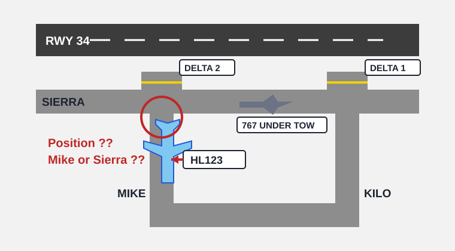
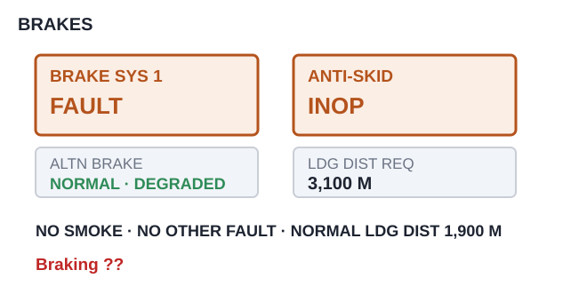

# EPTA 항공영어구술능력시험 조종사용 모의세트 EPTA_10 — 2026-11-02

안 내 메모 가능 / 문항당 1회 Say again 기능 사용 가능. 응시자 콜사인은 항상 **HL123**.

---

## Part Ⅰ TASK A. Readback and Hearback

✅ Directions : You will be listening to 4 ATC instructions. Your callsign will be HL123.
Listen carefully and make a correct readback for each of them. "Say again (=Repeat)"
available once only. You may take notes while listening.
  * Correct / Full readback : necessary for standard operating procedures
  * Response time for each question : 20 seconds or less

✅ 시험[응답] 요령

| 항목 | 내용 |
|---|---|
| 구성 | 4문항 / 문항 별 응대시간 : 20초 |
| 평가요소 | 기본적인 교신 능력 평가로 ATC의 지시사항에 맞게 표준교신용어로 readback |
| 진행 | 관제사 지시 → 응답녹음 |
| 평가항목 | 표준 교신속도/발음/억양의 사용 여부 · 필요한 정보의 효율적 전달 능력 평가 · 정확한 표준 교신용어의 사용 여부 · 관제 지시 후 교신 응대의 즉시성 여부 |
| 유의사항 | 올바른 readback : 운항절차에 필요한 필수 사항을 모두 포함한 readback · 필수사항은 아니지만 지시사항을 전체 readback 해도 감점되지 않음 |

**P1A-Q1** 🎙 20초
Delivery : HL123, squawk 4162, ident.

Record your full readback.

[정답]

---

**P1A-Q2** 🎙 20초
🖥 [ MIRYA TWO departure, HARAN ]
Delivery : HL123, cleared to Pohang via MIRYA TWO departure, HARAN transition, climb to
5,000 feet, departure runway tree four.

Record your full readback.

[정답]

---

**P1A-Q3** 🎙 20초
Center : HL123, climb to flight level tree tree zero, maintain two eight zero knots until
level.

Record your full readback.

[정답]

---

**P1A-Q4** 🎙 20초
Approach : HL123, descend to 2,500 feet, cleared for the ILS runway one niner approach,
braking action reported good.

Record your full readback.

[정답]

---

## Part Ⅰ TASK B. Checking, Clarifying, Confirming, Informing

✅ Directions : You will be listening to 6 audio clips, which consist of short situational
prompts. Respond to each of them using mainly Standard Phraseology if possible. If not,
you may use plain English to help clarify your response. "Say again (=Repeat)" available
only once. Your callsign is HL123. You may take notes while listening.
  * Response time for each question : 20 seconds or less

✅ 시험[응답] 요령

| 항목 | 내용 |
|---|---|
| 구성 | 6문항 / 문항 별 응대시간 : 20초 |
| 평가요소 | 기본적인 교신 능력 평가로 ATC의 지시사항에 맞게 표준교신용어로 readback |
| 진행 | 상황정보 제시 → 관제지시 → 응답녹음 |
| 평가항목 | Task B는 상황정보 이해력 및 해당 교신에 대한 적절한 응대력 평가 · 상황정보 및 ATC의 교신에 따라 플레인 영어 사용이 요구될 수 있음 |
| 유의사항 | 상황정보(prompt) 음성에는 교신용어가 플레인 영어(발음)로 들려질 수 있음. 필요 시 올바른 교신용어로 응답해야 함 |

**P1B-Q1** 🎙 20초
After departure Tower cleared you to fly runway heading. At 2,000 feet you had to turn
right to zero four zero to stay clear of a build-up, and you are still on that heading.
You have not been able to tell anyone yet. Listen to the controller and respond
accordingly with a reason.

Departure : HL123, confirm maintaining runway heading?

Record your response.

[정답]

---

**P1B-Q2** 🎙 20초
Your crosswind limit on a wet runway is two five knots, and the runway is wet today.
Listen to the tower, respond accordingly, and tell him your limit.

Tower : HL123, crosswind on runway one four is one eight knots. Are you able to accept
runway one four?

Record your response.

[정답]

---

**P1B-Q3** 🎙 20초
🖥 [ Gangneung Control / request with a reason / present level ]
You have been in light icing at flight level one six zero for the last one five minutes
and your anti-ice has been on the whole time. A level change would take you out of it.
Contact Gangneung Control. Make a request with a reason, and tell him your present level.

Record your response.

[정답]

---

**P1B-Q4** 🎙 20초
While you were taxiing you saw a large piece of rubber lying on taxiway Sierra, but you
were busy with the checklist and did not report it. Tower now calls you. Give a full
readback, and report what you saw.

Tower : HL123, cleared for takeoff runway tree four, wind tree 50 at 6.

Record your response.

[정답]

---

**P1B-Q5** 🎙 20초
You are heavy today. The best rate of descent you can give without exceeding your speed
limit is 1,500 feet per minute. Listen to the controller, respond with a reason, and tell
him what you can do.

Approach : HL123, I need 2,500 feet per minute or better for descending traffic. Can you
do that?

Record your response.

[정답]

---

**P1B-Q6** 🎙 20초
The arrival information you have says runway one niner is in use. The approach controller
has just cleared the aircraft ahead of you for an approach to runway zero one, and you
heard it on the frequency. You are not sure which runway you will get. Contact approach.
Make a confirmation and clarify your intention.

Record your response.

[정답]

---

## Part Ⅱ TASK A. Role-play & Follow-up

✅ Directions : In Part 2 Task A, you will be going through a couple of flight situations
of a normal passenger flight. Follow the prompts for providing your response, which you
will either hear or see on the screen, or the both. "Say again (=Repeat)" available once
only. Your callsign is HL123.

After finishing Task A Role play, you will be asked one or two follow-up questions. You
will have up to 90 seconds to respond to them.

✅ 시험[응답] 요령

| 항목 | 내용 |
|---|---|
| 구성 | 약 7~12회 롤 플레이 / 응대시간 : 30초, Follow up : 90초 |
| 평가요소 | 정상상황에서 기본 교신능력과 비정상 발생시 상황보고 또는 요구사항 전달 등에 필요한 언어 구사력(교신용어와 플레인 영어의 복합 사용) |
| 진행 | 연속적인 비행 단계 또는 복합적인 상황의 롤 플레이. Initial Situation → continued → Situation update → continued |
| 평가항목 | 음성 또는 화면에 제공되는 Text clue(🖥)를 이용하여 지시대로 응대하는 능력 · 상황정보 및 ATC의 교신에 따라 요구되는 플레인 영어 사용능력 · 표준 교신속도/발음/억양의 사용 여부 및 정보의 효율적 전달능력 평가 · 교신 응대력(Role-play)과 플레인 영어(Follow-up) 능력을 전체적으로 평가 |
| 유의사항 | 교신상황은 시간제한 및 언어평가 목적에 따라 '인위적'일 수 있고, 상황 전개의 '비약'이 인정되므로 지시사항에 맞게 응답해야 함 · 응답 직전 '약간의' 준비시간은 용인됨. 다만 '매우' 늦은 응답 또는 무응답은 영향을 미침 |

Initial Situation You are the pilot of HL123 at Gwangju Airport, ready to start for Ulsan.
You have information Hotel and runway tree four is in use. Your required takeoff distance
today is 2,600 metres, and your slot time out of Gwangju is 0640Z. It is now 0612Z.
🔔(dingdong)

**P2A-Q1** 🎙 30초
🖥 [ Gwangju Delivery / information Hotel ]
☞ Contact Gwangju Delivery, request your ATC clearance, and advise that you are ready to
start.

[정답]

---

**P2A-Q2** 🎙 30초
🖥 [ NAKDO TWO departure ]
☞ Listen to the delivery controller and give a full readback.
Delivery : HL123, Gwangju Delivery, cleared to Ulsan as filed, NAKDO TWO departure, climb
to 5,000 feet, squawk 2607. Start up approved.

[정답]

---

**P2A-Q3** 🎙 30초
☞ Listen to the ground controller, give a full readback, and inquire how long it will
take.
Ground : HL123, Gwangju Ground, taxi to holding point Delta two via Mike and Sierra.
There's a Boeing 767 under tow crossing Sierra ahead of you, so you may be stopped for a few
minutes — I'll keep you posted.

[정답]

---

Situation Update You have stopped on Mike, just short of Sierra. The Boeing 767 under tow is
still on Sierra in front of you. 🔔(dingdong)

(Q4) 

**P2A-Q4** 🎙 30초
🖥 [ Mike / Sierra / Delta two ]
☞ Listen to the ground controller, respond accordingly, and report your position.
Ground : HL123, are you holding short of Sierra now, or are you still back on Mike?

[정답]

---

**P2A-Q5** 🎙 30초
☞ Listen to the ground controller, state your decision with a reason, and tell him the
figure you need.
Ground : HL123, I can send you round via Kilo to Delta one and you'd be moving in about
five minutes, but you'd only have 2,400 metres from there. Or you wait eight minutes for
Sierra. Up to you.

[정답]

---

**P2A-Q6** 🎙 30초
☞ Listen to the ground controller and give a full readback.
Ground : HL123, the tow is clear. Taxi to holding point Delta two via Sierra, contact
Gwangju Tower on 122.2 when ready.

[정답]

---

**P2A-Q7** 🎙 30초
☞ Listen to the tower and give a full readback.
Tower : HL123, Gwangju Tower, behind the landing A320, line up and wait runway tree four.

[정답]

---

Situation Update It is now 0637Z and you are number one at holding point Delta two.
🔔(dingdong)

**P2A-Q8** 🎙 30초
☞ Listen to the tower and provide both pieces of information.
Tower : HL123, I've lost your slot time — say it again for me, and tell me whether you can
be airborne in the next tree minutes.

[정답]

---

**P2A-Q9** 🎙 30초
☞ Listen to the tower and give a full readback.
Tower : HL123, cleared for takeoff runway tree four, after departure climb to 5,000 feet,
report passing tree thousand.

[정답]

---

Situation Update You are airborne and passing tree thousand feet, climbing to 5,000 feet.
🔔(dingdong)

**P2A-Q10** 🎙 30초
☞ Contact Gwangju Departure, report your passing altitude, and request further climb.

[정답]

---

**P2A-Q11** 🎙 90초 (Follow-up)
Follow up question.

In this situation, Ground offered you a shorter taxi route that would have left you with
less runway. What did you compare before you answered, and why? In your role as a pilot,
how do you keep track of the figures you need — slot times, runway lengths, fuel — while
you are busy on the ground? Give an example of a figure you have had to ask a controller
to repeat.

[정답]

---

## Part Ⅱ TASK B. Extended Role-play : Single Incident/Emergency Related

✅ Directions : You will be interacting with an Air traffic controller or Ground crew
based on short situational prompts. Follow the prompts and respond as necessary. Assume
you can accept all the instructions, unless being specified otherwise. "Say again
(=Repeat)" available only once. Your callsign is HL123.
  * Response time for each question : 30 seconds or less

✅ 시험[응답] 요령 ※ Task B의 교신내용이 Task C의 태스크와 연계되므로, 관련 정보의 메모가 필요

| 항목 | 내용 |
|---|---|
| 구성 | 약 7~12회 롤 플레이 / 응대시간 : 30초 |
| 평가요소 | 단일 상황에서 비정상/비상상황에서 문제를 해결과정에서의 상황보고 또는 의사전달능력 등에 필요한 언어 구사력(플레인 영어의 빈도가 높아짐) |
| 진행 | 비정상 또는 비상 상황이 포함된 '단일'사건의 롤 플레이. Initial Situation → continued → Situation update → continued |
| 평가항목 | 음성 또는 화면에 제공되는 Text clue(🖥)를 이용하여 지시대로 응대하는 능력 · 상황정보 및 ATC의 내용에 따라 요구되는 교신용어 또는 플레인 영어 사용 능력 · 표준 교신속도/발음/억양의 사용 여부 및 정보의 효율적 전달능력 평가 · 교신 응대력(Role-play)과 플레인 영어능력을 전체적으로 평가 |
| 유의사항 | 교신상황은 시간제한 및 언어평가 목적에 따라 '인위적'일 수 있고, 상황 전개의 '비약'이 인정되므로 지시사항에 맞게 응답해야 함 · 응답 직전 '약간의' 준비시간은 용인됨. 다만 '매우' 늦은 응답 또는 무응답은 영향을 미침 · 플레인 영어 사용 빈도가 다소 높을 수 있고, 응대 내용의 정확도 및 유창도에 따라 Operational(Level4)과 Extended(Level5) 여부가 평가됨 |

Initial Situation You are the pilot of HL123, descending through flight level one niner
zero for one one thousand, 70 miles from SOBAEK, inbound to Yeosu Airport. You have
information Kilo. Your required landing distance today is 1,900 metres. 🔔(dingdong)

**P2B-Q1** 🎙 30초
☞ Contact Yeosu Approach and report your position and level.

[정답]

---

**P2B-Q2** 🎙 30초
🖥 [ SOBAEK ONE arrival ]
☞ Listen to the controller and give a full readback.
Approach : HL123, Yeosu Approach, descend to 9,000 feet, reduce speed to two five zero
knots, expect the SOBAEK ONE arrival, ILS runway one seven, Yeosu altimeter two niner
niner four.

[정답]

---

Situation Update Passing one two thousand feet you get a BRAKE SYSTEM 1 FAULT with
ANTI-SKID INOP. The alternate brake system is working but your braking is degraded — your
required landing distance is now tree,100 metres. There is no smoke and nothing else is
affected. 🔔(dingdong)

(Q3) 

**P2B-Q3** 🎙 30초
☞ Report your situation to the controller, name the fault, say what it means for your
landing, and request priority.

[정답]

---

**P2B-Q4** 🎙 30초
🖥 [ Yeosu / Sacheon / landing distance available ]
☞ Listen to the controller, state your decision with a reason, and tell him the distance
you need.
Approach : HL123, roger. Yeosu runway one seven has 2,800 metres available. Sacheon is one
eight minutes away and has tree,200 metres. What would you like?

[정답]

---

**P2B-Q5** 🎙 30초
☞ Listen to the controller, give a full readback and say your intentions.
Approach : HL123, roger, turn left heading one zero zero, descend to 6,000 feet, vectors
for Sacheon. Say your intentions.

[정답]

---

**P2B-Q6** 🎙 30초
☞ Listen to the controller and answer both of his questions.
Approach : HL123, two things for the fire service — is there any smoke or burning smell
from the wheels, and do you want them standing by when you land?

[정답]

---

**P2B-Q7** 🎙 30초
☞ Listen to the controller and provide both pieces of information.
Approach : HL123, Sacheon wants it for the fire brief — say again the landing distance you
need, and say again how many minutes you need before you are on the ground.

[정답]

---

Situation Update The brake fault has cleared. The alternate system is giving you normal
braking and your required landing distance is back to 2,300 metres. 🔔(dingdong)

**P2B-Q8** 🎙 30초
☞ Listen to the controller, give him an update, state your decision with a reason, and say
what you will need on the runway.
Approach : HL123, if your braking is back I can turn you round for Yeosu runway one seven
— 2,800 metres, and you'd be on the ground in niner minutes instead of one eight. Do you
want it?

[정답]

---

**P2B-Q9** 🎙 30초
☞ Listen to the controller and give a full readback.
Approach : HL123, turn right heading two two zero, descend to 2,500 feet until
established, cleared for the ILS runway one seven approach, contact Yeosu Tower on 118.7.

[정답]

---

## Part Ⅱ TASK C. Reporting about Task B

✅ Directions : You have just finished Part 2 Task B. Now you will be listening to the
ATC's radiotelephony messages to better recall the events. Afterwards, you will be
asked two questions about the situation. You will have 90 seconds for each question.

✅ 시험[응답] 요령

| 항목 | 내용 |
|---|---|
| 구성 | 2문항 / 응대시간 : 90초 |
| 평가요소 | Task B에서 수행한 롤 플레이 내용에 대한 리포팅(플레인 영어) 능력 |
| 진행 | TASK B의 ATC 교신 내용 다시 듣기 → 질문 → 응답하기 |
| 평가항목 | 구체적인 사건과 상황 전개의 내용을 묻는 질문(Q1)에 대한 사실전달 능력 · 사건에 대한 이해를 바탕으로 의견을 묻는 질문(Q2)에 대한 의견제시 능력 |
| 유의사항 | 제공시간을 최대한 활용하여 평가항목(유창성, 이해력, 어휘, 발음, 문장구조)에 대한 능력을 충분히 표현 · 경험 사례 또는 관련 지식/보도 등을 활용하여 플레인 영어능력을 최대로 발휘 |

☞ Now listen to the controller's radiotelephony messages.

ATC: HL123, Yeosu Approach, descend to 9,000 feet, reduce speed to two five zero knots,
expect the SOBAEK ONE arrival, ILS runway one seven, Yeosu altimeter two niner niner four.
ATC: HL123, roger. Yeosu runway one seven has 2,800 metres available. Sacheon is one eight
minutes away and has tree,200 metres. What would you like?
ATC: HL123, roger, turn left heading one zero zero, descend to 6,000 feet, vectors for
Sacheon. Say your intentions.
ATC: HL123, two things for the fire service — is there any smoke or burning smell from the
wheels, and do you want them standing by when you land?
ATC: HL123, Sacheon wants it for the fire brief — say again the landing distance you need,
and say again how many minutes you need before you are on the ground.
ATC: HL123, if your braking is back I can turn you round for Yeosu runway one seven —
2,800 metres, and you'd be on the ground in niner minutes instead of one eight. Do you
want it?
ATC: HL123, turn right heading two two zero, descend to 2,500 feet until established,
cleared for the ILS runway one seven approach, contact Yeosu Tower on 118.7. 🔔(dingdong)

☞ Now answer the questions.

**P2C-Q1** 🎙 90초
What happened to your aircraft (HL123)? Explain the nature of the incident.

[정답]

---

**P2C-Q2** 🎙 90초
How do you think the incident was handled by the air traffic controller? Do you feel the
situation could have been handled differently? Make a comment from a pilot's point of
view.

[정답]

---
