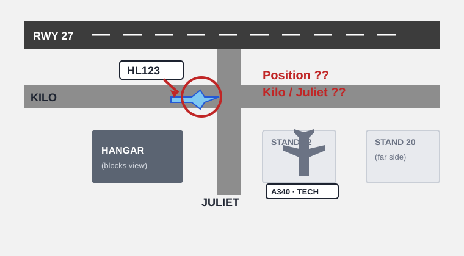
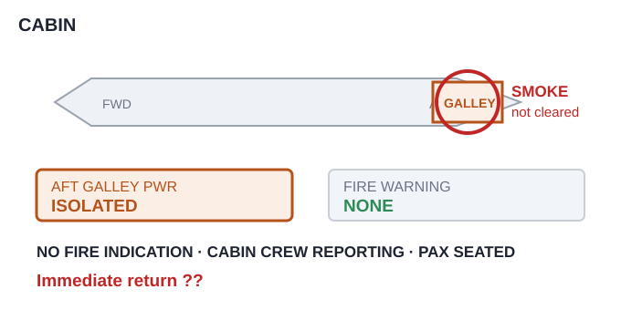

# EPTA 항공영어구술능력시험 조종사용 모의세트 EPTA_11 — 2026-11-03

안 내 메모 가능 / 문항당 1회 Say again 기능 사용 가능. 응시자 콜사인은 항상 **HL123**.

---

## Part Ⅰ TASK A. Readback and Hearback

✅ Directions : You will be listening to 4 ATC instructions. Your callsign will be HL123.
Listen carefully and make a correct readback for each of them. "Say again (=Repeat)"
available once only. You may take notes while listening.
  * Correct / Full readback : necessary for standard operating procedures
  * Response time for each question : 20 seconds or less

✅ 시험[응답] 요령

| 항목 | 내용 |
|---|---|
| 구성 | 4문항 / 문항 별 응대시간 : 20초 |
| 평가요소 | 기본적인 교신 능력 평가로 ATC의 지시사항에 맞게 표준교신용어로 readback |
| 진행 | 관제사 지시 → 응답녹음 |
| 평가항목 | 표준 교신속도/발음/억양의 사용 여부 · 필요한 정보의 효율적 전달 능력 평가 · 정확한 표준 교신용어의 사용 여부 · 관제 지시 후 교신 응대의 즉시성 여부 |
| 유의사항 | 올바른 readback : 운항절차에 필요한 필수 사항을 모두 포함한 readback · 필수사항은 아니지만 지시사항을 전체 readback 해도 감점되지 않음 |

**P1A-Q1** 🎙 20초
Ground : HL123, cross runway two seven, report vacated.

Record your full readback.

[정답]

---

**P1A-Q2** 🎙 20초
🖥 [ ZORIN ]
Center : HL123, after passing ZORIN, descend to flight level one niner zero, reduce speed
two five zero knots.

Record your full readback.

[정답]

---

**P1A-Q3** 🎙 20초
Center : HL123, climb to one five thousand feet, expedite until passing one two thousand.

Record your full readback.

[정답]

---

**P1A-Q4** 🎙 20초
Approach : HL123, cleared for the ILS runway one four approach, maintain one six zero knots
to the marker.

Record your full readback.

[정답]

---

## Part Ⅰ TASK B. Checking, Clarifying, Confirming, Informing

✅ Directions : You will be listening to 6 audio clips, which consist of short situational
prompts. Respond to each of them using mainly Standard Phraseology if possible. If not,
you may use plain English to help clarify your response. "Say again (=Repeat)" available
only once. Your callsign is HL123. You may take notes while listening.
  * Response time for each question : 20 seconds or less

✅ 시험[응답] 요령

| 항목 | 내용 |
|---|---|
| 구성 | 6문항 / 문항 별 응대시간 : 20초 |
| 평가요소 | 기본적인 교신 능력 평가로 ATC의 지시사항에 맞게 표준교신용어로 readback |
| 진행 | 상황정보 제시 → 관제지시 → 응답녹음 |
| 평가항목 | Task B는 상황정보 이해력 및 해당 교신에 대한 적절한 응대력 평가 · 상황정보 및 ATC의 교신에 따라 플레인 영어 사용이 요구될 수 있음 |
| 유의사항 | 상황정보(prompt) 음성에는 교신용어가 플레인 영어(발음)로 들려질 수 있음. 필요 시 올바른 교신용어로 응답해야 함 |

**P1B-Q1** 🎙 20초
Approach cleared you to descend maintaining your own visual separation from an Airbus A340
ahead. The A340 has just entered cloud and you no longer have it in sight. Listen to the
controller, respond accordingly with a reason, and make a request.

Approach : HL123, confirm maintaining visual separation with the Airbus A340?

Record your response.

[정답]

---

**P1B-Q2** 🎙 20초
You are heavy today. The slowest speed you can hold with the flaps you have out is two one
zero knots. Listen to the controller, respond with a reason, and tell him what you can do.

Approach : HL123, maintain one eight zero knots until four miles. Can you do that?

Record your response.

[정답]

---

**P1B-Q3** 🎙 20초
🖥 [ Hartwell Control ]
You have been in moderate turbulence at flight level three three zero for the last one
zero minutes. The aircraft ahead of you reported it smooth at flight level three one zero.
You want to descend to flight level three one zero, and you want to know what the ride is
like there. Contact Hartwell Control. Make a request with a reason, and inquire about the
conditions at that level.

Record your response.

[정답]

---

**P1B-Q4** 🎙 20초
During pushback you saw a ground vehicle drive away leaving a spill of fuel on the apron
beside stand one two. You were busy with the checklist and did not report it. Ground now
calls you. Listen to the ground, give a full readback, and report what you saw.

Ground : HL123, taxi to holding point Charlie via Alpha and Delta.

Record your response.

[정답]

---

**P1B-Q5** 🎙 20초
You are presently established on a heading of two seven zero. The controller's instruction
would mean a full turn through three six zero degrees, so you think he may have meant a
different heading. Listen to the controller and make a confirmation.

Approach : HL123, turn left heading two seven zero.

Record your response.

[정답]

---

**P1B-Q6** 🎙 20초
You were cleared to climb to eight thousand feet, but you set six thousand by mistake and
you are now level at six thousand. You want your climb back. Listen to the controller,
correct your mistake, and make a request.

Departure : HL123, report passing seven thousand.

Record your response.

[정답]

---

## Part Ⅱ TASK A. Role-play & Follow-up

✅ Directions : In Part 2 Task A, you will be going through a couple of flight situations
of a normal passenger flight. Follow the prompts for providing your response, which you
will either hear or see on the screen, or the both. "Say again (=Repeat)" available once
only. Your callsign is HL123.

After finishing Task A Role play, you will be asked one or two follow-up questions. You
will have up to 90 seconds to respond to them.

✅ 시험[응답] 요령

| 항목 | 내용 |
|---|---|
| 구성 | 약 7~12회 롤 플레이 / 응대시간 : 30초, Follow up : 90초 |
| 평가요소 | 정상상황에서 기본 교신능력과 비정상 발생시 상황보고 또는 요구사항 전달 등에 필요한 언어 구사력(교신용어와 플레인 영어의 복합 사용) |
| 진행 | 연속적인 비행 단계 또는 복합적인 상황의 롤 플레이. Initial Situation → continued → Situation update → continued |
| 평가항목 | 음성 또는 화면에 제공되는 Text clue(🖥)를 이용하여 지시대로 응대하는 능력 · 상황정보 및 ATC의 교신에 따라 요구되는 플레인 영어 사용능력 · 표준 교신속도/발음/억양의 사용 여부 및 정보의 효율적 전달능력 평가 · 교신 응대력(Role-play)과 플레인 영어(Follow-up) 능력을 전체적으로 평가 |
| 유의사항 | 교신상황은 시간제한 및 언어평가 목적에 따라 '인위적'일 수 있고, 상황 전개의 '비약'이 인정되므로 지시사항에 맞게 응답해야 함 · 응답 직전 '약간의' 준비시간은 용인됨. 다만 '매우' 늦은 응답 또는 무응답은 영향을 미침 |

Flight Paths In this scenario, you'll be the pilot flying Hotel Lima 123, which goes
through three flight stages. Descent, approach, and taxi.

Initial Situation You are the pilot of HL123, descending through flight level two zero zero
for one one thousand, 60 miles from TREBO, inbound to Thatcham Airport. You have
information Delta. Your required landing distance today is 1,750 metres. 🔔(dingdong)

**P2A-Q1** 🎙 30초
☞ Contact Thatcham Approach and report your position and level.

[정답]

---

**P2A-Q2** 🎙 30초
🖥 [ TREBO ONE arrival ]
☞ Listen to the controller and give a full readback.
Approach : HL123, Thatcham Approach, descend to 9,000 feet, reduce speed to two five zero
knots, expect the TREBO ONE arrival, ILS runway two seven, Thatcham altimeter two niner
eight six.

[정답]

---

**P2A-Q3** 🎙 30초
☞ Listen to the controller, give a full readback, and inquire about the landing distance
available.
Approach : HL123, descend to 5,000 feet. Be advised there's work in progress on runway two
seven — they've displaced the threshold, so you won't have the full length today.

[정답]

---

**P2A-Q4** 🎙 30초
🖥 [ runway two seven / runway two one / landing distance available ]
☞ Listen to the controller, state your decision with a reason, and tell him the figure you
need.
Approach : HL123, two seven gives you 1,900 metres from the displaced threshold. Two one
has the full 2,600, but you'd be number three behind an Airbus A340 — about one two
minutes. Your call.

[정답]

---

Situation Update You are now established on the TREBO ONE arrival, descending through
7,000 feet. 🔔(dingdong)

**P2A-Q5** 🎙 30초
☞ Listen to the controller, give a full readback, and inquire how long it will take.
Approach : HL123, the Embraer 175 ahead of you has gone around. Turn left heading one eight
zero, descend to 4,000 feet, I'll have to slot you back in behind him.

[정답]

---

**P2A-Q6** 🎙 30초
☞ Listen to the controller and give a full readback.
Approach : HL123, turn right heading two four zero, descend to 3,000 feet until
established, cleared for the ILS runway two seven approach, contact Thatcham Tower on 118.3.

[정답]

---

**P2A-Q7** 🎙 30초
☞ Listen to the tower and give a full readback.
Tower : HL123, Thatcham Tower, runway two seven, cleared to land, wind two five zero at
eight, caution work in progress right of the threshold.

[정답]

---

**P2A-Q8** 🎙 30초
☞ Listen to the tower and provide both pieces of information.
Tower : HL123, I'm filing a report on the work in progress — say again the landing distance
you need, and tell me whether 1,900 metres was enough for you.

[정답]

---

Situation Update You have landed and vacated runway two seven. You are now stopped on
taxiway Kilo, short of taxiway Juliet. 🔔(dingdong)

**P2A-Q9** 🎙 30초
🖥 [ Stand one two / Stand two zero ]
☞ Listen to the ground controller, state your decision with a reason, and inquire how long
it will take.
Ground : HL123, Thatcham Ground, stand one two is still occupied by the Airbus A340 with a
technical. I can give you stand two zero, but it's eight minutes of taxi. Or you hold for
one two. What would you prefer?

[정답]

---

(Q10) 

**P2A-Q10** 🎙 30초
☞ Listen to the ground controller, respond accordingly, and report your position.
Ground : HL123, I've lost sight of you behind the hangar — whereabouts are you now?

[정답]

---

**P2A-Q11** 🎙 90초 (Follow-up)
Follow up question.

In this situation, the runway you were offered had less landing distance than usual because
of work in progress. What did you compare before you accepted it, and why? In your role as
a pilot, how do you prepare for a runway that turns out shorter than you planned for — on
the day, and in your briefing beforehand? Give an example of a figure you have had to
re-check because something changed at short notice.

[정답]

---

## Part Ⅱ TASK B. Extended Role-play : Single Incident/Emergency Related

✅ Directions : You will be interacting with an Air traffic controller or Ground crew
based on short situational prompts. Follow the prompts and respond as necessary. Assume
you can accept all the instructions, unless being specified otherwise. "Say again
(=Repeat)" available only once. Your callsign is HL123.
  * Response time for each question : 30 seconds or less

✅ 시험[응답] 요령 ※ Task B의 교신내용이 Task C의 태스크와 연계되므로, 관련 정보의 메모가 필요

| 항목 | 내용 |
|---|---|
| 구성 | 약 7~12회 롤 플레이 / 응대시간 : 30초 |
| 평가요소 | 단일 상황에서 비정상/비상상황에서 문제를 해결과정에서의 상황보고 또는 의사전달능력 등에 필요한 언어 구사력(플레인 영어의 빈도가 높아짐) |
| 진행 | 비정상 또는 비상 상황이 포함된 '단일'사건의 롤 플레이. Initial Situation → continued → Situation update → continued |
| 평가항목 | 음성 또는 화면에 제공되는 Text clue(🖥)를 이용하여 지시대로 응대하는 능력 · 상황정보 및 ATC의 내용에 따라 요구되는 교신용어 또는 플레인 영어 사용 능력 · 표준 교신속도/발음/억양의 사용 여부 및 정보의 효율적 전달능력 평가 · 교신 응대력(Role-play)과 플레인 영어능력을 전체적으로 평가 |
| 유의사항 | 교신상황은 시간제한 및 언어평가 목적에 따라 '인위적'일 수 있고, 상황 전개의 '비약'이 인정되므로 지시사항에 맞게 응답해야 함 · 응답 직전 '약간의' 준비시간은 용인됨. 다만 '매우' 늦은 응답 또는 무응답은 영향을 미침 · 플레인 영어 사용 빈도가 다소 높을 수 있고, 응대 내용의 정확도 및 유창도에 따라 Operational(Level4)과 Extended(Level5) 여부가 평가됨 |

Initial Situation You are the pilot of HL123, climbing through 9,000 feet for flight level
three one zero, 25 miles south of Stapleton Airport. Your fuel endurance is one hour five
zero minutes and there are one four seven persons on board. Your required landing distance
is 2,200 metres. 🔔(dingdong)

**P2B-Q1** 🎙 30초
☞ Contact Stapleton Departure and report your passing altitude.

[정답]

---

**P2B-Q2** 🎙 30초
☞ Listen to the controller and give a full readback.
Departure : HL123, Stapleton Departure, climb to flight level three one zero, turn right
heading one two zero, contact Hartwell Control on 132.4 when passing one eight thousand.

[정답]

---

Situation Update Passing one three thousand feet, the cabin crew report smoke coming from
the rear galley. You have isolated the galley power but the smoke has not cleared. There is
no fire indication on the flight deck. 🔔(dingdong)

(Q3) 

**P2B-Q3** 🎙 30초
☞ Declare an emergency, report the nature of your problem, and request an immediate return.

[정답]

---

**P2B-Q4** 🎙 30초
☞ Listen to the controller and provide the requested information.
Approach : HL123, Stapleton Approach, roger your MAYDAY, radar contact. Say your fuel
endurance and the number of persons on board.

[정답]

---

**P2B-Q5** 🎙 30초
🖥 [ Stapleton / Brindle / landing distance available ]
☞ Listen to the controller, state your decision with a reason, and tell him the figure you
need.
Approach : HL123, Stapleton runway zero niner has 2,400 metres, but with the departure
sequence you'd be one five minutes to touchdown. Brindle is niner minutes away with 3,000
metres. What would you like?

[정답]

---

**P2B-Q6** 🎙 30초
☞ Listen to the controller, give a full readback and say your intentions.
Approach : HL123, roger, turn left heading two seven zero, descend to 8,000 feet, vectors
for Brindle. Say your intentions.

[정답]

---

**P2B-Q7** 🎙 30초
☞ Listen to the controller and answer both of his questions.
Approach : HL123, two things for Brindle — is the smoke still in the cabin, and do you want
the fire service to meet you on the runway?

[정답]

---

**P2B-Q8** 🎙 30초
☞ Listen to the controller and provide both pieces of information.
Approach : HL123, Brindle wants it for the emergency brief — say again your fuel endurance,
and say again how many persons on board.

[정답]

---

Situation Update The smoke has stopped and the cabin is clear. The cabin crew report the
galley oven as the source and it is now isolated. 🔔(dingdong)

**P2B-Q9** 🎙 30초
☞ Listen to the controller, give him an update, state your decision with a reason, and say
what you will need on the runway.
Approach : HL123, if the cabin's clear now, do you want to cancel the emergency, or keep it
in?

[정답]

---

**P2B-Q10** 🎙 30초
☞ Listen to the controller and give a full readback.
Approach : HL123, turn right heading three five zero, descend to 2,500 feet until
established, cleared for the ILS runway one four approach, contact Brindle Tower on 119.1.

[정답]

---

## Part Ⅱ TASK C. Reporting about Task B

✅ Directions : You have just finished Part 2 Task B. Now you will be listening to the
ATC's radiotelephony messages to better recall the events. Afterwards, you will be
asked two questions about the situation. You will have 90 seconds for each question.

✅ 시험[응답] 요령

| 항목 | 내용 |
|---|---|
| 구성 | 2문항 / 응대시간 : 90초 |
| 평가요소 | Task B에서 수행한 롤 플레이 내용에 대한 리포팅(플레인 영어) 능력 |
| 진행 | TASK B의 ATC 교신 내용 다시 듣기 → 질문 → 응답하기 |
| 평가항목 | 구체적인 사건과 상황 전개의 내용을 묻는 질문(Q1)에 대한 사실전달 능력 · 사건에 대한 이해를 바탕으로 의견을 묻는 질문(Q2)에 대한 의견제시 능력 |
| 유의사항 | 제공시간을 최대한 활용하여 평가항목(유창성, 이해력, 어휘, 발음, 문장구조)에 대한 능력을 충분히 표현 · 경험 사례 또는 관련 지식/보도 등을 활용하여 플레인 영어능력을 최대로 발휘 |

☞ Now listen to the controller's radiotelephony messages.

ATC: HL123, Stapleton Departure, climb to flight level three one zero, turn right heading
one two zero, contact Hartwell Control on 132.4 when passing one eight thousand.
ATC: HL123, Stapleton Approach, roger your MAYDAY, radar contact. Say your fuel endurance
and the number of persons on board.
ATC: HL123, Stapleton runway zero niner has 2,400 metres, but with the departure sequence
you'd be one five minutes to touchdown. Brindle is niner minutes away with 3,000 metres.
What would you like?
ATC: HL123, roger, turn left heading two seven zero, descend to 8,000 feet, vectors for
Brindle. Say your intentions.
ATC: HL123, two things for Brindle — is the smoke still in the cabin, and do you want the
fire service to meet you on the runway?
ATC: HL123, Brindle wants it for the emergency brief — say again your fuel endurance, and
say again how many persons on board.
ATC: HL123, if the cabin's clear now, do you want to cancel the emergency, or keep it in?
ATC: HL123, turn right heading three five zero, descend to 2,500 feet until established,
cleared for the ILS runway one four approach, contact Brindle Tower on 119.1. 🔔(dingdong)

☞ Now answer the questions.

**P2C-Q1** 🎙 90초
What happened to your aircraft (HL123)? Explain the nature of the incident.

[정답]

---

**P2C-Q2** 🎙 90초
How do you think the incident was handled by the air traffic controller? Do you feel the
situation could have been handled differently? Make a comment from a pilot's point of
view.

[정답]

---
