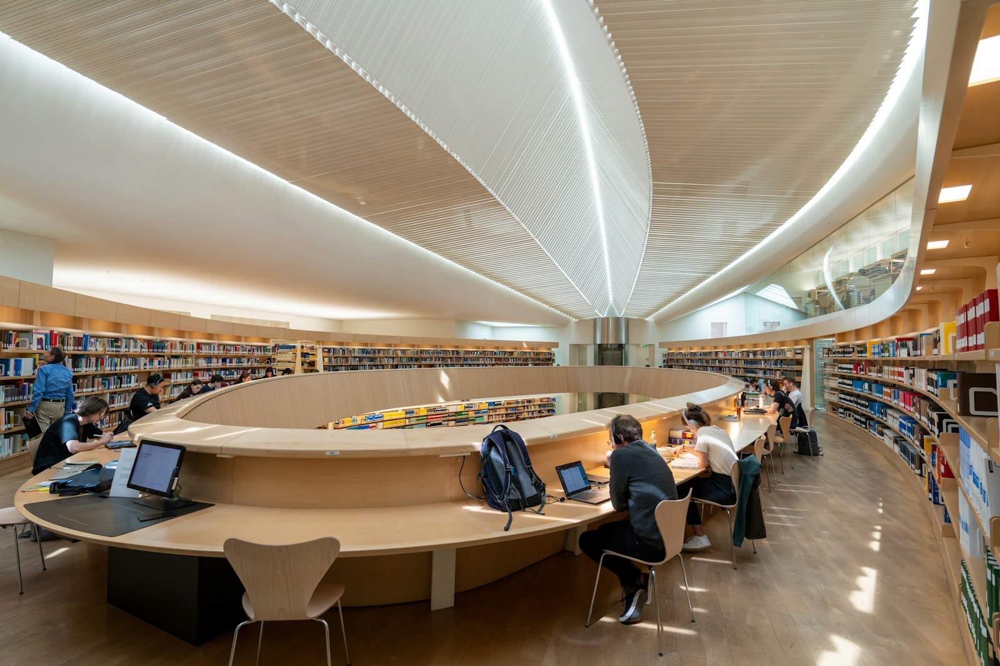
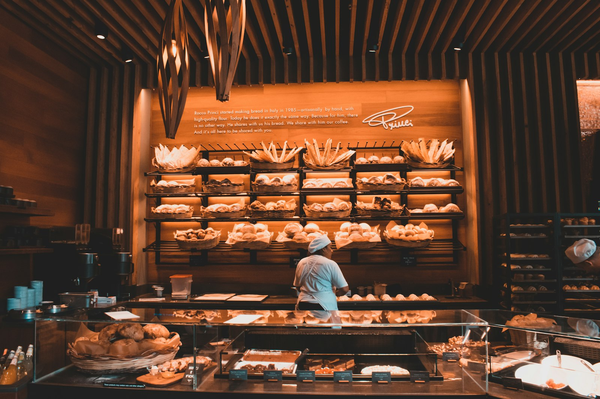

# 🗣️ TOEIC Speaking Practice Test (Q3 ~ Q11) — Set 07

> AL(160-200) 목표 트레이닝용 모의고사입니다. 실제 시험처럼 문제지를 먼저 눈으로 읽고, 준비 시간을 스스로 재면서(Q3-Q4: 45초 준비/45초 답변, Q5-Q7: 준비 없이 15초/15초/30초, Q8-Q10: 45초 준비 후 15초/15초/30초, Q11: 45초 준비/60초 답변) 아래 **- 내 답변:** 칸에 텍스트로 작성하세요.
>
> **이번 세트 집중 훈련 포인트 (Set 06 오답노트 반영):**
> - `a smartphone` — 관사 빠뜨리지 않기 (Q6에 스마트폰 언급할 상황을 일부러 넣었습니다).
> - `there is/are` — 뒤에 오는 명사가 단수/복수인지에 맞춰 쓰기.
> - `communicate with each other`처럼, 동사 뒤에 전치사가 필요한지 한 번씩 체크하기.
> - **Part 4 조건이 이번엔 4개**입니다 (가격 + 크기 + 거리 + 반려동물 허용 여부). 표를 끝까지 다 확인하세요.

---

## Part 2. Describe a Picture (Q3 - Q4)

### Q3. Describe a picture in detail.

> **[Context Hint]:** A modern university library with curved wooden desks and tall bookshelves, where several students are sitting and studying, some using laptops, under a wave-shaped ceiling with skylights.

- **내 답변:**
This picture was taken in a library , in the background, a lot of books are on the selves in a row, in the middle of the picture, i can see many people who are reading a book or laptop, on the left side, i can see a man who is looking for a book. i think it's like a typical calm library picture.
---

### Q4. Describe a picture in detail.

> **[Context Hint]:** A bakery worker wearing a white chef's hat is standing at a shelf filled with baskets of bread, arranging or restocking the loaves, with a glass display case full of pastries in front of the counter.

- **내 답변:**
this picture was taken at a bakery store. in the background. i can see lots of kind of bread on the selves. and some fixutres hanging on the ceiling . and there is a woman who is wearing uniform. i think she seems to making some breads.
i think it looks like a typical and calm bakery store picture.
---

## Part 3. Respond to Questions (Q5 - Q7)

**Scenario:** Imagine that an American food and lifestyle research firm is conducting a telephone survey about **dining and cooking habits**. You have agreed to participate in the survey.

### Q5. How often do you cook at home versus eat out, and what do you usually cook?

- **내 답변:**
i rarely cook at home. i usually cook once a week.
### Q6. What do you think is the most convenient way for busy people to eat healthy meals?

- **내 답변:**
I think the most convienient way for busy people to eat health meals is to order dietery food such as salads.
### Q7. Some restaurants are replacing servers with tablet ordering systems and robot food delivery. **First**, what is your opinion of this trend? **Second**, what advice would you give to a restaurant that wants to adopt this technology without losing its personal touch?

- **내 답변:**
first i think this trend is make sense. I saw a lot of tablet ordering systems recently it is really easy to order. and i often saw robot food delivery . it is sometimes little bit depressed that it is so slow to deliver and sometimes it is unsafe. second as for adivce, i would tell the restaurant to make the system same as what the servant did, such as their delivery speed, and politeness and so on.
---

## Part 4. Respond to Questions Using Information Provided (Q8 - Q10)

**Situation:** You are helping a friend look for an apartment. Your friend calls you with some questions about the listings.

### Apartment Listings

| Apartment              | Rent / Month | Size  | Distance to Subway | Pets Allowed |
|--------------------------|----------------|-------|-----------------------|----------------|
| Sunview Studio           | $900           | 25㎡  | 5 min                 | No             |
| Maple Residence          | $1,150         | 35㎡  | 10 min                | Yes            |
| Central Loft             | $1,300         | 30㎡  | 3 min                 | No             |
| Green Park Apartments    | $1,050         | 40㎡  | 15 min                | Yes            |
| Harbor View Suites       | $980           | 28㎡  | 8 min                 | Yes            |

### Q8. What is the monthly rent for Sunview Studio, and how far is it from the subway?

- **내 답변:**
it costs $900 and it takes 5 min from the subway.
### Q9. I heard Green Park Apartments allows pets. How big is it, and how far is it from the subway?

- **내 답변:**
correct, it allows pets , its size is 40m2 and it takes 15min from the subway.
### Q10. My friend needs an apartment that costs $1,100 or less per month, is at least 28㎡, is within 10 minutes of the subway, and allows pets. Which apartment should they choose, and why?

- **내 답변:**
I think harbor view suites is fit for your friends standards. it costs only $980 and it takes only 8min from the subway. and it allows pets.
---

## Part 5. Express an Opinion (Q11)

### Q11. Some people believe companies should adopt a four-day work week, while others believe a five-day work week is necessary to stay productive. Which do you think is better, and why?

- **내 답변:**
4day -> one day more rest , and they know scheduel make it 4day , in my case ,my company 5 -> 4 first adapt difficult 1mont apapt now satisfy produc fup

i think adopting a four day work week is better than a five day work week. first if they work only 4 days a week. they get 1 more day off. it make them more relax , and they can make scedule for 4 days rather than 5days. in my case. my company start with 5days a week. and 2 years later , we changed our work shift to 4days. first time . we were hard to apapt the shift . but we still work hard and adapt easily later. after 1month everyone satisfied with the workshift and their productivity has grown up . so that is why i think 4days work is better than 5days work.
---

## 📝 채점 및 오답노트 안내

1. 위의 **- 내 답변:** 칸에 실전처럼 즉흥적으로 텍스트를 작성하세요 (빠르게 타이핑하며 생기는 오타/쉼표는 채점에서 제외되니 신경 쓰지 마세요).
2. 다 작성한 뒤 이 파일을 저에게 보내주시면, **내 원문 → 교정 문장 → 무엇이 바뀌었는지** 형식으로 문장 단위 피드백과 오답노트를 드리겠습니다. (이미 맞는 표현은 안 바꾸고, 대안 표현이 있으면 별도로 참고용으로만 덧붙입니다.)
