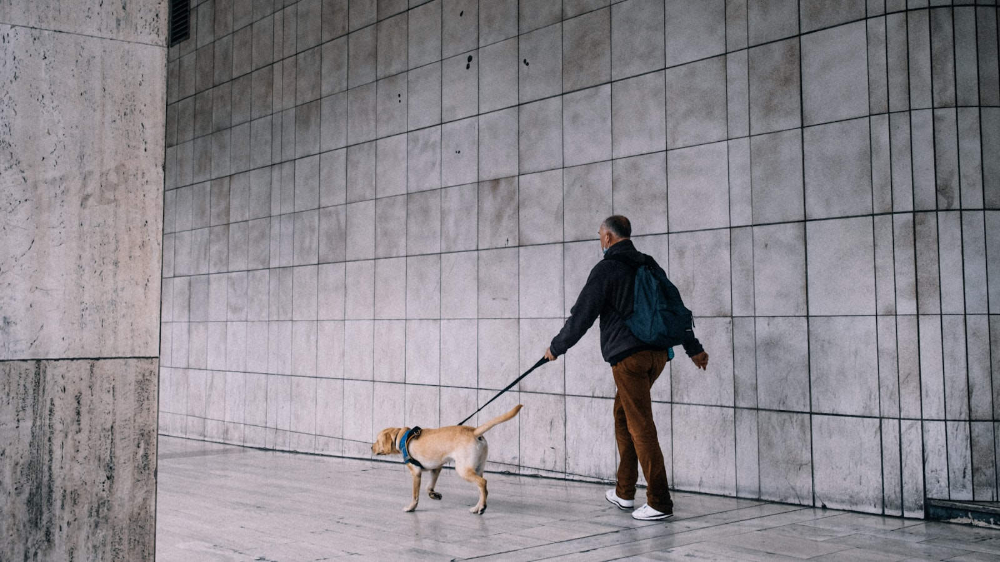
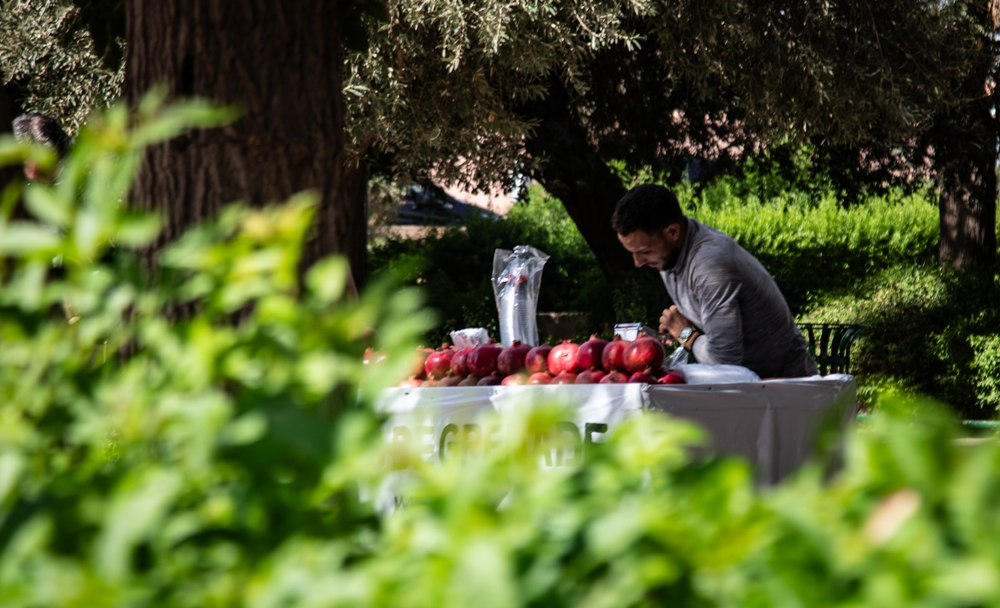

# 🗣️ TOEIC Speaking Practice Test (Q3 ~ Q11) — Set 08

> AL(160-200) 목표 트레이닝용 모의고사입니다. 실제 시험처럼 문제지를 먼저 눈으로 읽고, 준비 시간을 스스로 재면서(Q3-Q4: 45초 준비/45초 답변, Q5-Q7: 준비 없이 15초/15초/30초, Q8-Q10: 45초 준비 후 15초/15초/30초, Q11: 45초 준비/60초 답변) 아래 **- 내 답변:** 칸에 텍스트로 작성하세요.
>
> **이번 세트 집중 훈련 포인트 (Set 07 오답노트 반영):**
> - `hanging from the ceiling` — Set 02, 06, 07에서 계속 `on`으로 틀렸습니다. 이번 사진엔 해당 표현이 나올 상황은 없지만, 다음에 조명/장식이 나오면 꼭 `from`으로 써보세요.
> - 긴 이야기(특히 Q11)를 할 땐 시제를 처음부터 끝까지 통일하기.
> - `servant`/`server`처럼 비슷하게 생긴 단어 조심하기.
> - **Part 4 조건이 이번엔 5개**입니다 (요금 + 경력 + 지역 + 요일 가능 여부 + 평점). 표를 끝까지 다 확인하세요.

---

## Part 2. Describe a Picture (Q3 - Q4)

### Q3. Describe a picture in detail.

> **[Context Hint]:** A man wearing a dark jacket and a backpack is walking a dog on a leash along a tiled wall, seen from behind, with the dog sniffing the ground ahead of him.

- **내 답변:**
This picture was taken in a building. I can see a man who is walking with holding a rope. and i can see a dog who pulling his boss. in the background. i can see lots of tiles in a row. on the left side there is a pole. overall it looks like a typical and calm scene.
---

### Q4. Describe a picture in detail.

> **[Context Hint]:** A man is leaning over an outdoor market table covered with a pile of pomegranates, arranging or packing the fruit, with green trees and bushes surrounding the stand.

- **내 답변:**
Thick picture was taken at a park. i can see a man who seems to be sitting and watching something. and there are some fruits arranged on a table. in the background. i can see some trees in the foreground. i can see some grass. overall it looks like a typical calm park scene.
---

## Part 3. Respond to Questions (Q5 - Q7)

**Scenario:** Imagine that an American urban planning research firm is conducting a telephone survey about **commuting habits**. You have agreed to participate in the survey.

### Q5. How do you usually commute to work or school, and how long does it take?

- **내 답변:**
i usually commute to work 5 days a week . and it takes 30min by bicycle.
### Q6. What do you think is the most stressful part of commuting?

- **내 답변:**
because i commute to work by bicycle. so the most stressful part of commuting is weather.
### Q7. Some companies are allowing employees to choose flexible commuting hours to avoid rush hour traffic. **First**, what is your opinion of this policy? **Second**, what advice would you give to a company that wants to implement it fairly for all employees?

- **내 답변:**
first . it is good idae to choose flexible commuting hours, but i think even if there is a flexible time, it has to be within 2hours, because some teams have to meeting , and other team have to communicate with other team . second as for advice, i would tell the company to make a attendance time to commute on time, if there is no timetable , the employee will commute whenever they want. it makes the company mess.
---

## Part 4. Respond to Questions Using Information Provided (Q8 - Q10)

**Situation:** You are helping your company hire a photographer for an upcoming event. Your manager calls you with some questions about the candidates.

### Photographer Options

| Photographer | Rate / Hour | Experience | Location | Available on Sat | Rating |
|----------------|---------------|--------------|-----------|---------------------|--------|
| A                | $80           | 5 years      | Seoul     | Yes                 | 4.9    |
| B                | $60           | 2 years      | Busan     | Yes                 | 4.5    |
| C                | $70           | 6 years      | Seoul     | No                  | 4.8    |
| D                | $55           | 4 years      | Seoul     | Yes                 | 4.3    |
| E                | $75           | 7 years      | Seoul     | Yes                 | 4.7    |

### Q8. What is the hourly rate for Photographer A, and how many years of experience do they have?

- **내 답변:**
it costs $80 and they have 5 years of experience.
### Q9. I heard Photographer C isn't available on Saturday. What's their experience, and what's their rating?

- **내 답변:**
you are correct , photographer c isn't available on sat. they have 6 years of experience. and it rated 4.8
### Q10. My manager needs a photographer based in Seoul who charges $75 or less per hour, has at least 5 years of experience, is available on Saturday, and has a rating of 4.5 or higher. Who should I book, and why?

- **내 답변:**
I think photoprapher E is right person for your manager. it costs  $75 and they have 7 years of experience. and they are available on sat and it rated 4.7. I think it is good choice for you manager.
---

## Part 5. Express an Opinion (Q11)

### Q11. Some people believe companies should be allowed to collect personal data to provide more personalized services and ads, while others believe this is a serious invasion of privacy. Which view do you agree with, and why?

- **내 답변:**
not agree , people cannot memori, service all same whoever, first people feel same, second they have to devlop

I agree that company should not be allowed to collect personal date to provicde more personalized services and ads. there are some reasons that support my opinion, as you said, it is a serious incasion of privacy. and first employee cannot memorize all the people's data , so they cannot service as well, and i think all services should be served same for whoever they are , second if their service is bad, they have to get some feedback and have to better than before. so this is why i agree with.
---

## 📝 채점 및 오답노트 안내

1. 위의 **- 내 답변:** 칸에 실전처럼 즉흥적으로 텍스트를 작성하세요 (빠르게 타이핑하며 생기는 오타/쉼표는 채점에서 제외되니 신경 쓰지 마세요).
2. 다 작성한 뒤 이 파일을 저에게 보내주시면, **내 원문 → 교정 문장 → 무엇이 바뀌었는지** 형식으로 문장 단위 피드백과 오답노트를 드리겠습니다. (이미 맞는 표현은 안 바꾸고, 대안 표현이 있으면 별도로 참고용으로만 덧붙입니다.)
