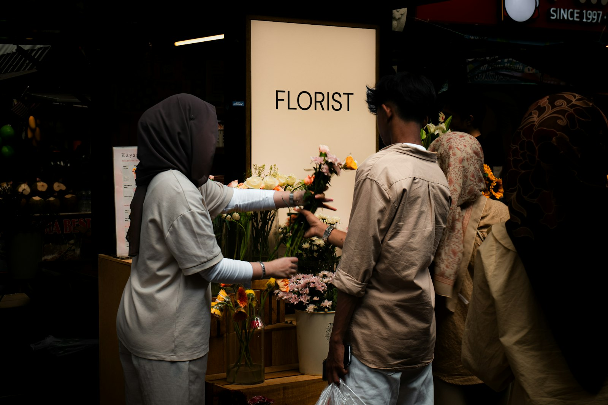

# 🗣️ TOEIC Speaking Practice Test (Q3 ~ Q11) — Set 09

> AL(160-200) 목표 트레이닝용 모의고사입니다. 실제 시험처럼 문제지를 먼저 눈으로 읽고, 준비 시간을 스스로 재면서(Q3-Q4: 45초 준비/45초 답변, Q5-Q7: 준비 없이 15초/15초/30초, Q8-Q10: 45초 준비 후 15초/15초/30초, Q11: 45초 준비/60초 답변) 아래 **- 내 답변:** 칸에 텍스트로 작성하세요.
>
> **이번 세트 집중 훈련 포인트 (Set 08 오답노트 반영):**
> - `is/are rated ~` — Set 08에서 두 번 나온 실수입니다. 평점을 말할 땐 be동사를 꼭 넣으세요.
> - 일반적인 진술("회사들은 ~해야 한다" 등)에서 단/복수 다시 한번 체크.
> - 사진 속 인물이 실제로 뭘 하고 있는지(앉아있는지, 서 있는지, 무엇을 만지는지) 정확히 관찰하고 묘사하기.
> - **Part 4는 이번엔 다시 시간표 유형입니다** — 오랜만에 시간 겹침 계산을 다시 연습해봅니다.

---

## Part 2. Describe a Picture (Q3 - Q4)

### Q3. Describe a picture in detail.

> **[Context Hint]:** Two men are standing with their backs to the camera, looking at framed paintings on a museum wall, including a self-portrait of a man in a hat, with a small text label mounted on the wall between the paintings.

- **내 답변:**
This picture was taken at a exhibition. in the background i can see paintings which are hanging on the wall. and i can see some people who seem to be chatting and enjoying paintings. i think it looks like typical and silence exhibition scene.
---

### Q4. Describe a picture in detail.

> **[Context Hint]:** A florist wearing a headscarf is handing a bouquet of flowers to a male customer at a flower shop, with a lit-up "FLORIST" sign in the background and buckets of colorful flowers displayed around them.

- **내 답변:**
This picture was taken at a flower shop. in the background. i can see a sign which wrote with florist . and i can see some flowers arranged on a shelve. and some flowers are displayed on each glass. and i can see 3 people , one of them seems like a owner. i think she is attracting a customer attention. i think it looks like a typical messy flower shop scene.
---

## Part 3. Respond to Questions (Q5 - Q7)

**Scenario:** Imagine that an American personal finance research firm is conducting a telephone survey about **saving and spending habits**. You have agreed to participate in the survey.

### Q5. Do you usually save a fixed amount of money each month, and how do you manage it?

- **내 답변:**
yes i do save a fixed amound of money each month, i saved it on my account.
### Q6. What do you think is the most effective way for young adults to build a habit of saving money?

- **내 답변:**
I think there are 2 effective ways. first , commute by food is a way and second, don't drink alcohol everyday.
### Q7. Some people believe budgeting apps make it easier to save money, while others think they don't really change people's spending habits. **First**, what is your opinion of budgeting apps? **Second**, what advice would you give to someone who wants to start using one effectively?

- **내 답변:**
I think bugeting apps make it easier to save money.  first all i have to do is just using smartphone. i can use it wherever i want whenever i want. and as for advice . download it first and make a plan when you use it , for example everynight 10pm , plan to write it down what you use everyday.
---

## Part 4. Respond to Questions Using Information Provided (Q8 - Q10)

**Situation:** You are a member of a gym and are checking the weekly class schedule. A friend calls you with some questions about the classes.

### Weekly Fitness Class Schedule

| Class          | Day   | Time          | Instructor  | Room      |
|-----------------|-------|----------------|--------------|-----------|
| Yoga Flow       | Mon   | 07:00 - 08:00 | Ms. Lee      | Studio A  |
| Spin Class      | Mon   | 07:30 - 08:15 | Mr. Kim      | Studio B  |
| Pilates         | Wed   | 18:00 - 19:00 | Ms. Park     | Studio A  |
| HIIT Bootcamp   | Wed   | 18:30 - 19:30 | Mr. Choi     | Studio C  |
| Zumba           | Fri   | 19:00 - 20:00 | Ms. Han      | Studio B  |

### Q8. What time does Spin Class start on Monday, and who teaches it?

- **내 답변:**
it will start at 7 30 and it will led by mr.kim.
### Q9. I heard there's a Pilates class on Wednesday. What time is it, and which room is it in?

- **내 답변:**
you are correct. it runs from 18 to 19 and you have to go studio a
### Q10. I want to take Yoga Flow on Monday, but I also have a work call from 07:30 to 08:00 that day. Which part of the class will I miss, and what would you suggest I do?

- **내 답변:**
unfortunately , you will miss last 30minutes of the yoga flow , i think you should ask mr lee what does class do at the last 30minutes of the yoga flow. and you should practice yourself
---

## Part 5. Express an Opinion (Q11)

### Q11. Some people believe gig economy jobs (like freelance or platform-based work) offer more freedom than traditional full-time employment, while others believe traditional jobs offer more stability and security. Which do you think is better, and why?

- **내 답변:**
In my opinion, earlier , i think traditional full time employment offer more freedom than gig economy jobs , but recently chatgpt and some ai are emerged , my thought is changed absolutely , freelance can do more things than as what they used to work . and the full time jobs employee lost their work than what they used to work. so I think frelancer is better than traditional full time employment
---

## 📝 채점 및 오답노트 안내

1. 위의 **- 내 답변:** 칸에 실전처럼 즉흥적으로 텍스트를 작성하세요 (빠르게 타이핑하며 생기는 오타/쉼표는 채점에서 제외되니 신경 쓰지 마세요).
2. 다 작성한 뒤 이 파일을 저에게 보내주시면, **내 원문 → 교정 문장 → 무엇이 바뀌었는지** 형식으로 문장 단위 피드백과 오답노트를 드리겠습니다. (이미 맞는 표현은 안 바꾸고, 대안 표현이 있으면 별도로 참고용으로만 덧붙입니다.)
