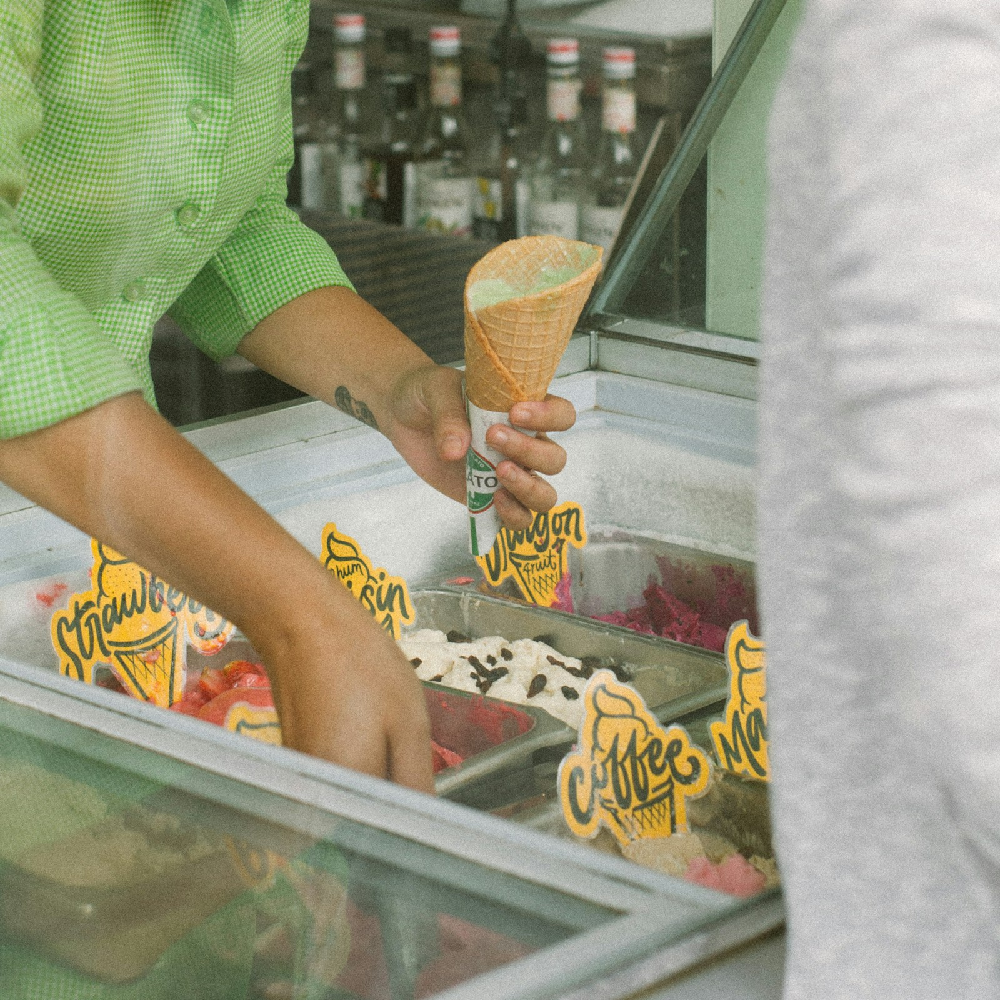

# 🗣️ TOEIC Speaking Practice Test (Q3 ~ Q11) — Set 11

> AL(160-200) 목표 트레이닝용 모의고사입니다. 실제 시험처럼 문제지를 먼저 눈으로 읽고, 준비 시간을 스스로 재면서(Q3-Q4: 45초 준비/45초 답변, Q5-Q7: 준비 없이 15초/15초/30초, Q8-Q10: 45초 준비 후 15초/15초/30초, Q11: 45초 준비/60초 답변) 아래 **- 내 답변:** 칸에 텍스트로 작성하세요.
>
> **이번 세트 집중 훈련 포인트 (Set 10 오답노트 반영):**
> - ⚠️ **`use a smartphone`** — 벌써 6번째 반복된 실수입니다. 이번엔 Q6에 스마트폰 얘기가 자연스럽게 나올 수 있는데, 나오면 관사를 꼭 확인하세요.
> - **짧은 질문도 두 부분 다 답하기** — Q9처럼 짧아 보이는 질문도 물음표가 몇 개인지 세어보세요.
> - 사진 속 인물의 동작을 정확히 관찰하기 (무엇을 손에 들고 있는지, 무슨 동작을 하는지).

---

## Part 2. Describe a Picture (Q3 - Q4)

### Q3. Describe a picture in detail.

> **[Context Hint]:** A smiling young man wearing glasses and a light blue T-shirt is holding a large blue trash bag by a riverside, with other volunteers in matching blue shirts picking up trash on the shore in the background.

- **내 답변:**
This picture was taken on a seashore, in the background i can see lots of trees. on the right side, i can see 2 people who seem to be holding trash bags and picing up some trash. i think they are cleaning the site. in the foreground, i can see a man who is smiling overall i think it looks like a typical calm scene.
---

### Q4. Describe a picture in detail.

> **[Context Hint]:** A close-up shot of a gelato shop worker's hand holding a filled ice cream cone over a display case, with metal trays of different flavors (strawberry, coffee, dragon fruit) labeled with small signs, and a customer standing nearby.

- **내 답변:**

---
This picture was taken at a icecream store. in the background i can see some bottles which are arraged in a row. on the left side i can see a clerk who seems to be holiding a ice cream snack in a hands and using a tool in the other hand . in the middle of the picture i can see a variety of ice creams. i think some of them is strawberry flavor and one of them is chocolate falvor. overal i think it looks like a typical calm store scene.
## Part 3. Respond to Questions (Q5 - Q7)

**Scenario:** Imagine that an American community research firm is conducting a telephone survey about **volunteering and community involvement**. You have agreed to participate in the survey.

### Q5. Have you ever participated in a volunteer activity, and what did you do?

- **내 답변:**
yes in my childhood , i had participated in a volunterr activity , and i did making a document in the office.
### Q6. What do you think is the easiest way for a busy person to find time to volunteer?

- **내 답변:**
I think the easiest way for a busy person to find time to volunteer is just download apps. there are lots of lists on the apps.
### Q7. Some companies now give employees paid time off specifically to volunteer. **First**, what is your opinion of this policy? **Second**, what advice would you give to a company that wants to encourage more employees to use it?

- **내 답변:**
I think it doesn't make sense. first , there a lots of education which the volunteers should learn. and they can make mistake, second as for advice i would tell a company to start with simple things such as let them make simple documents or copy some documents.
---

## Part 4. Respond to Questions Using Information Provided (Q8 - Q10)

**Situation:** You are helping organize sign-ups for a community volunteer weekend. A friend calls you with some questions about the programs.

### Volunteer Program Options

| Program                | Date        | Time          | Location                  | Rating |
|--------------------------|-------------|----------------|------------------------------|--------|
| Beach Cleanup             | Sat, Aug 15 | 09:00 - 12:00 | Haeundae Beach                | 4.8    |
| Food Bank Sorting         | Sat, Aug 15 | 10:00 - 13:00 | Community Center              | 4.5    |
| Animal Shelter Care       | Sun, Aug 16 | 09:00 - 11:00 | City Animal Shelter           | 4.9    |
| Park Restoration          | Sun, Aug 16 | 13:00 - 16:00 | Central Park                  | 4.6    |
| Senior Center Visit       | Sat, Aug 15 | 14:00 - 16:00 | Sunshine Senior Center        | 4.7    |

### Q8. What time does the Beach Cleanup start on Saturday, and where is it held?

- **내 답변:**
it will start at 9 and it will be held on heaundae beach
### Q9. I heard there's an Animal Shelter Care program. What day and time is it, and what's its rating?

- **내 답변:**
yes you are correct , it will runs from 9 to 11 , on aug 16 on sun. and it is rated 4.9
### Q10. I want to do the full Beach Cleanup on Saturday morning, but I also wanted to help with Food Bank Sorting that same day. Which part of Food Bank Sorting will I miss, and what would you suggest I do?

- **내 답변:**
unfortunaltely, you will miss the first 2hours of the food bank sorting, so i would suggest volunteering hard during the time.
---

## Part 5. Express an Opinion (Q11)

### Q11. Some people believe online customer reviews are more trustworthy than official advertising, while others believe reviews can be easily faked and shouldn't be trusted too much. Which view do you agree with, and why?

- **내 답변:**
온라인 리뷰가 더 맞음 , 오피셜 광고는 과장 exagr, 리뷰는 폰으로 아무때나 쓸수있고 사진도 같이 올림 , 요즘에는 신고기능도 있어서 block할수있음 ,
I think online customer revicews are more trustworthy than officail advertising., there are some reasons that support my opinion, first , there are some exagrations on official advertising because their target is rasing money, second online reviews will be written whenever and wherever they are ,  all the reviwers have to do is just use smartphones. and they can upload the revicews with picture , it can also make more trustworthy. so that is why i agree with online customer reviews are more trustworhy than officail advertising.
---

## 📝 채점 및 오답노트 안내

1. 위의 **- 내 답변:** 칸에 실전처럼 즉흥적으로 텍스트를 작성하세요 (빠르게 타이핑하며 생기는 오타/쉼표는 채점에서 제외되니 신경 쓰지 마세요).
2. 다 작성한 뒤 이 파일을 저에게 보내주시면, **내 원문 → 교정 문장 → 무엇이 바뀌었는지** 형식으로 문장 단위 피드백과 오답노트를 드리겠습니다. (이미 맞는 표현은 안 바꾸고, 대안 표현이 있으면 별도로 참고용으로만 덧붙입니다.)
