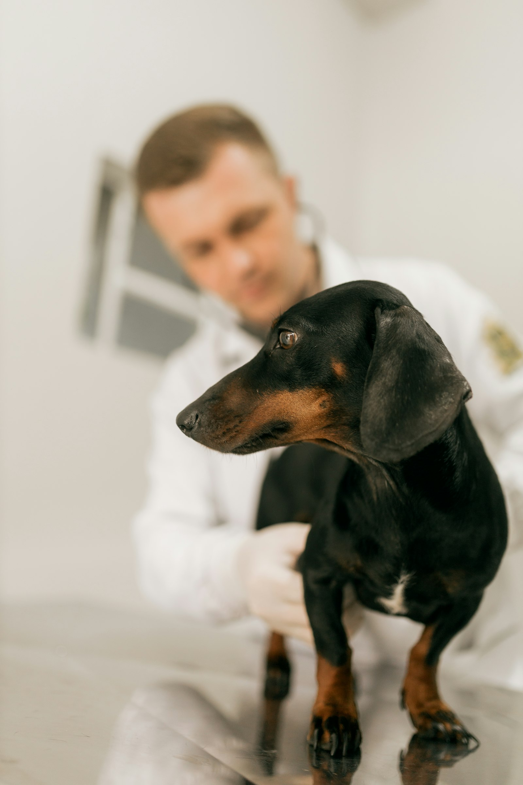
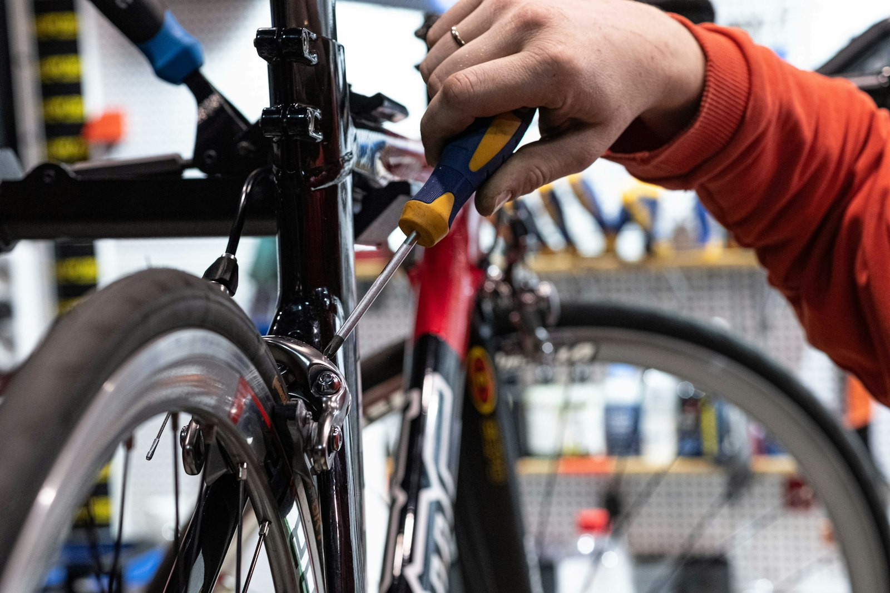

# 🗣️ TOEIC Speaking Practice Test (Q3 ~ Q11) — Set 13

> AL(160-200) 목표 트레이닝용 모의고사입니다. 실제 시험처럼 문제지를 먼저 눈으로 읽고, 준비 시간을 스스로 재면서(Q3-Q4: 45초 준비/45초 답변, Q5-Q7: 준비 없이 15초/15초/30초, Q8-Q10: 45초 준비 후 15초/15초/30초, Q11: 45초 준비/60초 답변) 아래 **- 내 답변:** 칸에 텍스트로 작성하세요.
>
> **이번 세트 집중 훈련 포인트 (Set 12 오답노트 반영):**
> - 사진 속 사물(가구, 도구 등)을 먼저 보고 장소를 판단하기 — "office"로 넘겨짚지 않기.
> - **표에 숫자 조건이 3개**입니다 — 요일/거리뿐 아니라 무게 제한처럼 눈에 덜 띄는 조건도 꼼꼼히 확인하세요.
> - Q11에서 확신 없는 부분은 그럴듯한 이유로 채워서 설득력 있게 마무리하기.

---

## Part 2. Describe a Picture (Q3 - Q4)

### Q3. Describe a picture in detail.

> **[Context Hint]:** A small black and tan dachshund stands on an examination table in sharp focus, while a veterinarian in a white coat with a stethoscope is blurred in the background, gently holding the dog's leg.

- **내 답변:**

---
This picture was taken in a animal hospictal. in the background there is a window closed. and i can see a doctor who seems to be checking a dog. and i can also see a dog who seems to be sitting and wating for checking out. overall i think it looks like a typical calm animal hospital.
### Q4. Describe a picture in detail.

> **[Context Hint]:** A close-up of a person's hand in an orange sweater using a screwdriver to fix the brake of a bicycle, with more bikes and tools on a pegboard visible in the background of the repair shop.

- **내 답변:**
This picture was taken at a bicycle workshop. in the background. i can see a lot of items arranged on shelves. some of them are stacked. on the right side. i can see a person's hand which seems to be screwing a part of bicycle. on the left side . i can also see a bicycle. i think it is being fixed. overal it looks like a typical calm bicycle workshop.
---

## Part 3. Respond to Questions (Q5 - Q7)

**Scenario:** Imagine that an American pet owners' association is conducting a telephone survey about **pet ownership and pet care**. You have agreed to participate in the survey.

### Q5. Do you have a pet, or have you had one in the past, and what kind?

- **내 답변:**
yes i have a pet now , it is dog. i love it.
### Q6. What do you think is the most challenging part of owning a pet for busy people?

- **내 답변:**
the most challenging part of owning a pet for busy people is cleaning some hair. it makes home dirty.
### Q7. Some apartment buildings are now banning pets to reduce noise and damage complaints. **First**, what is your opinion of this policy? **Second**, what advice would you give to a pet owner who is looking for a pet-friendly place to live?

- **내 답변:**
yes, make noise , smell , training
I think banning pets to reduce noise and damage complaints make sense. first the pets are make noise and make smell. so i would tell a pet owner who is looking for a pet freiendly place to live to train hard and avoid to make smell or noise.
---

## Part 4. Respond to Questions Using Information Provided (Q8 - Q10)

**Situation:** You are looking for a boarding facility for your dog while you're away. A friend calls you with some questions about the options.

### Pet Boarding Facilities

| Facility              | Price / Night | Distance | Max Dog Weight | Rating |
|--------------------------|-----------------|-----------|-------------------|--------|
| Cozy Paws Boarding        | $45             | 10 min    | 30kg               | 4.8    |
| Happy Tails Inn           | $35             | 5 min     | 20kg               | 4.4    |
| Central Pet Resort        | $60             | 15 min    | 40kg               | 4.9    |
| Budget Pet Stay           | $28             | 20 min    | 25kg               | 4.0    |
| Green Valley Kennels      | $50             | 8 min     | 35kg               | 4.6    |

### Q8. What is the price per night at Cozy Paws Boarding, and how far is it?

- **내 답변:**
it costs $45 and it takes 10min 
### Q9. I heard Central Pet Resort is highly rated. What's the max dog weight it accepts, and what's its rating?

- **내 답변:**
yes you are correct . it accepts 40kg , and it is rated 4.9
### Q10. My dog weighs 32kg, and I want a place that's within 10 minutes and costs $50 or less per night. Which facility should I choose, and why?

- **내 답변:**
i think green valley kennels fits you are looking for. it takes only 8min and it costs %50 and it allows below 35 kg.
---

## Part 5. Express an Opinion (Q11)

### Q11. Some people believe self-checkout kiosks are more convenient than human cashiers, while others believe they reduce jobs and personal service quality. Which view do you agree with, and why?

- **내 답변:**
키오스크가 편리한게 맞음, 일자리 줄어들거에 다른 서비스 퀄리티 올림 , click만 하면됨
I think self checkout kiosks are more convenient than human cashiers. there are some reasons that support my opinion. first kiost is convient it makes sense. even though it reduce jobs , but service quality will go up , they can do other than service for kiosk . and clients can do more easily , all they have to do is just click and waiting for the food. so i agree that self checkout kisosk are more coveenient than human cashiers.
---

## 📝 채점 및 오답노트 안내

1. 위의 **- 내 답변:** 칸에 실전처럼 즉흥적으로 텍스트를 작성하세요 (빠르게 타이핑하며 생기는 오타/쉼표는 채점에서 제외되니 신경 쓰지 마세요).
2. 다 작성한 뒤 이 파일을 저에게 보내주시면, **내 원문 → 교정 문장 → 무엇이 바뀌었는지** 형식으로 문장 단위 피드백과 오답노트를 드리겠습니다. (이미 맞는 표현은 안 바꾸고, 대안 표현이 있으면 별도로 참고용으로만 덧붙입니다.)
