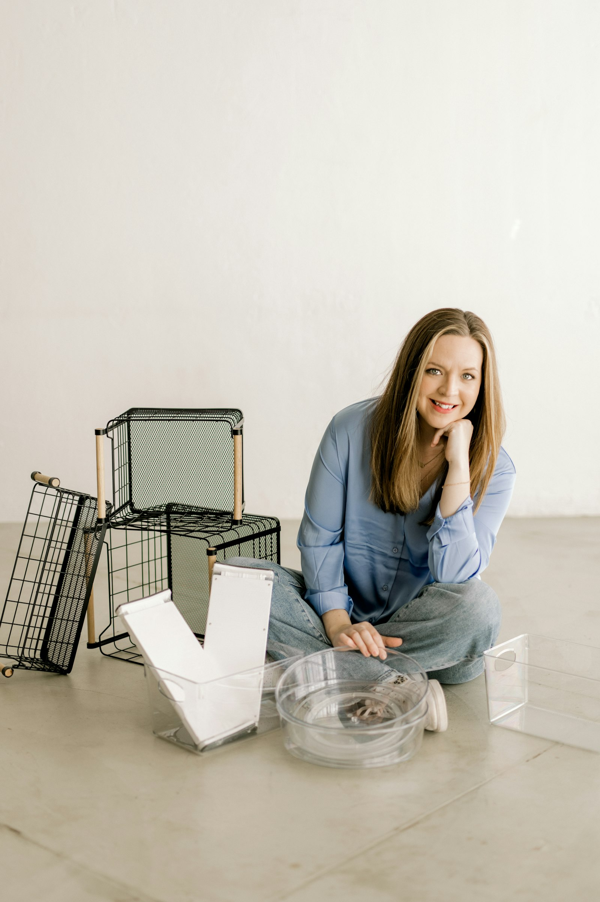
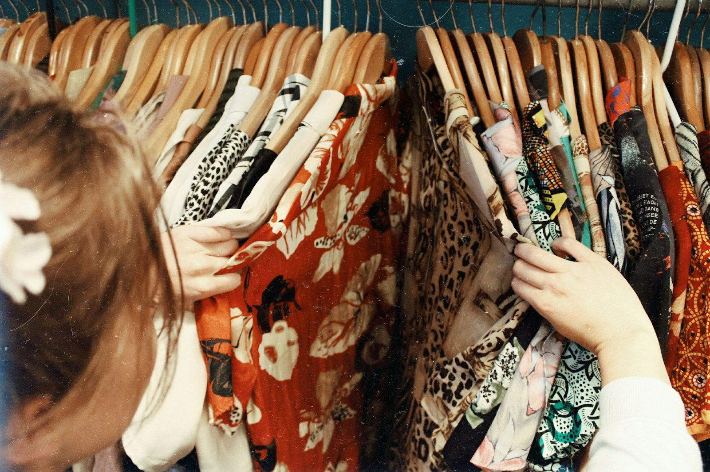

# 🗣️ TOEIC Speaking Practice Test (Q3 ~ Q11) — Set 14

> AL(160-200) 목표 트레이닝용 모의고사입니다. 실제 시험처럼 문제지를 먼저 눈으로 읽고, 준비 시간을 스스로 재면서(Q3-Q4: 45초 준비/45초 답변, Q5-Q7: 준비 없이 15초/15초/30초, Q8-Q10: 45초 준비 후 15초/15초/30초, Q11: 45초 준비/60초 답변) 아래 **- 내 답변:** 칸에 텍스트로 작성하세요.
>
> **이번 세트 집중 훈련 포인트 (Set 13 오답노트 반영):**
> - `banning/using X + makes sense` — 동명사구 주어는 단수 동사. 계속 나오는 패턴이니 이번엔 꼭 체크하세요.
> - `avoid + V-ing` (avoid to는 틀림).
> - Q7 조언을 쓰기 전에 질문이 정확히 뭘 묻는지 다시 한번 확인하기.

---

## Part 2. Describe a Picture (Q3 - Q4)

### Q3. Describe a picture in detail.

> **[Context Hint]:** A smiling woman sits cross-legged on the floor, resting her chin on her hand, surrounded by black wire storage baskets and clear plastic organizing bins on a plain wooden floor.

- **내 답변:**

---
This picture was taken in a room. in the background there is a white wall. i can see a woman who seems to be sitting and smiling with folding her arm. on the left side , i can see 3 baskets stacked in a pile. i also can see 2 items in glass box. also i can see 2 round box stacked overal i think it looks like a typical calm room scene.
### Q4. Describe a picture in detail.

> **[Context Hint]:** A close-up from behind of a woman with a flower hair clip, using both hands to look through a tightly packed rack of colorful, patterned vintage clothes hanging on wooden hangers.

- **내 답변:**
This picture was taken at a cloth store. i can see lots of clothes some of them are striped shirts and some of them are funny painting shirts. on the left side i can see a woman who seems to checking the clothes, the clothes are arranged in a row. overall i think it looks like a typical calm cloth store.
---

## Part 3. Respond to Questions (Q5 - Q7)

**Scenario:** Imagine that an American home lifestyle research firm is conducting a telephone survey about **home organization and decluttering habits**. You have agreed to participate in the survey.

### Q5. How often do you organize or declutter your home, and what area do you usually start with?

- **내 답변:**
i often organize my bed room and i start with simple things such as cleaning.
### Q6. What do you think is the biggest reason people struggle to keep their homes organized?

- **내 답변:**
i think the biggist reason people struggle to keep their homes organized is to make their mind, if their home is messy , they should not do anything and be lazy.
### Q7. Some people hire professional organizers to help declutter their homes instead of doing it themselves. **First**, what is your opinion of this trend? **Second**, what advice would you give to someone who wants to declutter on their own without hiring help?

- **내 답변:**
i think it depends on the situation. if i were a rich, i will hire professional organizers, but if not i will do it myself, second as for advice, i would tell someone who wants to declutter on their own without hiring help to start with simple things such as cleaning and folding clothes and washing dishes.
---

## Part 4. Respond to Questions Using Information Provided (Q8 - Q10)

**Situation:** You are choosing a home cleaning service for your apartment. A friend calls you with some questions about the options.

### Home Cleaning Service Packages

| Company             | Price | Duration    | Eco-Friendly Products | Rating |
|------------------------|-------|--------------|--------------------------|--------|
| SparkleClean            | $80   | 2 hours      | Yes                      | 4.7    |
| QuickShine              | $55   | 1.5 hours    | No                       | 4.2    |
| GreenHome Co.           | $95   | 3 hours      | Yes                      | 4.9    |
| TidyUp Services         | $60   | 2 hours      | No                       | 4.4    |
| EcoFresh Cleaners       | $70   | 2.5 hours    | Yes                      | 4.6    |

### Q8. What is the price for SparkleClean, and how long does the service take?

- **내 답변:**
it costs $80 and it takes 2hours.
### Q9. I heard GreenHome Co. uses eco-friendly products. How long does their service take, and what's their rating?

- **내 답변:**
yes you are right, it takes 3hours and it uses eco friendly products, it is rated 4.9
### Q10. I want a cleaning service that uses eco-friendly products, takes 2.5 hours or less, and costs $75 or less. Which company should I choose, and why?

- **내 답변:**
you should choose ecofresh cleaners. it costs only &70 and it takes 2.5hours , and it uses eco friendly products i think it fits what you are looking for
---

## Part 5. Express an Opinion (Q11)

### Q11. Some people believe physical books are better for learning than e-books, while others believe e-books are more practical. Which do you agree with, and why?

- **내 답변:**
나는 이북, 어디서나 할수있음 통근할때 , 친구들 만나러갈때 등등 , 언제든 할수있고 , 메모도 할수있음 , 스크린샷을 찍을수도있고 더 값싼
I think e books are better for learning than physical books. there are some reaons that support my opinion. first i can read wherever and whenever i want , all i have to do is just use a smartphone. when i go to work or friend , i can read, also i can memo it with using my smartphone, and i can screenshot, and it is more cheap than buying physical books, so i disagree that physical books are better for learning than e books.
---

## 📝 채점 및 오답노트 안내

1. 위의 **- 내 답변:** 칸에 실전처럼 즉흥적으로 텍스트를 작성하세요 (빠르게 타이핑하며 생기는 오타/쉼표는 채점에서 제외되니 신경 쓰지 마세요).
2. 다 작성한 뒤 이 파일을 저에게 보내주시면, **내 원문 → 교정 문장 → 무엇이 바뀌었는지** 형식으로 문장 단위 피드백과 오답노트를 드리겠습니다. (이미 맞는 표현은 안 바꾸고, 대안 표현이 있으면 별도로 참고용으로만 덧붙입니다.)
